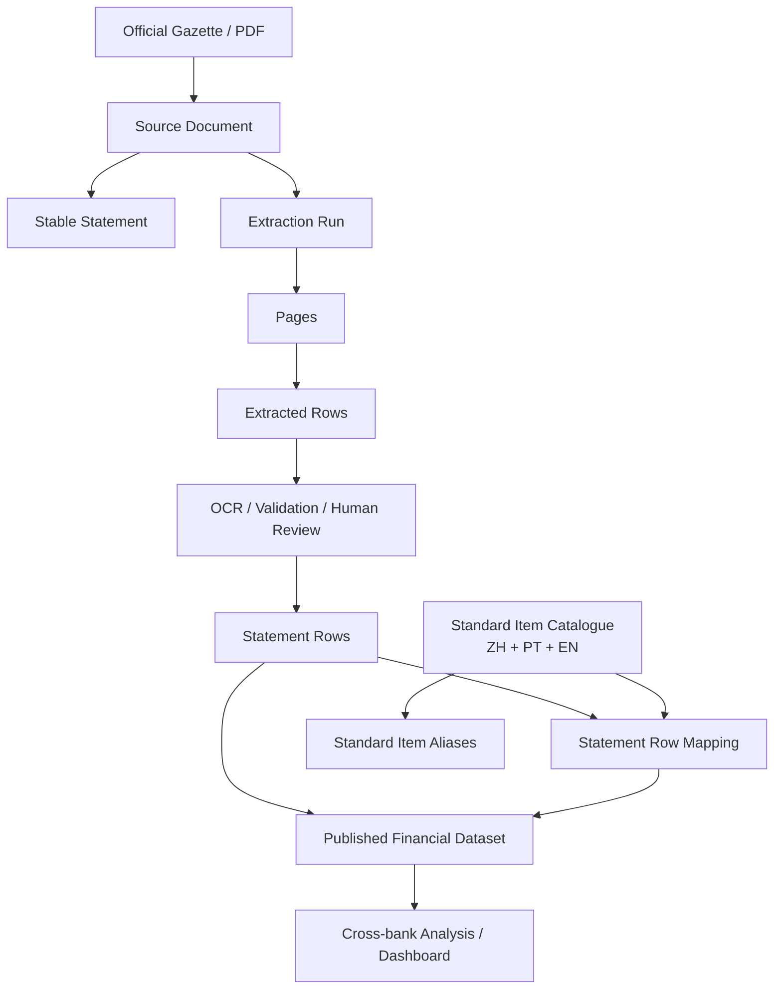

# Data Model v2.2 — Bilingual Standard Item Catalogue & Schema Refactoring Plan

**文件類型：** Database Design & Refactoring Specification  
**版本：** 2.2  
**狀態：** Proposed — 需先完成 Registry Data Audit，然後才可制定正式 DDL 及執行 Migration  
**依據：** `existingdb_schema.md`、中文及葡文銀行公報樣本、Data Model v2.1 討論  
**主要更新：** 將現有 `standard_labels` 提升為跨語言 Standard Item Catalogue 的主要候選來源，明確定義中文／葡文名稱的對應方式，以及 `line_item_concepts` 的保留、合併或退役條件。

---

## 1. 本次設計更新的核心結論

用戶補充了一項關鍵業務規則：**澳門銀行公報中，中文及葡文的同一類報表項目，基本上可以建立一個一一對應的標準項目清單。** 因此，平台不應只將每條原始報表行獨立保存，再嘗試臨時翻譯或分類；而應有一份經整理及人工確認的雙語 Standard Item List，作為跨銀行、跨語言標準化的核心。

這項規則會改變 v2.1 對 `standard_labels` 和 `line_item_concepts` 的處理方向：

1. **`standard_labels` 是現有 Schema 中最接近 Standard Item Catalogue 的結構。** 它已有 `standard_key`、`canonical_zh`、`canonical_pt`、`canonical_en`、`parent_standard_id`、`level`、`category` 及 `standard_label_aliases`。應優先以它作為新 Standard Item Master 的基礎，而不是在未確認用途前將它和 `line_item_concepts` 一概合併成泛化的 `financial_concepts`。
2. 中文及葡文名稱應存放在**同一個 Standard Item Record** 的不同語言欄位，而不是各自建立一條獨立 Standard Item，再依賴翻譯表連接。
3. 每份銀行報表的原始 Row 仍然要獨立保存；每條已確認的 `statement_row` 再對應至一個 Standard Item。
4. **一一對應指的是標準清單內的中葡語義對應，不代表所有來源 Row 與 Standard Item 都是全域一對一。** 不同銀行、不同年份的多條來源 Row，可以對應同一個 Standard Item；每條來源 Row 在同一時間最多只有一個已批准的 Standard Item Mapping。
5. 原始報表階層、Standard Item Catalogue 階層，以及日後可能出現的分析分類，必須分開管理。

### 1.1 建議的核心定義

> `Standard Item` 是一個跨銀行、跨語言的標準報表項目識別。它代表一個在定義及上下文上已確認的報表項目，並可同時保存中文、葡文及英文標準名稱。

例如以下只是一個示意配對：

| `standard_key` | `canonical_zh` | `canonical_pt` | `canonical_en` |
|---|---|---|---|
| `CASH` | 現金 | CAIXA | Cash |
| `CASH_MOP` | 澳門元 | PATACAS | Patacas |
| `CASH_FX` | 外幣 | MOEDAS EXTERNAS | Foreign currencies |
| `AMCM_DEPOSITS` | AMCM 存款 | DEPÓSITOS NA AMCM | Deposits at AMCM |
| `AMCM_DEPOSITS_MOP` | 澳門元 | PATACAS | Patacas |

表中 `CASH_MOP` 及 `AMCM_DEPOSITS_MOP` 即使有相同的中葡文字，也應是兩個不同 Standard Item，因為它們所屬的父項及財務語義不同。**不可對 `canonical_zh` 或 `canonical_pt` 建立全域唯一限制。**

---

## 2. 根據公報樣本確認的業務模型

中文及葡文公報都呈現簡化的財務報表／Balancete 摘要，而不是銀行內部完整 General Ledger。

### 2.1 來源報表層（Source Statement Rows）

中文樣本：

```text
現金
    澳門元
    外幣

AMCM 存款
    澳門元
    外幣
```

葡文樣本：

```text
CAIXA
    PATACAS
    MOEDAS EXTERNAS

DEPÓSITOS NA AMCM
    PATACAS
    MOEDAS EXTERNAS
```

原始報表應按每份 Statement 保留其實際名稱、語言、次序、縮排、父子關係及 Debit/Credit 餘額。

### 2.2 標準項目層（Bilingual Standard Item Catalogue）

Standard Item Catalogue 將經確認的中葡對應放在同一筆資料：

```text
CASH
  canonical_zh = 現金
  canonical_pt = CAIXA
  canonical_en = Cash

  CASH_MOP
    canonical_zh = 澳門元
    canonical_pt = PATACAS
    canonical_en = Patacas

  CASH_FX
    canonical_zh = 外幣
    canonical_pt = MOEDAS EXTERNAS
    canonical_en = Foreign currencies
```

此標準樹是跨銀行比較用的**標準項目階層**，不應強迫每間銀行的原始報表採用相同層數或相同排序。

### 2.3 三種階層不可混淆

| Hierarchy | 儲存位置 | 用途 |
|---|---|---|
| 原始報表階層 | `statement_rows.parent_row_id` | 保留該銀行該份報表實際的 Parent / Child |
| 標準項目階層 | `standard_items.parent_standard_item_id` | 建立中葡雙語標準項目清單，便於跨銀行對應及比較 |
| 分析分類（如日後需要） | 可選 `analytics_categories` 等 | 將多個 Standard Items 歸入較高層分析類別；不是來源 Row 的翻譯或直接替代 |

初期必須建立前兩種。第三種只有在 Dashboard 確實需要不同於標準項目樹的分析分組時才新增。

---

## 3. 對現有 Schema 的重新評估

### 3.1 `standard_labels`：提升為主要 Standard Item Catalogue

現有 `standard_labels` 已包括：

- `standard_id`
- `standard_key`
- `parent_standard_id`
- `canonical_zh`
- `canonical_pt`
- `canonical_en`
- `level`
- `category`
- `status`
- `source`
- `note`

現有 `standard_label_aliases` 則包括：

- `standard_id`
- `raw_name`
- `normalized_name`
- `language`
- `status`
- `source`
- `note`

這個結構已經很接近所需的雙語 Standard Item List。建議把它提升為新模型的權威標準項目來源，而不是再平行建立另一份同用途的多語名稱清單。

#### 建議處理方式

- 邏輯名稱：`standard_items`
- 初期實體 Table：可暫時保留 `standard_labels`，避免一次過改動過多程式碼；待應用程式切換完成後，再決定是否改名為 `standard_items`。
- `standard_id` 可在新 DDL 中改名為 `standard_item_id`，或暫時保留舊欄位名稱並在程式 ORM/API 層使用 `standard_item_id`。兩者只能選一個正式識別，不可同時存在兩個權威 ID。
- `standard_key` 保留為穩定、唯一、與顯示語言無關的識別碼。
- `canonical_zh`、`canonical_pt`、`canonical_en` 代表同一 Standard Item 的語言名稱。
- `parent_standard_id` 保留並重新定義為 Standard Item Catalogue 的 Parent。
- `level` 如只表示 `parent/child`，應評估改成由 Parent 關係推導，避免重複保存；如它其實有其他業務意義，需先查程式碼再保留。
- `category` 只作受控的分類／分析屬性，不應與 Parent Tree 混為一談。
- `status` 建議統一為 `draft / pending / approved / retired / merged` 等明確狀態；合併時需保留舊 ID 對照。

**關鍵規則：** `standard_key` 唯一；中葡英文名稱不是全域唯一。不同父項下可以出現相同的 `canonical_zh` 或 `canonical_pt`。

### 3.2 `standard_label_aliases`：保留為 Standard Item Alias

邏輯名稱建議為 `standard_item_aliases`，實體 Table 初期可保留 `standard_label_aliases`。

用途是保存某個 Standard Item 在不同銀行、不同年份或 OCR 中出現的其他寫法，例如：

- 正式用詞變體
- 歷史用詞
- 銀行專用名稱
- 簡稱
- 葡文／中文拼寫變體
- OCR 常見誤識別（只可在確認後啟用）

建議增加或考慮以下欄位：

| 欄位 | 用途 |
|---|---|
| `alias_id` | PK |
| `standard_item_id` | FK 至 Standard Item |
| `raw_name` | 原始別名 |
| `normalized_name` | 正規化搜尋名稱 |
| `language` | zh-Hant / pt / en / unknown |
| `alias_type` | official_variant / bank_specific / historical / abbreviation / ocr_variant / other |
| `bank_id` | 可 NULL；如別名只適用某銀行，指定銀行 |
| `status` | pending / approved / rejected |
| `source` | 別名證據來源 |
| `note` | 上下文說明 |

Alias 的唯一性應按 Standard Item、語言及適用範圍設計；不可因同一字串出現在不同 Standard Item 就拒絕新增。`PATACAS` 這類上下文依賴名稱必須配合 Parent／路徑作 Mapping。

### 3.3 `line_item_concepts`：不可再直接視為與 `standard_labels` 等價

現有 `line_item_concepts` 也有：

- `concept_key`
- `canonical_zh` / `canonical_pt` / `canonical_en`
- `parent_concept_id`
- `level`
- `category`
- `status`
- `line_item_aliases`

它與 `standard_labels` 在欄位形狀上高度相似，但單靠 Schema Dump 尚不能確認兩者在實際應用中是否完全相同。

v2.2 採用以下決策：

1. **預設由 `standard_labels` 承擔雙語 Standard Item Catalogue 的權威角色。**
2. 對 `line_item_concepts` 執行完整資料及程式碼用途審計。
3. 若它只是另一份相同的跨語言報表項目清單，將經核實的記錄整合到 Standard Items，建立 `line_item_concept_id → standard_item_id` Crosswalk，之後退役舊 Registry 及 `line_item_aliases`。
4. 若它實際代表「分析分類」或「較高層財務概念」，才可保留為獨立 Analytics Taxonomy，並需重新命名及定義其用途；它不應再與來源 Row 直接競爭成為兩個 Standard Item Mapping 目標。
5. 若用途仍不清楚，Migration 前保持 Read-only，不自動合併。

**不要只因兩張 Table 有相似欄位便合併；亦不要只因名稱不同便永久保留兩套權威標準清單。**

---

## 4. Target Data Model v2.2

### 4.1 核心資料流程



### 4.2 Target Tables

| Table | 主要責任 | 來源／狀態 |
|---|---|---|
| `banks` | 銀行主檔 | 現有，保留 |
| `bank_aliases` | 銀行名稱別名 | 整合現有兩張 Alias Table |
| `source_documents` | 官方 PDF 身份、SHA-256、URL、檔案存放 | 新增 |
| `statements` | 穩定的邏輯財務報表身份 | 現有，調整 |
| `runs` / `extraction_runs` | 每次 OCR／抽取執行 | 現有，重新定位 |
| `pages` | Run 內 PDF 頁面及 OCR 狀態 | 現有，保留及整理 |
| `extracted_rows` | 某次 Run 從 PDF 抽出的原始 Row Observation | 從 `line_items` 拆出 |
| `statement_rows` | 經採納的報表 Row 及原始報表階層 | 從 `line_items` 重構 |
| `standard_items`（初期可沿用 `standard_labels`） | 權威中葡英標準項目清單 | 以 `standard_labels` 為基礎 |
| `standard_item_aliases`（初期可沿用 `standard_label_aliases`） | 標準項目的語言／銀行／歷史別名 | 以現有 Alias 為基礎 |
| `statement_row_mappings` | Statement Row 對應至 Standard Item 的決策及版本 | 新增／整理現有 Mapping |
| `review_tasks` | Review 工作排程及狀態 | 新增／轉換 |
| `field_verifications` | 欄位核實及修正歷史 | 新增／轉換 |
| `audit_logs` | 全系統 Audit | 可逐步整合現有 Audit |

可選：`analytics_categories` 或 `standard_item_analytics_mappings`。只有在確實需要把多個 Standard Items 重新分組作 Dashboard 分析時才加入，不屬於第一輪必需 Table。

---

## 5. 標準項目資料模型（最重要部分）

### 5.1 `standard_items`（邏輯名稱；由現有 `standard_labels` 演進）

每筆 Record 代表一個跨語言標準項目，中文、葡文、英文名稱同屬一個 ID。

| 欄位 | 建議型別／用途 | 對應現有欄位 |
|---|---|---|
| `standard_item_id` | PK | `standard_id` |
| `standard_key` | Unique、穩定識別碼 | `standard_key` |
| `parent_standard_item_id` | Self-FK，標準項目父層 | `parent_standard_id` |
| `canonical_zh` | 中文標準名稱 | `canonical_zh` |
| `canonical_pt` | 葡文標準名稱 | `canonical_pt` |
| `canonical_en` | 英文標準名稱 | `canonical_en` |
| `category` | 可選受控分類 | `category` |
| `status` | draft / pending / approved / retired / merged | `status` |
| `merged_into_standard_item_id` | 合併後指向主項目 | 由舊 merge 資料整理；目前 `standard_labels` 未見此欄 |
| `definition` | 項目定義及適用範圍 | 可由 `note` 整理 |
| `source` | 官方／人工確認依據 | `source` |
| `note` | 備註 | `note` |
| `created_at`, `updated_at` | 時間欄位 | 新增 |

#### Standard Item 設計規則

- `standard_key` 是跨語言穩定身份，不能由顯示名稱即時計算。
- 同一 Standard Item 的 `canonical_zh` 和 `canonical_pt` 是一對語義對應名稱。
- 中文及葡文不應拆成兩筆 Standard Item。
- 可以有缺少某種語言的項目；缺少翻譯不得阻止保存來源 Row，但應列入 Catalogue Completeness Review。
- `canonical_zh`、`canonical_pt`、`canonical_en` 不設全域 Unique Constraint。
- 同名子項可以在不同父項下重複，例如不同業務項目下都出現「澳門元／PATACAS」，必須以 `standard_item_id` 及 Parent Context 區分。
- Standard Item Tree 只描述標準項目清單的分類關係；不可用它覆蓋每份 Statement 原始結構。
- 若中葡名稱只有表面翻譯相似，但財務涵義未確認，不可視為已建立一對一配對；狀態應保持 pending。

### 5.2 標準清單與原始 Row 的 Cardinality

正確關係不是來源 Row 與 Standard Item 在整個資料庫中嚴格一對一，而是：

- 一個 Standard Item 可以被多間銀行、不同年份、不同 Statement 的多條 Rows 引用。
- 一條 Statement Row 在同一時間最多有一個 Approved Standard Item Mapping。
- 一條 Statement Row 可以暫時 Unmapped，或有多個未批准候選，但不得同時有多個互相衝突的正式 Mapping。
- 一份 Statement 不一定包含 Standard Catalogue 的所有項目。
- 一間銀行可能合併、拆分或省略其他銀行使用的項目；若無法等義對應，應保持 Unmapped 或新增待審 Standard Item，不可強行 Mapping。

### 5.3 `standard_item_aliases`

以現有 `standard_label_aliases` 為基礎。

| 欄位 | 用途 |
|---|---|
| `alias_id` | PK |
| `standard_item_id` | FK → `standard_items` |
| `raw_name` | 原始名稱／別名 |
| `normalized_name` | 正規化名稱 |
| `language` | zh-Hant / pt / en / unknown |
| `alias_type` | official_variant / bank_specific / historical / abbreviation / ocr_variant / other |
| `bank_id` | Optional：銀行專用別名 |
| `status` | pending / approved / rejected |
| `source` | 來源 |
| `note` | 上下文及限制 |

Index / uniqueness 建議：

- Index `(normalized_name, language)` 供搜尋候選。
- Index `(standard_item_id, language)` 供查詢同一 Standard Item 各語言名稱。
- Unique 可考慮 `(standard_item_id, normalized_name, language, bank_id)`，但 SQLite NULL 唯一行為及實際 Alias 重複規則需在 DDL 階段確認。
- **不可建立 `UNIQUE(normalized_name, language)`**，因為同一詞可能在不同 Parent Context 對應不同 Standard Item。

### 5.4 `statement_row_mappings`

將一條來源 Statement Row 連接到一個標準項目。Mapping 不應只依賴標籤字串，必須使用語言、銀行、Statement Type、來源 Row Parent 及已知標準父項等上下文。

| 欄位 | 用途 |
|---|---|
| `mapping_id` | PK |
| `statement_row_id` | FK → `statement_rows` |
| `standard_item_id` | FK → `standard_items`；未確認時 NULL 或不建立 Approved Mapping |
| `mapping_status` | proposed / pending / approved / rejected / unmapped |
| `match_method` | exact_bilingual / approved_alias / parent_context / bank_rule / fuzzy_candidate / manual |
| `matched_alias_id` | Optional FK → `standard_item_aliases` |
| `match_score` | 候選排序分數，不等於準確率 |
| `mapping_version` | Mapping 規則版本 |
| `reviewed_by`, `reviewed_at` | 人工批准資料 |
| `valid_from`, `valid_to` | 歷史有效期／替換紀錄 |
| `created_at` | 建立時間 |

**唯一有效 Mapping 規則：** 同一 `statement_row_id` 在同一時間最多一個 `approved` 且未失效的 Mapping。歷史 Mapping 可以保留多筆。

初期不建議再在 `statement_rows` 同時保存另一個可獨立修改的 `standard_item_id`，避免雙重權威來源。若日後為效能加入快取欄位，必須明確標示為可重建的 denormalized cache。

---

## 6. Statement Row、Extraction 及 Verification

### 6.1 `statement_rows`

每筆代表某份 Statement 中實際存在的一行。

| 欄位 | 說明 |
|---|---|
| `statement_row_id` | PK |
| `statement_id` | FK → statements |
| `source_extracted_row_id` | FK → extracted_rows；人工建立或舊資料可 NULL |
| `parent_row_id` | Self-FK → statement_rows，來源報表 Parent |
| `row_order` | Statement 原始次序 |
| `pdf_page`, `printed_page` | 來源頁碼 |
| `indent_level` | 原始縮排資訊 |
| `row_type` | heading / item / subtotal / total / note / unknown |
| `label_raw` | 公報原始標籤 |
| `label_normalized` | 純文字正規化名稱 |
| `label_language` | zh-Hant / pt / en / mixed / unknown |
| `debit_raw`, `credit_raw` | 被採納的原始顯示文字（可選由 Observation 引用） |
| `debit_amount`, `credit_amount` | 精確十進位值 |
| `debit_value_state`, `credit_value_state` | amount / dash / blank / unreadable / not_applicable / not_extracted |
| `created_at`, `updated_at` | 時間 |

`parent_row_id` 和 `parent_standard_item_id` 代表兩種不同樹，絕不可互相代用。

### 6.2 `extracted_rows`

保存每個 OCR Run 抽取到的原始觀察，包括 `run_id`、`page_id`、`row_order`、原始文字、Debit/Credit 原文、Bounding Box、OCR Confidence、候選 Row Type 及原始 payload。

每次重新 OCR 都新增 Observation，不覆蓋先前結果。

### 6.3 Verification

現有 `row_verification` 只有 Row-level 狀態；v2.2 建議保留 Review Task 流程，並新增 `field_verifications` 保存欄位層級的核實及修正。Standard Item Mapping 的人工批准亦應留下 Reviewer、時間及決策理由。

---

## 7. Mapping 與 Review 的工作邏輯

### 7.1 建議的自動 Mapping 次序

1. 先識別語言及清理原始標籤，不改動 `label_raw`。
2. 嘗試比對 Standard Item 的該語言 `canonical_*` 名稱。
3. 嘗試已批准的 `standard_item_aliases`。
4. 檢查來源 Row 的 Parent、完整 Row Path、銀行及 Statement Type。
5. 如 Parent 已映射至某個 Standard Item，優先搜尋該標準 Parent 下的 Child Standard Items。
6. 只有候選唯一且符合既定政策時，才可自動建立 Approved Mapping；否則建立候選並送 Review。

### 7.2 PATACAS 上下文例子

`PATACAS` 不能只靠名稱直接對應，因為它可能出現在：

- `CAIXA → PATACAS`
- `DEPÓSITOS NA AMCM → PATACAS`
- `DEPÓSITOS À ORDEM → PATACAS`

這些來源 Rows 可能分別對應不同 Standard Items，例如 `CASH_MOP`、`AMCM_DEPOSITS_MOP`、`DEMAND_DEPOSITS_MOP`。同樣的 canonical Portuguese label 可以在不同 Standard Item Records 出現；Parent Context 決定語義。

### 7.3 Review UI 應顯示雙語標準項目

人工核實一條 Statement Row 時，介面不應只顯示一個 Standard Label，而應顯示：

- 原始名稱及來源語言
- 原始 Parent / Row Path
- 建議 Standard Item Key
- Standard Item 中文名稱
- Standard Item 葡文名稱
- 標準 Parent / Child 路徑
- Mapping 方法及候選分數
- 是否已有其他銀行／歷史紀錄使用此 Standard Item

Reviewer 可以批准、改選另一個 Standard Item、建立待審新項目，或標記 Unmapped。

### 7.4 Standard Item Catalogue 管理介面

應有獨立的 Catalogue Management 頁面：

- 搜尋中文、葡文、英文標準名稱及 Alias。
- 同一畫面編輯同一 Standard Item 的多語名稱。
- 顯示 Standard Item Parent / Child Tree。
- 查看哪些 Bank / Statement Rows 正在使用該項目。
- 新增 Alias、標記歷史用詞或 OCR Variant。
- 對標準名稱或 Parent 的修改保留 Audit Trail。
- 合併重複 Standard Items 前，列出所有關聯 Rows、Aliases 及 Mapping，並要求人工批准。

---

## 8. 現有 Table → v2.2 Migration Mapping

| 現有 Table | v2.2 Target | 行動 |
|---|---|---|
| `schema_meta` | `schema_meta` | 保留，更新 Schema Version |
| `runs` | `runs` / `extraction_runs` | 保留，重新定位為一次 Extraction 執行 |
| `banks` | `banks` | 保留 |
| `bank_aliases` | `bank_aliases` | 將 `bank_key` 轉為 `bank_id` FK；需與另一張 Alias 表合併 |
| `bank_name_aliases` | `bank_aliases` | 合併後保留 Legacy ID Crosswalk |
| `statements` | `statements` | 保留及調整，與 Run 身份分離 |
| `pages` | `pages` | 保留，維持 Run-scoped |
| `line_items` | `extracted_rows` + `statement_rows` | 拆分 OCR Observation 與採納報表行 |
| `row_verification` | `review_tasks` + `field_verifications` | 轉換；未知舊狀態不得猜測 |
| `standard_labels` | `standard_items` | **主要 Standard Item Catalogue 來源**；保留 `standard_key`、中葡英名稱及標準 Parent Tree |
| `standard_label_aliases` | `standard_item_aliases` | 保留並擴充銀行／歷史／OCR Alias Scope |
| `line_item_concepts` | 待審：併入 `standard_items` 或改作 Analytics Taxonomy | 先比較 Record、Parent、Alias、Mapping 使用及程式碼依賴；不可自動雙向合併 |
| `line_item_aliases` | 待審：併入 `standard_item_aliases` 或 Analytics Alias | 按 `line_item_concepts` 最終用途決定 |
| `name_mapping_review` | `review_tasks` / Mapping Review | 保留候選與人工決策；分開 Bank Identity 和 Standard Item Mapping |
| `name_mapping_audit` | `audit_logs` | 可逐步整合，保留舊 Audit ID |

### 8.1 現有 `line_items` 欄位搬遷

| 現有欄位 | v2.2 目的地 | 說明 |
|---|---|---|
| `line_item_id` | Legacy ID Crosswalk → `statement_row_id` | 不可只假設 ID 一定可原樣沿用 |
| `statement_id` | `extracted_rows` / `statement_rows` | 按責任分配 |
| `run_id` | `extracted_rows.run_id` | 不作 Statement Row 身份 |
| `row_order`, `pdf_page`, `printed_page` | `extracted_rows` + `statement_rows` | 原始 Observation 與採納位置分開 |
| `label_raw` | `extracted_rows` + `statement_rows` | 原始 OCR 和採納的來源文字均保留 |
| `label_normalized` | `statement_rows` 或可重算欄位 | 記錄正規化規則版本 |
| `label_standard`, `label_standard_id`, `label_standard_status`, `label_standard_score` | `statement_row_mappings` | 轉成映射至 `standard_item_id` 的決策 |
| `line_item_concept_id` | `standard_item_id` Crosswalk 或 Analytics Taxonomy Mapping | 不能未核對就覆蓋 `label_standard_id` |
| `user_standard_label_id`, `user_standard_match_status` | Mapping Candidate / Review History | 不作第二套權威 Mapping |
| `label_role` | `statement_rows.row_type` + Observation Candidate | 確認值與 OCR 候選分開 |
| `parent_label_raw`, `parent_label_standard` | `statement_rows.parent_row_id` + Observation | 用 Row FK 建立來源 Parent Tree |
| `label_path`, `label_path_key` | 可重建快取／Legacy Reconciliation | 不作主要身份 |
| `label_language` | `statement_rows.label_language` + Observation | 保留語言判斷 |
| `natural_key`, `occurrence`, status | Legacy Reconciliation／Match Support | 先檢查程式碼依賴；不作 PK |
| `debit_raw`, `credit_raw` | `extracted_rows`；採納原文可由 Row 引用 | 保留來源文字 |
| `debit_amount`, `credit_amount` | `statement_rows` | 唯一權威精確值 |
| `debit_cents`, `credit_cents` | Migration Reconciliation | 對帳後停止雙重維護 |
| `number_format`, parse status, confidence | Extraction / Parsing Evidence | 保留 Run、Page 或 Field 層級來源 |
| `review_reason`, `review_status` | `review_tasks` | Workflow 狀態獨立 |
| `row_confidence`, `row_average_confidence` | `extracted_rows` | OCR Confidence 不等於核實 |
| `source_image`, `bbox_*` | `extracted_rows` | 保留圖片版本及座標系統 |

---

## 9. Refactoring Action Plan

原則：先做 Standard Item Catalogue Audit，再鎖定 Schema；不應在尚未確認中葡對應和兩套 Registry 用途前，直接執行 Merge。

### Phase 0 — Standard Item & Existing Database Audit

**目標：** 確認 `standard_labels` 是否已可作權威雙語清單，以及 `line_item_concepts` 實際扮演甚麼角色。

Actions:

1. 備份 SQLite DB，記錄 SHA-256、檔案大小及備份時間。
2. 匯出 `standard_labels` 全部 Records，包含 Parent Tree、Standard Key、ZH/PT/EN 名稱、Status、Source、Note。
3. 匯出 `standard_label_aliases`，按 Standard ID、Language、Alias Type 及 Status 統計。
4. 匯出 `line_item_concepts` 和 `line_item_aliases` 全部 Records。
5. 比較兩套 Registry 的 Standard Key／Concept Key、語言名稱、Parent、Category、Alias、Status 及被 `line_items` 引用次數。
6. 搜尋程式碼所有 `standard_labels`、`standard_label_aliases`、`line_item_concepts`、`line_item_aliases` 讀寫及 UI 使用。
7. 檢查每筆 `line_items.label_standard_id`、`line_item_concept_id`、`user_standard_label_id` 是否同時存在及互相衝突。
8. 建立中葡對照檢查清單：缺少葡文／中文、同一標準項目多個翻譯、相同名稱在不同 Parent 重複、疑似錯配。
9. 用中文及葡文公報樣本核對一組 Parent/Child 標準項目，例如 `現金/CAIXA`、`澳門元/PATACAS`、`外幣/MOEDAS EXTERNAS`。
10. 檢查同一個子標籤在不同 Parent 下是否需要不同 Standard Item ID。

Deliverables:

- `STANDARD_ITEM_CATALOGUE_AUDIT.md`
- `STANDARD_ITEM_BILINGUAL_CONCORDANCE.csv`
- `STANDARD_REGISTRY_USAGE_MATRIX.csv`
- `LEGACY_MAPPING_CONFLICTS.csv`
- `DATA_PROFILE_REPORT.md`

Exit Criteria:

- 已確認 `standard_labels` 是否作為唯一權威 Standard Item Catalogue。
- 每個 `line_item_concepts` Record 有明確去向：merge / retain-as-analytics / retire / needs-review。
- 重大中葡名稱配對及 Parent Context 問題已列出，不以猜測補齊。

### Phase 1 — Lock Standard Item Governance

**目標：** 定義雙語標準清單由誰管理、如何新增、合併、批准及版本化。

Actions:

1. 確認 `standard_key` 命名規則及不可變更原則。
2. 定義 `canonical_zh`、`canonical_pt`、`canonical_en` 的用途、缺值政策及語言標記。
3. 定義 Standard Item Parent Tree；檢查 Parent 循環、層級不一致及重複 Standard Items。
4. 定義同一文字在不同 Parent Context 可重複的規則。
5. 定義 Alias Type、語言、銀行範圍及 Approval Status。
6. 定義一條 `statement_row` 最多一個有效 Approved Standard Item Mapping 的規則。
7. 定義新增標準項目、修改翻譯、合併重複項目的審批流程。
8. 決定 `line_item_concepts` 如屬分析分類，是否獨立保留及如何連接 Standard Items。

Deliverables:

- `STANDARD_ITEM_GOVERNANCE.md`
- `STANDARD_ITEM_DATA_DICTIONARY.md`
- `STANDARD_ITEM_STATUS_RULES.md`
- `BILINGUAL_MAPPING_POLICY.md`

Exit Criteria:

- 一個 Standard Item 的中葡名稱可被清楚解釋為同一財務報表項目。
- Standard Item 的父子關係、Alias 及 Mapping 規則已確認。
- 未確認項目有 pending/unmapped 政策，不會強行配對。

### Phase 2 — Finalize Target Schema & Migration Contract

**目標：** 將 v2.2 邏輯轉成可執行 DDL。

Actions:

1. 決定實體 Table 名稱：`standard_labels` 暫留或改名 `standard_items`。
2. 定義 `statement_rows`、`extracted_rows`、`statement_row_mappings`、`review_tasks`、`field_verifications`。
3. 定義 `standard_item_aliases` 欄位及索引。
4. 定義 `standard_id`、`concept_id`、`line_item_id` 的 Crosswalk。
5. 定義 SQLite FK、CHECK、Unique／Partial Unique Index。
6. 定義金額 Decimal 儲存及 dash/blank 狀態。
7. 定義 Migration / Rollback Script。

Deliverables:

- `DATA_MODEL_V2_2.md`
- `DATABASE_DDL_V2_2.sql`
- `MIGRATION_MAPPING_V2_2.csv`
- `LEGACY_ID_CROSSWALK_SPEC.md`

Exit Criteria:

- DDL 可在空白 DB 建立。
- 一條 Row 不能有兩個同時有效的 Approved Standard Item Mapping。
- 中葡標準名稱在同一 Standard Item Record 配對。
- 原始報表樹與標準項目樹可獨立存在。

### Phase 3 — Build Parallel Schema & Migrate Standard Catalogue First

**目標：** 先遷移標準清單，驗證其後才遷移 Rows。

Actions:

1. 在新 SQLite Copy 建立 v2.2 Parallel Tables。
2. 從 `standard_labels` 遷移至 `standard_items`，保留 Legacy ID。
3. 遷移 `standard_label_aliases` 至 `standard_item_aliases`。
4. 按 Phase 0 結果轉換 `line_item_concepts` 及 `line_item_aliases`：只有已確認等義的項目才合併；分析分類則獨立保留。
5. 建立 `legacy_standard_id_map`、`legacy_concept_id_map`。
6. 將現有 `line_items` 的標準 Mapping 欄位轉成 `statement_row_mappings`。
7. 對衝突 Mapping 建立 Review Task，不自行選擇其中一套。
8. 驗證 Standard Item Tree、雙語名稱及 Alias 數量。

Deliverables:

- Standard Item Migration Script
- `STANDARD_CATALOGUE_RECONCILIATION_REPORT.md`
- `STANDARD_ITEM_MAPPING_CONFLICTS.csv`
- Legacy ID Crosswalk

Exit Criteria:

- 原有所有 Standard Label / Concept ID 都有去向。
- 所有被合併或退役的 ID 均可追溯至新 Standard Item 或明確的退役原因。
- 中葡配對沒有靜默遺失或錯誤合併。

### Phase 4 — Migrate Statement Rows, Extraction & Verification

**目標：** 將現有 `line_items` 拆分為 OCR Observation 及正式報表行。

Actions:

1. 建立 `extracted_rows` 及 `statement_rows`。
2. 將 OCR Raw、Confidence、BBox、Number Format、Run/Page 資訊搬至 `extracted_rows`。
3. 將採納的報表名稱、Debit/Credit、Row Type、Row Order 搬至 `statement_rows`。
4. 從舊 Parent Label／Path／Indent 資訊建立 `parent_row_id` 候選。
5. 只有 Parent 能唯一確認時才自動建立 FK；其他列入人工 Review。
6. 將舊 `label_standard_id`、Concept ID 及 User Standard ID 以 Crosswalk 轉成 Mapping 候選／歷史。
7. 將 `row_verification` 轉為 Review / Verification History，未知狀態保留 Legacy Value。
8. 執行 Row Count、Amount、Tree、Mapping、Verification 對帳。

Deliverables:

- `MIGRATION_RECONCILIATION_REPORT.md`
- `AMBIGUOUS_PARENT_ROWS.csv`
- `ROW_MAPPING_CONFLICTS.csv`
- `VERIFICATION_HISTORY_RECONCILIATION.csv`

Exit Criteria:

- 所有舊 Row 有明確遷移結果。
- 金額及原始名稱可完整對帳。
- 重複名稱沒有被合併。
- Mapping 與人工核實紀錄有 Legacy Provenance。

### Phase 5 — Update Import, Mapping & Review Application

**目標：** 讓新流程以 Standard Item Catalogue 作為跨語言標準化中心。

Actions:

1. OCR Pipeline 只產生 Raw Extraction Observations，不直接覆蓋 Standard Item Catalogue。
2. Mapping Engine 使用 Canonical ZH/PT/EN、Approved Aliases、Bank Context、Statement Parent Path 產生候選。
3. Reviewer 在一個介面查看原始 Row、標準中文、標準葡文、Standard Key 及標準 Parent Path。
4. 新增／修改 Standard Item 必須進入 Catalogue Review；不允許 OCR 自動新增 Approved Standard Item。
5. 批准 Mapping 後寫入 `statement_row_mappings`，保留 Method、Version、Reviewer 及時間。
6. Review / Publish / Export 改用新 `statement_rows` 及 Mapping。
7. 舊 Registry 改為 Read-only，過渡期間提供查詢相容層。

Exit Criteria:

- 中文與葡文來源可映射到同一 Standard Item ID。
- `PATACAS` 等重複字詞會用 Parent Context 區分。
- Unmapped Row 可正常保存、覆核及發布（按發布政策）。
- 標準清單的更新不會覆寫來源原始文字。

### Phase 6 — Deprecate Legacy Structures & PostgreSQL Readiness

**目標：** 完成切換後退役重複結構，為日後 PostgreSQL 做準備。

Actions:

1. 停止舊 `line_items`、`row_verification` 及重複 Registry 的寫入。
2. 保留 Legacy ID Crosswalk、Migration Logs 及唯讀備份。
3. 確認所有程式碼、CLI、匯出及測試不再引用舊 Table。
4. 完成至少一個完整 Import → Map → Review → Publish → Query 週期。
5. 成功 Restore Backup。
6. SQLite v2.2 穩定後，才獨立規劃 PostgreSQL Migration。

---

## 10. 必須建立的測試案例

### 10.1 雙語一對一配對

- `現金` ↔ `CAIXA` 對應同一 `standard_item_id`。
- `澳門元` ↔ `PATACAS` 在相同標準 Parent Context 下對應同一 Standard Item。
- `外幣` ↔ `MOEDAS EXTERNAS` 在相同標準 Parent Context 下對應同一 Standard Item。
- 同一 Standard Item 可同時保存中葡標準名稱，而不是建立兩筆語言別 Standard Items。

### 10.2 重複名稱及 Parent Context

- `CAIXA → PATACAS` 與 `DEPÓSITOS NA AMCM → PATACAS` 不會因標籤相同而自動映射至同一 Standard Item。
- 同一 `canonical_pt` 或 `canonical_zh` 可以存在於多個 Standard Item，前提是標準項目語義及 Parent 不同。
- Alias Exact Match 若有多個候選，不可自動批准。

### 10.3 多銀行／多年度 Mapping

- 不同銀行的中文與葡文來源 Rows 可映射到同一 Standard Item。
- 同一銀行不同年份的 Row 可沿用經批准的 Mapping Rule，但每份 Statement Row 都保留自己的 Mapping Provenance。
- 新增銀行專用別名不會污染其他銀行的 Alias Match。

### 10.4 Catalogue Governance

- 新增 Standard Item 時需有 `standard_key`，且不可與現有 Key 重複。
- 缺少葡文或中文名稱可以先保存為 Pending，但不視為完整雙語配對。
- 修改 Canonical Name 會留下 Audit History。
- 合併 Standard Items 時，所有 Rows、Aliases 及舊 ID 均有完整轉移紀錄。

### 10.5 原始資料與標準清單分離

- 修改 Standard Item 的葡文名稱，不會更改任何 `statement_rows.label_raw`。
- 修改 Standard Item Parent，不會改動來源 `statement_rows.parent_row_id`。
- 重新 OCR 不會覆蓋 Standard Item Mapping 或已核實的 Statement Rows。

---

## 11. Data Quality & Governance Rules

1. Standard Item Catalogue 是平台內部受控的標準參考清單，不是 OCR 輸出結果。
2. 中葡名稱配對必須有明確語義依據；不能只靠機器翻譯或字面相似。
3. 每個 Standard Item 必須有穩定 `standard_key`。
4. Canonical Labels 不作全域唯一；Standard Key 才是身份。
5. 每條 Statement Row 只允許一個同時有效的 Approved Mapping。
6. Unmapped 是合法狀態，不代表資料錯誤或 OCR 失敗。
7. Alias 只用於候選辨識，不能單獨消除 Parent Context 歧義。
8. Standard Item Tree 與 Source Statement Tree 分開版本及審計。
9. 標準清單的新增、修改、合併、退役均須 Audit。
10. Dashboard 顯示標準項目數值時，必須能反查來源 Row、原始名稱、PDF、OCR Run 及 Mapping Decision。

---

## 12. Open Decisions Before Final DDL

| 問題 | 需要的證據 | 暫定建議 |
|---|---|---|
| `standard_labels` 是否已完整覆蓋中葡一對一清單？ | 全部 Registry Records、實際 Mapping 使用、人工確認資料 | 作為權威清單候選，先做完整度審計 |
| `line_item_concepts` 是否另一種業務層次？ | 全部 Records、程式碼引用、UI 功能及下游查詢 | 不預設合併；相同用途才併入，分析分類才獨立保留 |
| 每個 Standard Item 是否必須同時有中葡名稱？ | 現有項目清單及歷史公報覆蓋 | 目標清單以雙語完整為目標；例外可 Pending |
| 同一中葡詞組是否可能對應不同 Parent 下的多個項目？ | 實際標準樹及來源樣本 | 允許重複名稱，以 Standard Key + Parent Context 區分 |
| 是否要實體改名 `standard_labels` → `standard_items`？ | 程式碼依賴量及 API 相容性 | 邏輯上先定義 Standard Items；實體改名可延後 |
| 是否需要 Analytics Taxonomy？ | Dashboard 指標及跨項目加總需求 | 第一輪不新增，待有實際用例才建立 |
| Standard Item Mapping 是否需多個候選？ | 現有 mapping 流程及 Review UI | 候選可多個；Approved Mapping 同時只可一個 |

---

## 13. Recommended Repository Documentation

```text
docs/
├── DATA_MODEL_V2_2.md
├── STANDARD_ITEM_GOVERNANCE.md
├── STANDARD_ITEM_DATA_DICTIONARY.md
├── BILINGUAL_MAPPING_POLICY.md
├── SCHEMA_BASELINE.md
├── TABLE_USAGE_MATRIX.md
├── STANDARD_ITEM_CATALOGUE_AUDIT.md
├── MIGRATION_PLAN_V2_2.md
└── RECONCILIATION_REPORT.md

database/
├── migrations/
│   ├── 001_create_v2_2_core.sql
│   ├── 002_migrate_standard_items.sql
│   ├── 003_migrate_standard_item_aliases.sql
│   ├── 004_migrate_source_documents_and_statements.sql
│   ├── 005_split_line_items.sql
│   ├── 006_migrate_statement_row_mappings.sql
│   ├── 007_migrate_review_and_audit.sql
│   └── 008_add_constraints_and_indexes.sql
└── scripts/
    ├── profile_existing_db.py
    ├── audit_standard_catalogue.py
    ├── build_bilingual_concordance.py
    ├── migrate_to_v2_2.py
    ├── reconcile_v2_2.py
    └── rollback_v2_2.py
```

以上是建議交付物清單，並不代表 Repository 已經有相關檔案。應先完成 Phase 0，再生成正式 DDL 和 Migration Script。

---

## 14. Final Recommendation

根據現有 Schema 及中葡公報樣本，v2.2 最重要的改變是：

1. **以現有 `standard_labels` 作為雙語 Standard Item Catalogue 的首要基礎。** 同一標準項目在同一 Record 保存中文、葡文及英文名稱。
2. `standard_label_aliases` 演進為 `standard_item_aliases`，處理銀行專用、歷史、別名及 OCR 變體。
3. `statement_rows` 保存每份銀行報表實際出現的 Row；透過 `statement_row_mappings` 對應至 Standard Item。
4. 原始報表 Parent Tree 與 Standard Item Parent Tree 各自獨立。
5. `line_item_concepts` 不再被預設為與 `standard_labels` 同等的第二套 Standard Item Registry；必須先確定是否重複，或它是否代表另一種分析分類。
6. 在 `standard_labels`／`line_item_concepts` 的用途、實際 Records 及程式碼依賴未審計前，不進行合併或刪表。

**最終原則：一份受控的中葡雙語 Standard Item Catalogue，連接多間銀行、多份報表、多種來源名稱；來源 Row 保持原貌，Mapping 有上下文、有版本、有審批、有追溯。**

這樣既能保留各銀行公報原本的報表結構，又能建立長期一致的跨銀行財務資料基礎。
