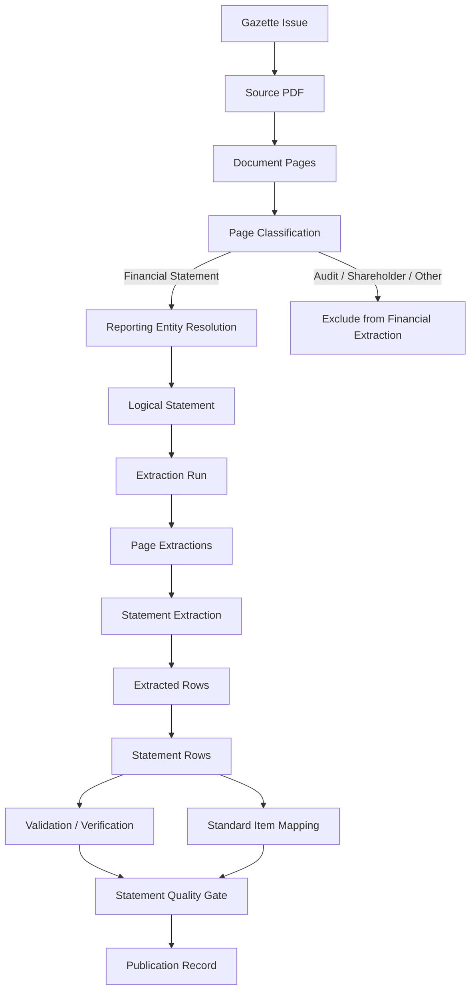

# Macau Banking Data Platform — Data Model v3 Implementation Specification

**文件狀態：** Implementation Specification Draft 1.0  
**設計基線：** v5 Read-only Baseline + SQL Audit（2026-11-18 baseline）  
**目標資料庫：** `data/macau_balancete_v3.sqlite`  
**舊資料庫：** `data/baseline/baseline_v5_20261118.sqlite`（唯讀、永久保留）  
**主要範圍：** Summary Financial Statements published in Macau Gazette；不以 General Ledger / 詳細 Trial Balance 為資料模型前提。

---

## 0. 文件目的及使用方式

本文件將現有 v5 Schema、中文及葡文公報樣本，以及已完成的 v5 SQL Audit 結果，整理成可執行的 v3 Database 設計及 Controlled Rebuild 規格。

本文件涵蓋：

1. v3 的核心資料概念及不可違反的設計原則。
2. v3 Tables、欄位、主外鍵、Unique Constraints、Indexes 及資料狀態。
3. Bilingual Standard Item Catalogue 的重建及 Registry Reconciliation。
4. Page Classification、Entity Cleanup、Statement Identity 及 Re-OCR / Adoption。
5. Replay Importer、Legacy Crosswalk 及 Reconciliation 規格。
6. Phase-by-phase Refactoring Action Plan、測試及驗收條件。

**本文件不是直接執行的 Migration Script。** DDL 應按第 12 節的建立次序拆成 SQL migration files；執行前必須在新 v3 檔案及測試副本驗證。任何步驟均不得寫入 v5 baseline。

### 0.1 證據來源及限制

本規格的資料量、Mapping 衝突、Entity 異常、Amount 統計及 Artifact 完整性，採用使用者提供的已完成 `audit_v5.py` 報告數字。該 Audit 報告聲稱以唯讀模式執行，且原 DB 與 baseline SHA-256 相同。

本次規格撰寫並沒有重新執行 `audit_v5.py`，因此以下數字視為 **Audit baseline supplied by project owner**，不是本文件作者重新量度的結果。正式 Build 前仍須在目標 Repository 重跑 Audit，並確認輸出與本文件所引用的 baseline 一致。

---

## 1. 設計總結：v3 的核心決定

### 1.1 核心模型

v3 是一個 **Multi-bank Summary Financial Statement Database**，不是 General Ledger Database。

- `statement_rows`：公報中實際出現的一條報表行。
- `extracted_rows`：某一次 OCR / Extraction Run 對該行的原始觀察。
- `standard_items`：跨銀行、跨年份及跨語言共用的標準財務項目。
- `statement_row_mappings`：原始報表行對應標準項目的證據、建議及批准狀態。

原始報表階層與標準項目階層是兩套不同的 Hierarchy，不得混為一談。

### 1.2 鎖定的 v3 決策

| 範疇 | v3 決定 |
|---|---|
| 舊 DB | v5 freeze；只讀，不作 in-place migration |
| 新 DB | 建立 `macau_balancete_v3.sqlite` |
| 資料來源 | Replay 14 個現有 Runs 的完整原始 Outputs |
| Statement identity | Logical Statement 與 Extraction Run 分離 |
| Adoption | `statements.adopted_statement_extraction_id` 為唯一權威 |
| Statement rows | Append-only；重新採納新 Extraction 時新增新 Row Set，不覆寫舊 Rows |
| Page | `document_pages` 保存 PDF 物理頁；`page_extractions` 保存每次 Run 的頁面觀察 |
| OCR data | `extracted_rows` 保存原始 OCR / parser evidence |
| Financial data | `statement_rows` 保存某次已採納 Extraction 的結構化報表行 |
| Amount | `raw TEXT` + `minor INTEGER` + `value_state`；`currency`、`unit_scale` 及 decimal precision 在 Statement 層 |
| Standard Catalogue | 89 seed + 65 draft + 120 lexicon 先 Reconciliation，禁止直接 UNION |
| Mapping | 所有 Legacy Mapping 初始為 `proposed`；不得自動變成 `approved` |
| Entity | 使用 `reporting_entities`；非實體 OCR Header 不得建立 Entity |
| Page classification | 必須先於正式 Entity / Statement Creation |
| Publication | Statement-level `publication_records`；不用單一 `is_published` 作整體品質判斷 |
| Cell table | MVP 不建立 `extracted_cells` |
| PostgreSQL | 暫不遷移；DDL 保持可移植性 |

### 1.3 明確不做的事情

- 不將系統設計成借貸分錄、總帳科目或交易流水資料庫。
- 不要求每間銀行使用相同原始科目樹。
- 不因為中文名稱及葡文名稱看似相近便自動批准配對。
- 不因 OCR confidence 高便視為數據已核實。
- 不把 `-`、空白或 unreadable 自動當成零。
- 不在第一版建立通用 EAV / `extracted_cells`。
- 不建立多個互相重複的 Adoption / Current Status 欄位。
- 不在 Registry 中建立核數師報告、股東名單、普通 Header OCR 垃圾作 Reporting Entity。

---

## 2. v5 Audit Baseline

### 2.1 Baseline Integrity

使用者提供的 Audit 結果：

```text
Original DB SHA-256:
a08ca1e24a5ae7cbf50067093124e7d42e5b7a2cbef36d56c6f6424586c598b6

Frozen baseline SHA-256:
a08ca1e24a5ae7cbf50067093124e7d42e5b7a2cbef36d56c6f6424586c598b6

Status: MATCH
```

Baseline path：

```text
data/baseline/baseline_v5_20261118.sqlite
```

唯讀 Audit 執行方式：

```bash
python3 tools/audit_v5.py \
  --db data/baseline/baseline_v5_20261118.sqlite \
  --out docs/audit
```

Audit script 使用 `mode=ro` 及 `PRAGMA query_only=ON`。現有 test suite：151 tests OK（以使用者提供結果為準）。

### 2.2 資料量及 Provenance

| 指標 | Audit 數值 |
|---|---:|
| Runs | 14 |
| Statements | 118 |
| Rows | 7,156 |
| Database size | 約 12 MB |
| PDF files | 14 / 14 存在 |
| Run output sets | 14 / 14 完整（`run_report.json`、`tb_rows.csv`、`documents.csv`） |
| PDF hash match | 14 / 14 |
| Provenance mismatch | 0 |
| Legacy `row_verification` | 0 rows |
| `name_mapping_audit` | 0 rows |
| `name_mapping_review` | 154 rows，全部 pending |
| Legacy published | 5 runs、38 statements，均來自 app 0.4.2 |
| Published verified rows | 0 |
| `needs_review` | 4,279 / 7,156（約 60%） |
| `auto_check_pass` | 2,877 |

**解讀：** 舊 Published 只代表舊版本曾經發布，不代表已符合 v3 的 verification / quality policy。v3 必須將 38 個舊 Published Statements 標示為 `legacy_published_unverified`，不得自動升格為 Verified 或正常 Published。

### 2.3 Standard Registry Inventory

| 來源 | Items | 中葡齊全 | 只有中文 | 只有葡文 | 使用 Rows |
|---|---:|---:|---:|---:|---:|
| `standard_labels` | 89 | 72 | 15 | 2 | 6,802 |
| `line_item_standard.csv` | 65 | 55 | 4 | 6 | 0（draft，未 apply） |
| `line_item_concepts` lexicon | 120 | 0 | 59 | 61 | 2,215 |
| `line_item_concepts` auto discovery | 96 | 0 | — | — | 0 |

其他重要結果：

- `standard_labels` 是 curated seed，不是最終 Catalogue。
- `line_item_standard.csv` 的 65 項是重要候選來源；其 55 個 exact bilingual candidates 仍不是自動批准的 merge。
- `line_item_concepts` 的 120 個 lexicon 項目均為單語，且有葡文資料被放在 `canonical_zh` 的 Schema Misuse；不得直接當成雙語 Catalogue。
- 96 個 `auto_discovery` 沒有被任何 Row 使用，應封存至 Exclusion Archive，不加入 Active Catalogue。
- `label_lexicon.csv` 是舊 `label_standard_id` 的來源，必須納入 Legacy Crosswalk，不能遺漏。

### 2.4 三方 Mapping Audit

| 指標 | 數量 |
|---|---:|
| Raw concept-vs-user name mismatch | 544 |
| Name-folding exact conflicts | 85 |
| Partial overlaps | 15 |
| Review rows after contextual grouping | 100 |

85 個 exact conflicts 的主要成因：

| 類型 | Rows |
|---|---:|
| `總額` vs `總計`（包括 `總額TOTAIS`） | 82 |
| `Outra Reserva` vs `其他儲備` | 3 |

15 個 partial overlaps 主要涉及葡文名稱 `Depósitos à ordem noutras instituições de crédito` 的 OCR truncation，例如缺少 `no Território` qualifier。

**v3 規則：** 文件不得將舊 302 或本次 100 寫成永久常數。每次 Audit / Reconciliation 必須按演算法重新計算。85、15、100 只作此 baseline 的結果。

### 2.5 Standard Item Reconciliation Baseline

370 rows = 89 + 65 + 120 + 96。

| 建議分類 | Rows |
|---|---:|
| `merge_candidate` | 112 |
| `needs_review` | 140 |
| `needs_review_unmatched` | 22 |
| `exclude_archive` | 96 |

65 Draft Items：

- 55 exact bilingual `merge_candidate`。
- 10 `needs_review`：6 個 pt-only、4 個 parent/child 或同名問題。

120 Lexicon Items：

- 114 個目前為 `needs_review`；當 89 + 65 的對應關係經批准後，部分可以 deterministic crosswalk。
- 其餘亦必須按實際語義及 Parent Context 審核。

**重要次序：先 Reconcile 89 + 65，再處理 120 lexicon。** 不得直接將三個 Registry UNION 成一份 Catalogue。

### 2.6 Mapping Conflict 的處理

- 85 exact conflicts 不等於 85 個不同財務概念；主要集中在兩組 Taxonomy Decisions。
- 15 partial overlap 必須區分 OCR truncation、Qualifier omission 及真正不同概念。
- 100 review rows 是此 Audit 使用的 review scope，不得直接當成永久全量衝突數。
- `總額` / `總計` 的 canonical 選擇，以及 `Outra Reserva` / `其他儲備` 的處理，由 Catalogue Owner 明確決定，不能由 Match Score 自動決定。

### 2.7 Entity / Statement / Page Cleanup

| 項目 | Audit 數值 |
|---|---:|
| Legacy bank records | 48 |
| Non-bank / junk records | 5（IDs 112–116） |
| OCR duplicate groups | 4 組 |
| Serious entity issues | 13 |
| Provisional identity | 40 |
| Statements | 118 |
| Serious statement issues | 16（5 junk + 11 duplicate entity） |
| Serious page issues | 5，均來自 Issue 17 非財務頁 |

四組實體變體：

- 11 / 49
- 22 / 58
- 33 / 91
- 36 / 69

IDs 113–116 是 OCR Header / 核數師報告 / 股東名單文字，不是 Reporting Entity。ID 112「南光石油化工」是公司而非銀行；除非未來明確擴展到非銀行發行人，否則不加入 Active Reporting Entity Registry，保留為排除決策及 Legacy Crosswalk。

**Page Classification 必須先於 Entity Resolution。** Issue 17 五個非財務頁面作為 Negative Test。

### 2.8 Amount Audit

| 項目 | 數量 |
|---|---:|
| Debit amount rows | 2,434 |
| Credit amount rows | 2,400 |
| Debit unparsed | 75 |
| Credit unparsed | 97 |
| Debit cents missing | 1 |
| Credit cents missing | 1 |
| Cents mismatch | 0 |
| Negative credit | 12 |
| Both debit + credit raw | 935 |
| Both debit + credit amount | 867 |
| Amount without label | 642 |

其他觀察：

- 40 個 `dot_comma` 及 70 個 `ambiguous` 全部集中在 Issue 17 五個非財務頁面。
- 真正銀行 Balance Sheet 頁面沒有 Audit 所報告的 number-format ambiguity。
- 12 個 negative credit 必須保留符號，不得自動取絕對值。
- 75 debit / 97 credit unparsed 不得當成零。
- 642 個 Amount without Label 必須保留原始證據並進入 Review；不可丟棄。

### 2.9 Audit 作為 v3 Gate

P0 的必要條件：重新執行 Audit 時，baseline SHA 必須一致，Artifact Manifest 所列檔案 Hash 必須匹配。任何差異先停止 Rebuild，確認來源版本後才繼續。

---

## 3. v3 資料流程



### 3.1 各層責任

| Layer | 責任 | 不應負責 |
|---|---|---|
| Document | 公報、PDF、物理頁身份 | OCR Run 狀態 |
| Entity / Statement | 誰發布哪份報表、報表日期及類型 | OCR 原始字串 |
| Extraction | 每次 OCR 的觀察及證據 | 最終 Approved Mapping |
| Statement Rows | 某個 Extraction 的採納報表行 Snapshot | 跨銀行 Catalogue 定義 |
| Standard Catalogue | 標準中葡項目及其 Hierarchy | 原始銀行 Report Tree |
| Quality / Publish | Validation、Review、Publication History | 覆寫原始 OCR 證據 |

---

## 4. 核心資料模型及 Table Scope

v3 採用分階段啟用，避免一次過建立所有通用框架。

### 4.1 Database Foundation（先建立）

1. `gazette_issues`
2. `source_documents`
3. `document_pages`
4. `reporting_entities`
5. `reporting_entity_aliases`
6. `statements`
7. `extraction_runs`
8. `page_extractions`
9. `statement_extractions`
10. `extracted_rows`
11. `statement_rows`
12. `standard_items`
13. `standard_item_aliases`
14. `statement_row_mappings`

### 4.2 Verification / Publish（Workbench Slice 開始時加入）

15. `field_verifications`
16. `validation_findings`
17. `review_tasks`
18. `publication_records`
19. `audit_events`

### 4.3 Migration Support（只供 Rebuild 使用）

- `legacy_id_crosswalk.csv`：外部 CSV，不要求成為正式 Runtime Table。
- `artifact_manifest.json`：外部 JSON，保存來源檔案 Hash。
- `STANDARD_ITEM_RECONCILIATION_MATRIX.csv`：外部 CSV，保存三套 Registry 的決策歷史。
- `replay_reconciliation.csv`：外部 CSV，保存舊資料到 v3 的逐項比對。

MVP 不建立 `extracted_cells`、`validation_rules`、`analytics_categories`，亦不建立泛用 `target_type + target_id` polymorphic table。

---

## 5. Table Specifications

> 以下列出各 Table 的責任及欄位契約。SQL DDL 必須遵守欄位名稱、類型、外鍵與狀態語義；可增加非破壞性 metadata 欄位，但不得另建第二套 Adoption、Mapping 或 Verification 權威。

### 5.1 `gazette_issues`

**責任：** 一期澳門政府公報的來源身份。

| Field | Type | Null | Rule |
|---|---|---:|---|
| `gazette_issue_id` | TEXT | No | PK，穩定 ID |
| `issue_key` | TEXT | No | UNIQUE，例如官方 Issue Number |
| `publication_date` | TEXT | Yes | ISO `YYYY-MM-DD` |
| `source_url` | TEXT | Yes | 官方來源 URL |
| `discovered_at` | TEXT | No | ISO timestamp |
| `notes` | TEXT | Yes | 來源說明 |

Indexes：`UNIQUE(issue_key)`、`publication_date`。

### 5.2 `source_documents`

**責任：** PDF 的物理文件身份及內容完整性。

| Field | Type | Null | Rule |
|---|---|---:|---|
| `source_document_id` | TEXT | No | PK |
| `gazette_issue_id` | TEXT | Yes | FK → `gazette_issues` |
| `document_key` | TEXT | No | UNIQUE，專案穩定識別 |
| `source_url` | TEXT | Yes | 官方 URL |
| `original_filename` | TEXT | Yes | 原檔名 |
| `storage_uri` | TEXT | No | 原始 PDF 儲存位置 |
| `sha256` | TEXT | No | 64 位 hex；index，不預設全域 UNIQUE |
| `page_count` | INTEGER | Yes | 大於 0 |
| `acquired_at` | TEXT | No | ISO timestamp |
| `mime_type` | TEXT | Yes | 通常為 application/pdf |

同一份 PDF 可能在不同來源／Issue 被重複引用，因此 `sha256` 預設只建 Index；重複內容由 Acquisition Policy 處理，不以 Hash 單獨代替 Document Identity。

### 5.3 `document_pages`

**責任：** PDF 中的物理頁身份及目前採納的頁面分類。重新 OCR 不得建立第二個物理頁。

| Field | Type | Null | Rule |
|---|---|---:|---|
| `document_page_id` | TEXT | No | PK |
| `source_document_id` | TEXT | No | FK → `source_documents` |
| `pdf_page` | INTEGER | No | 1-based 或 0-based 必須全系統統一；建議 1-based |
| `printed_page` | TEXT | Yes | 公報印刷頁碼 |
| `page_role` | TEXT | No | 見下方 enum |
| `classification_status` | TEXT | No | proposed / approved / rejected |
| `classification_source` | TEXT | Yes | automatic / human / imported |
| `classified_at` | TEXT | Yes | ISO timestamp |
| `notes` | TEXT | Yes | 補充 |

Constraints：`UNIQUE(source_document_id, pdf_page)`。

`page_role` 初始允許：

- `financial_statement`
- `audit_report`
- `shareholder_list`
- `cover`
- `contents`
- `other`
- `unknown`

Classification Policy：

- 自動分類只產生 proposed。
- 確認為 `financial_statement` 後才進行正式 Statement / Entity Resolution。
- `audit_report`、`shareholder_list`、`other` 不產生金融 Statement Rows。
- `unknown` 不得靜默當成 Financial Statement。

### 5.4 `reporting_entities`

**責任：** 代表實際發布金融報表的銀行／分行／銀行集團等實體，不是所有 OCR Header 字串。

| Field | Type | Null | Rule |
|---|---|---:|---|
| `entity_id` | TEXT | No | PK |
| `entity_key` | TEXT | No | UNIQUE、穩定機器鍵 |
| `entity_type` | TEXT | No | bank / branch / banking_group / non_bank |
| `canonical_zh` | TEXT | Yes | 標準中文名稱 |
| `canonical_pt` | TEXT | Yes | 標準葡文名稱 |
| `canonical_en` | TEXT | Yes | 可選英文名稱 |
| `parent_entity_id` | TEXT | Yes | FK → `reporting_entities` |
| `registry_status` | TEXT | No | proposed / approved / excluded / retired |
| `notes` | TEXT | Yes | 補充 |
| `created_at` | TEXT | No | ISO timestamp |

MVP Active Registry 只收錄經確認會發布目標財務報表的 Entity。非銀行公司如未在產品範圍內，不加入 Active Registry；以 Cleanup Decision / Legacy Crosswalk 保存排除原因。OCR junk header 永不建立 Entity。

### 5.5 `reporting_entity_aliases`

| Field | Type | Null | Rule |
|---|---|---:|---|
| `entity_alias_id` | TEXT | No | PK |
| `entity_id` | TEXT | No | FK → `reporting_entities` |
| `raw_name` | TEXT | No | 原始名稱 |
| `normalized_name` | TEXT | No | 正規化名稱 |
| `language` | TEXT | Yes | zh-Hant / pt / en / unknown |
| `alias_type` | TEXT | No | official / historical / ocr_variant / abbreviation / branch / other |
| `status` | TEXT | No | proposed / approved / rejected / retired |
| `source_reference` | TEXT | Yes | 文件、Run 或 Legacy ID |
| `notes` | TEXT | Yes | 補充 |

Unique 建議：`UNIQUE(entity_id, normalized_name, language)`；不要設 `UNIQUE(normalized_name, language)`，因為相同字串可因語境而屬於不同 Entity。

### 5.6 `statements`

**責任：** 一份邏輯上的銀行財務報表。與 OCR Run 分離。

| Field | Type | Null | Rule |
|---|---|---:|---|
| `statement_id` | TEXT | No | PK |
| `reporting_entity_id` | TEXT | No | FK → `reporting_entities` |
| `gazette_issue_id` | TEXT | Yes | FK → `gazette_issues` |
| `statement_date` | TEXT | Yes | ISO date；未確認可 NULL |
| `statement_type` | TEXT | No | balance_sheet / income_statement / cash_flow / other_financial_statement / unknown |
| `reporting_scope` | TEXT | Yes | bank / branch / group / other / unknown |
| `currency` | TEXT | Yes | Currency code；未知不得猜測 |
| `unit_scale` | INTEGER | Yes | 1 / 1000 / 1000000；未知可 NULL |
| `amount_decimal_places` | INTEGER | Yes | 顯示金額精度，例如 2；未知可 NULL |
| `identity_key` | TEXT | No | 正規化候選身份鍵；初期 NON-UNIQUE |
| `metadata_status` | TEXT | No | proposed / confirmed / needs_review |
| `adopted_statement_extraction_id` | TEXT | Yes | 唯一 Adoption 權威；FK 見 5.8 |
| `created_at` | TEXT | No | ISO timestamp |
| `notes` | TEXT | Yes | 補充 |

**Identity Rule：** 初期以 `reporting_entity_id + statement_date + statement_type + reporting_scope` 建立 `identity_key` 候選，但不得立即設 UNIQUE。先對 118 Statements、模擬重發、同日多類報表、分行／集團範圍做測試，再決定是否加 Partial Unique Index 或更完整 Identity 欄位。

**Currency / Scale Rule：**

- `currency` 是報表金額計價貨幣，不是行內 `PATACAS` / `MOEDAS EXTERNAS` 等分類文字。
- `unit_scale` 是公報所示單位乘數；只可於明確確認後填寫。
- `amount_decimal_places` 決定 Minor Unit 的 decimal exponent。
- 三者未知時可以 NULL，不可默認為 MOP、1 或 2 位小數。

### 5.7 `extraction_runs`

**責任：** 一次針對來源 PDF 的完整處理執行。

| Field | Type | Null | Rule |
|---|---|---:|---|
| `run_id` | TEXT | No | PK；可保留 Legacy Run ID 作 Crosswalk |
| `source_document_id` | TEXT | No | FK → `source_documents` |
| `app_version` | TEXT | Yes | Application version |
| `ocr_engine_versions` | TEXT | Yes | JSON text，記錄 Vision / Paddle 等版本 |
| `config_json` | TEXT | Yes | JSON text；配置快照 |
| `started_at` | TEXT | Yes | ISO timestamp |
| `completed_at` | TEXT | Yes | ISO timestamp |
| `run_status` | TEXT | No | queued / running / completed / failed / partial |
| `run_report_uri` | TEXT | Yes | 原始 Report 路徑 |

一個 Run 對應一份 Source Document 的 MVP 假設。若未來一個 Run 要處理多份 PDF，再擴展 Run-Document relation，不在 MVP 做。

### 5.8 `statement_extractions`

**責任：** 某一個 Run 對某一份 Logical Statement 的抽取結果。

| Field | Type | Null | Rule |
|---|---|---:|---|
| `statement_extraction_id` | TEXT | No | PK |
| `statement_id` | TEXT | No | FK → `statements` |
| `run_id` | TEXT | No | FK → `extraction_runs` |
| `extraction_status` | TEXT | No | proposed / completed / failed / rejected |
| `page_range_json` | TEXT | Yes | JSON text，記錄本次使用頁面 |
| `created_at` | TEXT | No | ISO timestamp |
| `notes` | TEXT | Yes | 補充 |

Constraints：

- `UNIQUE(statement_extraction_id, statement_id)`：供 Composite FK 使用。
- `UNIQUE(statement_id, run_id)`：同一個 Run 對同一 Statement 最多一個 Extraction；若將來確實要支援同 Run 多次 Extraction，再以版本號擴展。

**Single Adoption Rule：** `statements.adopted_statement_extraction_id` 是唯一權威。`statement_extractions` 不得另設 `is_adopted`、`adopted` 或 current flag。

Composite FK：

```sql
FOREIGN KEY (adopted_statement_extraction_id, statement_id)
REFERENCES statement_extractions(statement_extraction_id, statement_id)
```

此 FK 防止 Statement A 採納屬於 Statement B 的 Extraction。建立時可先讓 adopted ID 為 NULL；完成 Extraction 後才更新。

**MVP 限制：** 一份 Statement 只有一個 Adopted Extraction；不支援多個 Extraction 的頁面拼接。未來如有實際用例，再改為 row/page-level adoption。

### 5.9 `page_extractions`

**責任：** 某次 Extraction Run 對一個 PDF 物理頁的處理觀察。OCR 狀態不得放在 `document_pages`，避免重新 OCR 覆蓋舊狀態。

| Field | Type | Null | Rule |
|---|---|---:|---|
| `page_extraction_id` | TEXT | No | PK |
| `run_id` | TEXT | No | FK → `extraction_runs` |
| `document_page_id` | TEXT | No | FK → `document_pages` |
| `ocr_status` | TEXT | No | pending / completed / failed / skipped |
| `ocr_languages_json` | TEXT | Yes | JSON text |
| `image_path` | TEXT | Yes | Rendered image artifact |
| `image_width` | INTEGER | Yes | Pixels |
| `image_height` | INTEGER | Yes | Pixels |
| `number_format_detected` | TEXT | Yes | 原始偵測結果 |
| `number_format_confidence` | REAL | Yes | 0–1 |
| `page_result_uri` | TEXT | Yes | OCR page result JSON |
| `created_at` | TEXT | No | ISO timestamp |

Constraints：`UNIQUE(run_id, document_page_id)`；`UNIQUE(page_extraction_id, run_id)` 供 Composite FK。

### 5.10 `extracted_rows`

**責任：** 單次 Extraction 的原始 Row Observations。Immutable evidence；重新 OCR 產生新 Rows，不覆蓋舊 Rows。

| Field | Type | Null | Rule |
|---|---|---:|---|
| `extracted_row_id` | TEXT | No | PK |
| `statement_extraction_id` | TEXT | No | FK → `statement_extractions` |
| `run_id` | TEXT | No | 與 Statement Extraction 同 Run |
| `page_extraction_id` | TEXT | No | FK → `page_extractions` |
| `page_row_order` | INTEGER | No | 頁面內次序 |
| `statement_order` | INTEGER | Yes | 報表內全局次序；若不能可靠重建可 NULL |
| `label_raw` | TEXT | Yes | OCR 原始文字；允許 NULL 以保留 amount-only row |
| `label_normalized` | TEXT | Yes | OCR 後處理文字，不代表 Standard Item |
| `label_language` | TEXT | Yes | zh-Hant / pt / en / unknown |
| `debit_raw` | TEXT | Yes | OCR 原始借方文字 |
| `credit_raw` | TEXT | Yes | OCR 原始貸方文字 |
| `debit_parsed_minor` | INTEGER | Yes | Parser 候選值，不代表 Verified |
| `credit_parsed_minor` | INTEGER | Yes | Parser 候選值，不代表 Verified |
| `debit_value_state` | TEXT | No | amount / dash / blank / unreadable / not_applicable / ambiguous |
| `credit_value_state` | TEXT | No | 同上 |
| `row_type_proposed` | TEXT | No | heading / item / subtotal / total / unknown |
| `parent_extracted_row_id` | TEXT | Yes | OCR/geometry 推測 Parent；同一 Extraction 內 FK |
| `parent_context_status` | TEXT | No | root / identified / unknown / not_applicable |
| `indent_level` | INTEGER | Yes | 偵測縮排 |
| `row_band_y0` | REAL | Yes | Row band 座標 |
| `row_band_y1` | REAL | Yes | Row band 座標 |
| `label_bbox_x0` | REAL | Yes | Label bounding box |
| `label_bbox_y0` | REAL | Yes | Label bounding box |
| `label_bbox_x1` | REAL | Yes | Label bounding box |
| `label_bbox_y1` | REAL | Yes | Label bounding box |
| `debit_bbox_x0` | REAL | Yes | Debit bounding box |
| `debit_bbox_y0` | REAL | Yes | Debit bounding box |
| `debit_bbox_x1` | REAL | Yes | Debit bounding box |
| `debit_bbox_y1` | REAL | Yes | Debit bounding box |
| `credit_bbox_x0` | REAL | Yes | Credit bounding box |
| `credit_bbox_y0` | REAL | Yes | Credit bounding box |
| `credit_bbox_x1` | REAL | Yes | Credit bounding box |
| `credit_bbox_y1` | REAL | Yes | Credit bounding box |
| `row_confidence` | REAL | Yes | 0–1 |
| `row_payload_json` | TEXT | Yes | 僅放非核心附加 evidence |
| `created_at` | TEXT | No | ISO timestamp |

Constraints / indexes：

- `UNIQUE(page_extraction_id, page_row_order)`。
- `UNIQUE(extracted_row_id, statement_extraction_id)`。
- Composite FK 確保 `statement_extraction_id` 與 `run_id` 相同。
- Composite FK 確保 `page_extraction_id` 與 `run_id` 相同。
- Parent Extracted Row 必須屬於同一 Statement Extraction。

**座標規則：** 必須在 `page_extractions` 記錄的 Image Width / Height 座標系統下解讀。新程式要明確記錄是 rendered-image pixels 或 normalized coordinates，不可不同 OCR engine 混用兩種座標定義。MVP 建議使用 rendered-image pixel coordinates，並保留 image dimensions。

**MVP 不建立 `extracted_cells`。** 現有 Row-level label/debit/credit bounding boxes 足以支援中文及葡文 Balancete。未來有真正多欄 Notes / 表格重建用例再擴展。

### 5.11 `statement_rows`

**責任：** 某個 Statement Extraction 被採納後形成的報表行 Snapshot。每個 Extraction 有自己的 Row Set；Rows 不覆寫。

| Field | Type | Null | Rule |
|---|---|---:|---|
| `statement_row_id` | TEXT | No | PK |
| `statement_id` | TEXT | No | FK → `statements` |
| `statement_extraction_id` | TEXT | No | FK → `statement_extractions` |
| `extracted_row_id` | TEXT | No | FK → `extracted_rows` |
| `parent_row_id` | TEXT | Yes | 同一 Statement + Extraction 的 Parent FK |
| `statement_order` | INTEGER | Yes | 報表內排序 |
| `row_type` | TEXT | No | heading / item / subtotal / total / unknown |
| `parent_context_status` | TEXT | No | root / identified / unknown / not_applicable |
| `label_normalized` | TEXT | Yes | 可供 Review 的 normalized label；原始文字由 Extracted Row 保留 |
| `label_language` | TEXT | Yes | zh-Hant / pt / en / unknown |
| `debit_minor` | INTEGER | Yes | 採納的解析金額；原始字串由 Extracted Row 保留 |
| `debit_value_state` | TEXT | No | amount / dash / blank / unreadable / not_applicable / ambiguous |
| `credit_minor` | INTEGER | Yes | 採納的解析金額 |
| `credit_value_state` | TEXT | No | 同上 |
| `created_at` | TEXT | No | ISO timestamp |

Constraints：

- `UNIQUE(statement_row_id, statement_id, statement_extraction_id)`。
- `UNIQUE(statement_extraction_id, statement_order)`（如 statement_order 可用；否則使用 page + page row order 組合 Unique）。
- Composite FK `(statement_extraction_id, statement_id)` → `statement_extractions`。
- Composite FK `(extracted_row_id, statement_extraction_id)` → `extracted_rows`。
- Parent Composite FK `(parent_row_id, statement_id, statement_extraction_id)` → 本表 `(statement_row_id, statement_id, statement_extraction_id)`，確保 Parent 與 Child 屬於同一份 Statement 及同一 Extraction。

**Append-only / Current Set Rule：**

- 不以 UPDATE 覆蓋舊 Extraction 的 `statement_rows`。
- 一份 Statement 的 Current Rows 由 `statements.adopted_statement_extraction_id` 唯一決定。
- Current Row Set：`statement_rows.statement_extraction_id = statements.adopted_statement_extraction_id`。
- 舊 Extraction 的 Rows 保留，供歷史比較、Mapping / Verification 追溯。
- 如需修正 OCR / Row Structure，建立新 Statement Extraction 及新 Row Set，再經 Adoption 更新 Current Set。
- 禁止同時維護 `is_current`、`is_adopted`、`superseded_at` 等第二套 Current 權威。

**重要：** `field_verifications` 可為目前 Row 提供已核實欄位覆蓋值；不得直接改寫 `statement_rows` 原始 Snapshot。Effective Value 由 View / Query 合併 Base Row 與最新有效核實紀錄。

### 5.12 `standard_items`

**責任：** 唯一正式 Bilingual Standard Item Catalogue。

| Field | Type | Null | Rule |
|---|---|---:|---|
| `standard_item_id` | TEXT | No | PK，永不因名稱修改而改 ID |
| `item_key` | TEXT | No | UNIQUE，穩定機器鍵 |
| `canonical_zh` | TEXT | Yes | 標準中文名稱 |
| `canonical_pt` | TEXT | Yes | 標準葡文名稱 |
| `canonical_en` | TEXT | Yes | 可選英文名稱 |
| `parent_standard_item_id` | TEXT | Yes | FK → `standard_items` |
| `category` | TEXT | Yes | 財務分類，可逐步建立 |
| `item_status` | TEXT | No | draft / approved / retired |
| `created_at` | TEXT | No | ISO timestamp |
| `notes` | TEXT | Yes | 語義及治理說明 |

**Catalogue Rules：**

1. 中文與葡文是同一 Standard Item 的不同語言名稱，不是兩個獨立 Item。
2. 英文可選，不要求第一版完整。
3. Standard Item Parent Hierarchy 不等於原始 Statement Row Parent Hierarchy。
4. Item ID 穩定；canonical name 可經版本化治理修改。
5. 不同 Parent 下的同名 Child 可以是不同 Standard Item。
6. 同一 Alias Text 可以在不同 Context 對應不同 Standard Items；禁止建立全域 `UNIQUE(normalized_name, language)`。
7. 未有可靠中葡對應的 Item 可以暫時只有單一語言，但必須標示 draft / needs review，不得虛構翻譯。

### 5.13 `standard_item_aliases`

| Field | Type | Null | Rule |
|---|---|---:|---|
| `standard_item_alias_id` | TEXT | No | PK |
| `standard_item_id` | TEXT | No | FK → `standard_items` |
| `raw_name` | TEXT | No | 原始名稱 |
| `normalized_name` | TEXT | No | 正規化名稱 |
| `language` | TEXT | Yes | zh-Hant / pt / en / unknown |
| `alias_type` | TEXT | No | bank_label / historical / abbreviation / ocr_variant / translation / other |
| `source_registry` | TEXT | Yes | standard_labels / line_item_standard / line_item_concepts / label_lexicon / manual |
| `source_legacy_id` | TEXT | Yes | 原始 Registry ID |
| `alias_status` | TEXT | No | proposed / approved / rejected / retired |
| `notes` | TEXT | Yes | 補充 |

Unique：可設 `UNIQUE(standard_item_id, normalized_name, language)`；不得只對 `normalized_name + language` 設全域 Unique。

### 5.14 `statement_row_mappings`

**責任：** 保存一條 Statement Row 對 Standard Item 的候選及批准歷史。

| Field | Type | Null | Rule |
|---|---|---:|---|
| `mapping_id` | TEXT | No | PK |
| `statement_row_id` | TEXT | No | FK → `statement_rows` |
| `standard_item_id` | TEXT | No | FK → `standard_items` |
| `mapping_status` | TEXT | No | proposed / conflict / approved / rejected / superseded |
| `match_method` | TEXT | Yes | parent_exact / child_path_exact / bilingual_exact / alias_exact / fuzzy / manual / legacy_import |
| `match_score` | REAL | Yes | 0–1；只代表演算法分數 |
| `mapping_version` | TEXT | Yes | Mapping rules version |
| `evidence_source` | TEXT | Yes | legacy_user_standard / label_lexicon / concept_lexicon / draft_catalogue / manual |
| `context_json` | TEXT | Yes | Parent context、候選來源等補充證據 |
| `reviewed_by` | TEXT | Yes | 只有人工批准後填寫 |
| `reviewed_at` | TEXT | Yes | 只有人工批准後填寫 |
| `created_at` | TEXT | No | ISO timestamp |
| `notes` | TEXT | Yes | 衝突及審批說明 |

Rules：

- Legacy Mapping 全部匯入為 `proposed` 或 `conflict`。
- `match_score` 不得觸發 Approved。
- 每條 Row 最多一個當前 `approved` Mapping；使用 Partial Unique Index（SQLite / PostgreSQL 均支援）限制 `WHERE mapping_status = 'approved'`。
- 同一 Row 可有多個 `proposed` 候選。
- Parent/Child 自動 Mapping 必須使用已確認 Parent Context；若 Child 名稱本身有歧義而 Parent 未知，不可自動批准。
- 同名 `PATACAS` 必須按 Parent Context 區分，不得只靠字面名稱 Mapping。

### 5.15 `field_verifications`（Workbench Stage）

**責任：** 對 Statement Row 的特定欄位作人工核實或修正。不得把 Row-level OCR confidence 當成人工核實。

| Field | Type | Null | Rule |
|---|---|---:|---|
| `field_verification_id` | TEXT | No | PK |
| `statement_row_id` | TEXT | No | FK → `statement_rows` |
| `field_name` | TEXT | No | label_normalized / debit_minor / debit_value_state / credit_minor / credit_value_state / row_type / parent_row_id |
| `original_value_text` | TEXT | Yes | Base Snapshot 值 |
| `verified_value_text` | TEXT | Yes | 人工核實值；按 field_name 解析 |
| `verification_status` | TEXT | No | pending / verified / rejected / waived |
| `verified_by` | TEXT | Yes | 使用者 ID |
| `verified_at` | TEXT | Yes | ISO timestamp |
| `reason` | TEXT | Yes | 修正或核實原因 |
| `updated_at` | TEXT | No | ISO timestamp |

MVP 每個 Row + Field 保留一筆目前核實結果，`UNIQUE(statement_row_id, field_name)`。歷史修改由 `audit_events` 保存 before / after，不在此表重複維護多個 current records。

Effective Value View 必須只採用 `verification_status = 'verified'` 的 `verified_value_text`；pending / rejected 不覆蓋 Base Value。金額欄位在進入 Analytics 前必須依 field_name 轉回 INTEGER，不能以字串排序或運算。

### 5.16 `validation_findings`（Workbench Stage）

| Field | Type | Null | Rule |
|---|---|---:|---|
| `finding_id` | TEXT | No | PK |
| `statement_id` | TEXT | No | FK → `statements` |
| `statement_row_id` | TEXT | Yes | FK → `statement_rows` |
| `document_page_id` | TEXT | Yes | FK → `document_pages` |
| `rule_key` | TEXT | No | 穩定 Validation Rule Key |
| `severity` | TEXT | No | info / warning / error / critical |
| `finding_status` | TEXT | No | open / acknowledged / resolved / waived |
| `details_json` | TEXT | Yes | 規則輸出及 evidence |
| `created_at` | TEXT | No | ISO timestamp |
| `resolved_at` | TEXT | Yes | ISO timestamp |

Constraint：`statement_row_id`、`document_page_id` 最多一個可非 NULL；兩者皆 NULL 代表 Statement-level finding。避免用泛用 `target_type / target_id`。

### 5.17 `review_tasks`（Workbench Stage）

| Field | Type | Null | Rule |
|---|---|---:|---|
| `review_task_id` | TEXT | No | PK |
| `statement_id` | TEXT | No | FK → `statements` |
| `statement_row_id` | TEXT | Yes | FK → `statement_rows` |
| `finding_id` | TEXT | Yes | FK → `validation_findings` |
| `mapping_id` | TEXT | Yes | FK → `statement_row_mappings` |
| `document_page_id` | TEXT | Yes | FK → `document_pages` |
| `task_type` | TEXT | No | amount_review / label_review / mapping_review / parent_context_review / page_classification / identity_review / other |
| `priority` | TEXT | No | critical / high / normal / low |
| `task_status` | TEXT | No | open / in_progress / resolved / waived |
| `assigned_to` | TEXT | Yes | User ID |
| `created_at` | TEXT | No | ISO timestamp |
| `resolved_at` | TEXT | Yes | ISO timestamp |

Constraint：四個 target FKs 中必須剛好一個非 NULL。`statement_id` 始終提供 Statement scope。不得建立無法追溯 Statement 的孤立 Review Task。

### 5.18 `publication_records`（Workbench Stage）

| Field | Type | Null | Rule |
|---|---|---:|---|
| `publication_id` | TEXT | No | PK |
| `statement_id` | TEXT | No | FK → `statements` |
| `statement_extraction_id` | TEXT | No | Composite FK 屬於同一 Statement |
| `quality_level` | TEXT | No | quality_checked / reviewed / fully_verified / legacy_unverified |
| `publication_status` | TEXT | No | published / revoked / superseded |
| `published_by` | TEXT | Yes | User / system identity |
| `published_at` | TEXT | Yes | ISO timestamp |
| `reason` | TEXT | Yes | 發布、撤回或取代原因 |

一份 Statement 可以有多筆歷史 Publication Records；不使用 `is_published` 作為第二權威。正式發布時必須確認該 Extraction 仍是 Statement 的 Adopted Extraction。

### 5.19 `audit_events`（Workbench Stage）

**責任：** 保存人工修正、Mapping Approve / Reject、Adoption、Publish / Revoke 等操作歷史。

| Field | Type | Null | Rule |
|---|---|---:|---|
| `audit_event_id` | TEXT | No | PK |
| `event_type` | TEXT | No | 穩定事件代碼 |
| `statement_id` | TEXT | Yes | FK → `statements` |
| `statement_row_id` | TEXT | Yes | FK → `statement_rows` |
| `mapping_id` | TEXT | Yes | FK → `statement_row_mappings` |
| `review_task_id` | TEXT | Yes | FK → `review_tasks` |
| `actor_id` | TEXT | Yes | User / system |
| `before_json` | TEXT | Yes | 修改前內容 |
| `after_json` | TEXT | Yes | 修改後內容 |
| `reason` | TEXT | Yes | 原因 |
| `created_at` | TEXT | No | ISO timestamp |

MVP 只為 Statement、Row、Mapping、Review Task 的主要事件建立 Audit。其他 Registry 修改在對應管理操作中寫入明確事件；不建立泛用 polymorphic `entity_type/entity_id` 作為主要關聯。

---

## 6. Amount / Currency / Unit Scale Contract

### 6.1 儲存欄位

```text
extracted_rows:
  debit_raw TEXT
  credit_raw TEXT
  debit_parsed_minor INTEGER NULL
  credit_parsed_minor INTEGER NULL
  debit_value_state TEXT
  credit_value_state TEXT

statement_rows:
  debit_minor INTEGER NULL
  credit_minor INTEGER NULL
  debit_value_state TEXT
  credit_value_state TEXT

statements:
  currency TEXT NULL
  unit_scale INTEGER NULL
  amount_decimal_places INTEGER NULL
```

### 6.2 Minor Unit 定義

`debit_minor` / `credit_minor` 儲存 **公報顯示單位下的最小數值單位**，不是已乘 `unit_scale` 的實際金額。

若：

- 顯示值為 `1,234.50`
- `amount_decimal_places = 2`
- `unit_scale = 1000`

則：

- `debit_minor = 123450`
- Display Amount = `1234.50`
- Analytics Amount = `1234.50 × 1000 = 1,234,500`

公式：

```text
actual_amount = minor / (10 ^ amount_decimal_places) * unit_scale
```

**不得在 OCR Import 時乘入 `unit_scale`。** 否則會造成 Double Scaling 或失去公報原始顯示值。

### 6.3 Currency Precision

- `amount_decimal_places` 必須由報表顯示精度或明確設定決定。
- 不可假設所有貨幣均為兩位小數。
- 未能確定 precision 時，Amount Parsing 可以保留 Raw String，但 `minor` 暫時 NULL，`value_state = 'ambiguous'` 或 `unreadable'`。
- SQLite `INTEGER` 需確認不會超出 64-bit signed integer 範圍；超出時停止自動轉換並送 Review。
- 禁止以 SQLite `REAL` 或 Python `float` 作正式財務金額儲存。

### 6.4 Value States

建議允許值：

- `amount`：成功解析出確切金額。
- `dash`：公報明確顯示 `-`。
- `blank`：原欄位空白。
- `unreadable`：OCR 無法辨識。
- `not_applicable`：經確認不適用。
- `ambiguous`：多種數值解讀未能決定。

基本 Constraint：

- `value_state = 'amount'` 時，對應 minor 必須非 NULL。
- 非 `amount` 狀態時，minor 預設 NULL。
- `dash` 不自動當成 0；如報表總額檢查需將 dash 按 0 處理，必須由明確 Validation Rule 在計算時作解釋，原始狀態仍保留 `dash`。
- Negative Values 必須保留正負號，包括 Audit 發現的 12 個 negative credit。

---

## 7. Standard Item Catalogue Reconciliation

### 7.1 唯一正式 Catalogue

v3 的唯一 Active Catalogue 為 `standard_items` + `standard_item_aliases`。

來源資料只作 Seed / Evidence，不直接作第二套權威：

1. `standard_labels`：89 curated seed。
2. `line_item_standard.csv`：65 bilingual draft candidates。
3. `line_item_concepts` lexicon：120 single-language legacy evidence。
4. `label_lexicon.csv`：舊 `label_standard_id` 的 Legacy ID 來源。
5. `line_item_concepts` auto discovery：96 unused entries，封存排除。

### 7.2 Reconciliation 次序

**Stage A — 89 + 65**

- 先逐項比較 89 seed 與 65 draft。
- 55 bilingual exact candidates 進入 `merge_candidate`，仍要核對 Parent、語義及實際 Row Context。
- 其餘 10 Draft Items 標 `needs_review`，不可自動合併。
- 89 seed 的缺語言項目（15 缺葡文、2 缺中文）保留，除非有可靠來源補充；不虛構翻譯。

**Stage B — 120 Lexicon**

- 89 + 65 的候選關係經人工確認後，才將 120 lexicon 對應至正式 Standard Items / Aliases。
- lexicon 中葡文塞入 `canonical_zh` 的項目，先按實際文字語言修復來源 metadata，不直接搬欄位。
- 有 Parent Context 才可處理同名 Child。

**Stage C — 96 Auto Discovery**

- 96 項均沒有被 Rows 使用。
- 不進入 Active Catalogue。
- 寫入 `standard_item_exclusion_archive.csv`，保存 legacy ID、原始文字、來源、排除理由。

**Stage D — Label Lexicon Crosswalk**

- 舊 `label_standard_id` 指向 CSV，不是現有 DB PK。
- 每個舊 ID 必須在 `legacy_id_crosswalk.csv` 有處理結果。
- 不得把 `zh_044` / `pt_050` 等字串當成 v3 `standard_item_id`。

### 7.3 Reconciliation Matrix 格式

產生：`docs/audit/STANDARD_ITEM_RECONCILIATION_MATRIX.csv`

建議欄位：

```text
source_registry
source_legacy_id
source_raw_key
canonical_zh_candidate
canonical_pt_candidate
canonical_en_candidate
source_parent_key
candidate_standard_item_key
candidate_source_registry
candidate_legacy_id
match_type
match_evidence
parent_context_status
reconciliation_status
review_required
reviewed_by
reviewed_at
decision_note
```

狀態：

- `merge_candidate`
- `keep`
- `needs_review`
- `needs_review_unmatched`
- `retire`
- `exclude_archive`

矩陣的 370 rows（89 + 65 + 120 + 96）是本次 baseline 數量；之後如來源變更，應由 Script 重算，不硬編碼。

### 7.4 Taxonomy Decisions

至少需由 Catalogue Owner 明確決定：

1. `總額` / `總計` / `總額TOTAIS` 的 Canonical Name、Alias 及是否同一 Standard Item。
2. `Outra Reserva` / `其他儲備` 的語義是否等價，以及中葡 canonical 欄位如何處理。
3. 15 個 Partial Overlaps 是否為 OCR truncation、Qualifier omission 或真正不同概念。
4. 10 個 Draft Parent / Child / pt-only Items 的位置及語義。
5. 10 個 child seed items（例如澳門元 / 外幣）缺乏共同 Parent Key 的處理；不得單靠字面合併。

### 7.5 PATACAS / Parent Context Rule

`PATACAS` 可能出現在 `CAIXA` 及 `DEPÓSITOS NA AMCM` 等不同 Parent 下。

因此：

- Alias 字串不能全域唯一。
- Mapping 必須考慮 Parent Row / Parent Standard Item Context。
- 如果 Parent Context 未知，Child Mapping 只可 `proposed`，不可自動 `approved`。
- 舊資料只有 1,004 / 7,156 Rows 有 Parent Label（Audit 指標）；其餘不得事後猜測 Parent。
- 新 Extraction 要保留 indent、row band、bounding boxes、column boundaries 及 Parent Detection Evidence。

---

## 8. Page Classification & Entity Cleanup

### 8.1 正確處理順序

1. PDF page rendering / page inventory。
2. Page Role Classification。
3. 只有 `financial_statement` pages 進入 Statement Segmentation。
4. 再做 Reporting Entity Recognition / Resolution。
5. 建立 Statement。
6. 最後執行 Balance Sheet Row Extraction。

不得先把每頁 OCR Header 當成 Bank，再事後刪除 junk entities。

### 8.2 Issue 17 Negative Test

Audit 指出 Issue 17 五個非財務頁包含：

- 40 個 `dot_comma` detections。
- 70 個 `ambiguous` number formats。

這些頁面屬非財務內容；新 Pipeline 應透過 Page Classification 排除，不應放寬／改寫 Amount Parser 去遷就非目標頁面。

驗收：五個 Negative Test Pages 不得建立金融 `statements` 或 `statement_rows`；頁面身份及排除原因仍需保存。

### 8.3 Entity Cleanup

- Legacy IDs 113–116：OCR Header / Auditor / Shareholder 等字串，不建立 Reporting Entity；用 Page Classification / exclusion decision 保存來源。
- Legacy ID 112「南光石油化工」：非銀行；MVP 不建立 Active Bank Entity。若保留歷史識別，標示為 excluded non-bank evidence。
- Duplicate alias groups：11/49、22/58、33/91、36/69；每組決定一個 surviving Entity，其他舊 ID 經 Alias / Crosswalk 指向 surviving entity。
- 40 Provisional Identities：按 Statement Context 逐項處理，不能僅憑 OCR 名稱自動批准。

---

## 9. Statement Identity, Reprocessing & Adoption

### 9.1 Logical Statement Identity

`statements` 代表邏輯報表，不代表某一次 OCR。

候選 Identity 欄位：

- `reporting_entity_id`
- `statement_date`
- `statement_type`
- `reporting_scope`
- 必要時 `gazette_issue_id` 或更細的 `reporting_basis`

`identity_key` 初期只建立 Index，不立即 UNIQUE。

### 9.2 Identity Test Set

在加 UNIQUE 前必須通過：

1. Audit 目前 118 Statements。
2. 模擬同一銀行、同一報表日期重新 OCR。
3. 模擬同一銀行、同一日期不同 `statement_type`。
4. 模擬銀行總行與分行同日報表。
5. 模擬同一文件重發／修訂。
6. 模擬日期缺失或 Statement Metadata 不完整。

如以上結果證明現有組合不足，應新增 `reporting_scope` / `statement_variant` 等明確欄位，不可用不透明 Hash 隱藏身份衝突。

### 9.3 Single Adopted Extraction

MVP 一份 Statement 只有一個 Adopted Extraction。

唯一權威：

```text
statements.adopted_statement_extraction_id
```

不得同時存在 `statement_extractions.is_adopted`。

Composite FK：

```sql
FOREIGN KEY (adopted_statement_extraction_id, statement_id)
REFERENCES statement_extractions(statement_extraction_id, statement_id)
```

採納流程：

1. 建立新 Extraction Run。
2. 建立 Page Extractions。
3. 建立 Statement Extraction。
4. 建立 Extracted Rows。
5. 建立 Statement Rows Snapshot。
6. 執行 Validation / Review。
7. 通過 Adoption Gate 後，更新 Statement 的 `adopted_statement_extraction_id`。
8. 舊 Extraction 及舊 Statement Rows 保留，不刪除、不覆蓋。

如果未來同一 Statement 需要由多次 Extraction 拼接不同頁面，再以 `statement_extraction_pages` / row-level provenance 擴展；MVP 不做。

### 9.4 Append-only Statement Rows

- `statement_rows` 每個 Extraction 產生獨立 Row Set。
- 新 Extraction 不更新舊 Rows。
- Current Rows 透過 Join `statements.adopted_statement_extraction_id` 取得。
- Parent FK 必須限定同一 `statement_id` 及 `statement_extraction_id`。
- Field Correction 透過 `field_verifications` 建立有效欄位覆蓋，不修改 Snapshot。
- 新 OCR 結果與舊 Row Set 不一致時，建立新 Row Set，完成 Adoption 才切換 Current。

---

## 10. Replay Importer Specification

### 10.1 輸入來源

使用 Artifact Manifest 指定的來源：

- 14 個原始 PDF。
- 14 個 Run Output Directories。
- 每個 Run 的 `run_report.json`。
- `tb_rows.csv`。
- `documents.csv`。
- `labels/standard_label_by_user.cleaned.csv`。
- `labels/line_item_standard.csv`。
- `labels/label_lexicon.csv`。
- Audit 識別的其他必要 Registry / Config。

Replay 不應讀取變動中的 v5 作為唯一原始來源；v5 用來對帳，原始 Run Outputs 作為重建來源。

### 10.2 Idempotency

同一個 Artifact Manifest、同一個 Run、同一個 Importer Version 重跑，不得建立重複 Rows。

建議 Idempotency Keys：

- Run：`run_id` + source document hash。
- Page Extraction：`run_id + document_page_id`。
- Statement Extraction：`statement_id + run_id`。
- Extracted Row：`page_extraction_id + page_row_order`。
- Statement Row：`statement_extraction_id + source extracted_row_id`。

Importer 必須：

- 每個 Run 使用 Transaction 或可安全重試的分段 Transaction。
- 寫入前檢查既有 Idempotency Key。
- 同一來源但內容不同時報錯，不可靜默覆蓋。
- 匯入失敗保留明確 Run Status 及錯誤記錄。

### 10.3 Replay Mapping Policy

所有 Legacy Mapping 只建立 Proposed / Conflict：

- `user_standard_label_id` → Proposed Mapping，保留 match method。
- `label_standard_id` → 透過 `label_lexicon.csv` Crosswalk 後提出 Mapping。
- `line_item_concept_id` → 透過 120 Lexicon Reconciliation 提出 Mapping。
- 三方衝突 → `conflict` + Review Task。
- 沒有 Mapping 但有 Amount → 保留 Row，建立 Review Task。
- 不允許任何 Legacy `approved` 值（若舊資料存在）自動傳入 v3 Approved。

### 10.4 Parent Rebuild Policy

- 有可驗證 Parent Evidence 的 Rows 才建立 `parent_row_id`。
- 舊資料只有 Parent Label / label_path 時，先產生 Parent Candidate，不自動轉為正式 Parent。
- 無 Parent Evidence 的 Child 標示 `parent_context_status = 'unknown'`。
- Parent Context 未知的同名 Child 不可自動 Mapping。
- 任何人工補 Parent 必須有 Verification / Audit Evidence。

---

## 11. Reconciliation & Acceptance Criteria

### 11.1 Artifact Integrity

| Check | Acceptance |
|---|---|
| v5 baseline SHA-256 | 與 `a08ca1e24a5ae7cbf50067093124e7d42e5b7a2cbef36d56c6f6424586c598b6` 完全一致 |
| PDF hashes | 14 / 14 match |
| Run output sets | 14 / 14 完整 |
| Artifact manifest | 所有必要 Artifact 都有 SHA-256 |
| v5 mutation | 0 |

### 11.2 Replay Reconciliation

產生 `docs/audit/v3_reconciliation_summary.md` 及 CSV。

必須對比：

- 每 Run Row Count。
- 每 Statement Row Count。
- 每 Page Row Count。
- Debit / Credit Raw Values。
- Debit / Credit Minor Units。
- Negative Values。
- Value State counts。
- Label Raw Values。
- Standard Mapping Proposed / Conflict / Unmapped counts。
- Entity / Statement Identity。
- Parent Context completeness。
- Legacy ID Crosswalk coverage。

Acceptance：

- 可重建的 Rows 數量與來源 Outputs 一致；任何有意排除的資料必須有 disposition，不可無聲丟失。
- 所有已成功解析的 Legacy Cents 與 v3 Minor Unit 轉換逐筆一致；目標 0 mismatch。
- Legacy Amount Raw 字串保留。
- 12 個 negative credit 符號保留。
- 75 debit、97 credit unparsed 狀態保留，不轉零。
- 642 Amount-without-Label rows 保留並列入 Review。
- 不可重建的 Parent 一律標 Unknown，不猜測。
- 任何 Legacy Mapping 都不可自動成為 Approved。
- 每個舊 PK 都有 `mapped / archived / excluded / not_recoverable` Crosswalk 結果。

### 11.3 Mapping Reconciliation

Audit baseline expected counts（僅供核對，不硬編碼）：

- 370 source registry rows。
- 112 merge candidates。
- 140 needs review。
- 22 needs review unmatched。
- 96 exclude archive。
- 85 exact conflicts。
- 15 partial overlaps。

如果重新計算的結果不同，輸出差異並調查來源版本；不可為了符合預期數字而修改資料。

### 11.4 Page / Entity Acceptance

- Issue 17 五個非財務頁不產生金融 Statements / Statement Rows。
- Issue 17 的 40 dot_comma、70 ambiguous 不應觸發放寬 parser；頁面角色應被分類為非目標或 unknown。
- 113–116 不建立 Reporting Entities。
- 112 保留 Excluded Non-bank Evidence，不進入 Active Bank Registry。
- 四組 Entity Variant 按人工批准的 Alias Merge 處理。
- 40 Provisional Identity 必須可見為 pending / needs review，不得默認 approved。

### 11.5 Reprocessing Acceptance

- 同一 Statement 重新 OCR 後仍只有一個 Logical Statement。
- 新 Run 建立新 Statement Extraction。
- 舊 Extraction / Rows / Mapping / Verification 不會被覆蓋或刪除。
- 未 Adoption 前 Current Rows 仍指向舊 Extraction。
- Adoption 後 Current Rows 一次性切換到新 Extraction。
- 無跨 Statement 或跨 Extraction Parent FK。

### 11.6 Workbench Acceptance

- 每個 Row 可跳轉原始 PDF Page / Bounding Box。
- 原始 OCR Value 與 Verified Value 可同時查看。
- 每個 Field 可獨立核實。
- Mapping Proposed 不顯示為 Approved。
- Conflict 可建立 Review Task。
- Publish 必須針對 Statement + Adopted Extraction。
- Publish 記錄 Quality Level、操作者、時間及依據。

---

## 12. DDL Implementation Notes

### 12.1 SQLite Settings

每個連線啟用：

```sql
PRAGMA foreign_keys = ON;
```

對 v5 Audit / Baseline 連線：

```text
mode=ro
PRAGMA query_only=ON;
```

v3 正式 DB 不可使用 `REAL` 作財務金額。時間統一使用 ISO 8601 UTC 或明確記錄 timezone 的格式；不要混用本地時間與 UTC。

### 12.2 建表次序

由於 `statements` 與 `statement_extractions` 有 Adoption Composite FK，DDL 可以先建立 `statements`（其中 FK 指向之 table 可稍後建立），再建立 `statement_extractions`。初始 Statements 的 `adopted_statement_extraction_id` 必須為 NULL，待 Extraction 建立後才設定。

建議 SQL migration files：

```text
database/v3/
  001_core_documents.sql
  002_entities_statements.sql
  003_extraction.sql
  004_statement_rows.sql
  005_standard_catalogue.sql
  006_mapping.sql
  007_verification_publish.sql
  008_indexes_and_views.sql
```

### 12.3 Composite Foreign Keys

至少要實作以下 Composite FK：

1. `statements(adopted_statement_extraction_id, statement_id)` → `statement_extractions(statement_extraction_id, statement_id)`。
2. `statement_rows(statement_extraction_id, statement_id)` → `statement_extractions(statement_extraction_id, statement_id)`。
3. `statement_rows(extracted_row_id, statement_extraction_id)` → `extracted_rows(extracted_row_id, statement_extraction_id)`。
4. `statement_rows(parent_row_id, statement_id, statement_extraction_id)` → `statement_rows(statement_row_id, statement_id, statement_extraction_id)`。
5. `extracted_rows(page_extraction_id, run_id)` → `page_extractions(page_extraction_id, run_id)`。
6. `extracted_rows(statement_extraction_id, run_id)` → `statement_extractions(statement_extraction_id, run_id)`。

每個 Composite FK 的 Parent Columns 必須有對應 UNIQUE Constraint / Index。

### 12.4 Recommended Indexes

```text
source_documents(sha256)
document_pages(source_document_id, pdf_page)
document_pages(page_role, classification_status)
reporting_entity_aliases(normalized_name, language)
statements(reporting_entity_id, statement_date, statement_type)
statements(identity_key)
extraction_runs(source_document_id, run_status)
page_extractions(run_id, document_page_id)
statement_extractions(statement_id, run_id)
extracted_rows(statement_extraction_id, statement_order)
extracted_rows(page_extraction_id, page_row_order)
statement_rows(statement_extraction_id, statement_order)
statement_rows(statement_id, statement_extraction_id)
standard_items(item_key, item_status)
standard_item_aliases(normalized_name, language)
statement_row_mappings(statement_row_id, mapping_status)
field_verifications(statement_row_id, field_name)
validation_findings(statement_id, finding_status, severity)
review_tasks(task_status, priority, assigned_to)
publication_records(statement_id, published_at)
```

`identity_key` 初期不加 UNIQUE。`standard_item_aliases(normalized_name, language)` 不加全域 UNIQUE。

### 12.5 Partial Unique Indexes

每條 Statement Row 最多一個 Approved Mapping：

```sql
CREATE UNIQUE INDEX uq_one_approved_mapping_per_row
ON statement_row_mappings(statement_row_id)
WHERE mapping_status = 'approved';
```

如 SQLite 版本／目標 PostgreSQL 版本不支援相同 Partial Index 語法，需在 Build 前驗證；不能靜默省略此規則。

### 12.6 Views

至少建立：

- `v_current_statement_rows`：只讀取 Statement Adopted Extraction 的 Rows。
- `v_effective_statement_rows`：Current Rows + Approved Field Verification Overrides。
- `v_approved_statement_row_mappings`：只讀取 Approved Mapping。
- `v_statement_quality_summary`：Statement-level findings、review task、mapping coverage 及 publication quality。

View 不得把 Proposed Mapping 當作正式 Standard Item。

---

## 13. Refactoring Action Plan（P0–P7）

### P0 — Freeze v5 & Artifact Manifest（Audit 已完成，Build 前重驗）

**交付物：**

- `baseline_v5_20261118.sqlite`
- `artifact_manifest.json`
- `BASELINE.md`
- `SQL_AUDIT_V5.md/.json`
- Audit CSV set

**工作：**

1. 確認 v5 檔案為唯讀。
2. 重新計算 DB SHA-256，與 Audit baseline 比較。
3. 對 PDF、Run Outputs、Labels CSV 計 Hash。
4. 文件版本凍結，特別核對 `STANDARD_LINE_ITEMS.md` 數量與 Registry 實際內容是否 Drift。
5. 不修改 v5，不執行 v5 Schema Migration。

**Exit Gate：** DB Hash match；Manifest 完整；151 tests 在凍結版本通過。

### P1 — Registry Reconciliation & Catalogue Governance

**交付物：**

- `STANDARD_ITEM_RECONCILIATION_MATRIX.csv`
- `STANDARD_ITEM_DECISIONS.md`
- `standard_items_seed.csv`
- `standard_item_aliases_seed.csv`
- `standard_item_exclusion_archive.csv`

**工作：**

1. 89 seed 與 65 draft 逐項 Reconcile。
2. 人工決定 55 exact bilingual candidates 是否合併。
3. 處理 10 draft exceptions。
4. 決定 `總額` / `總計` Canonical / Alias 關係。
5. 決定 `Outra Reserva` / `其他儲備` 關係。
6. 分析 15 partial overlaps，區分 OCR truncation 與語義差異。
7. 再處理 120 single-language lexicon。
8. 將 96 unused auto discovery 寫入 Exclusion Archive。
9. 完成 `label_lexicon.csv` Legacy ID Crosswalk。
10. 所有 Legacy Mappings 建議狀態均為 Proposed / Conflict。

**Exit Gate：** 每個來源 Item 有 reconciliation disposition；無自動 Approved；Catalogue Owner 簽核正式中葡 Standard Item Seed。

### P2 — Page Classification & Entity / Statement Cleanup

**交付物：**

- `page_classification_decisions.csv`
- `reporting_entity_reconciliation.csv`
- `statement_identity_reconciliation.csv`
- `excluded_entity_evidence.csv`

**工作：**

1. 先分類所有 14 個 PDF Pages。
2. Issue 17 五個非財務頁作 Negative Test。
3. 對 113–116 不建立 Entity。
4. 112 標記為 Excluded Non-bank Evidence。
5. 處理四組 Duplicate Entity Aliases。
6. 處理 40 Provisional Identity。
7. 清理 5 個 Junk Statements 及 11 個 Duplicate-Entity Statements。
8. 設計 118 Statements Identity Test Set；不立即加 Unique Constraint。

**Exit Gate：** 所有 Active Statements 來自確認為 Financial Statement 的頁面；所有舊 Entity / Statement ID 有明確 crosswalk 或排除決策。

### P3 — v3 DDL & Database Foundation

**交付物：**

- `database/v3/001_...sql` 至 `008_...sql`
- `docs/DATA_MODEL_V3_IMPLEMENTATION_SPEC.md`
- `docs/DATA_DICTIONARY_V3.md`
- `tests/database/test_v3_constraints.py`

**工作：**

1. 依第 5 節建立 Tables。
2. 啟用 Foreign Keys。
3. 建立 Composite FK。
4. 建立必要 Indexes / Partial Unique Index。
5. 建立 Current / Effective Views。
6. 寫 Constraint Tests：錯誤 Adoption、跨 Statement Parent、跨 Extraction Parent、重複 Approved Mapping 必須失敗。

**Exit Gate：** 空白 v3 DB 可由 DDL 完整建立；所有 Constraint Tests 通過。

### P4 — Replay Importer

**交付物：**

- `tools/replay_v5_to_v3.py`
- `docs/REPLAY_IMPORT_SPEC.md`
- `docs/audit/legacy_id_crosswalk.csv`
- `docs/audit/replay_import_log.csv`

**工作：**

1. 以 Run Outputs 作為主要重建來源。
2. v5 作為對帳來源，不作唯一資料來源。
3. 建立 Issue / Document / Page。
4. 建立 Entity / Statement。
5. 建立 Extraction Run / Page Extraction / Statement Extraction。
6. 產生 Extracted Rows。
7. 根據可證明的資訊建立 Statement Rows；Parent 不確定時標 Unknown。
8. 匯入 Standard Item seed / aliases。
9. 舊 Mapping 全部建立 Proposed / Conflict。
10. 建立 Legacy ID Crosswalk。
11. 支援 Idempotent Re-run。

**Exit Gate：** 同一輸入重跑不重複插入；中斷後可安全重試；v5 Hash 不變。

### P5 — Reconciliation & Pilot

**試點：**

- Issue 45：葡文正常銀行 Balance Sheet。
- Issue 46：中文正常銀行 Balance Sheet（需先核對其輸入 PDF / Run Output 是否完整及具代表性）。
- Issue 17：五個非財務頁 Negative Test。

**工作：**

1. 全量 14 Runs Replay。
2. 逐 Run / Statement / Page 對 Row Count。
3. 逐 Amount 對 Debit / Credit Minor Units。
4. 對照 Mapping Status 與三方 Legacy Evidence。
5. 核對 Statement Identity。
6. 檢查 Parent Tree；不完整處保持 Unknown。
7. 檢查 v3 Current Rows 只指向 Adopted Extraction。
8. 執行重跑及 Reprocessing Simulation。

**Exit Gate：** 第 11 節所有 Reconciliation Acceptance 通過，或每個差異均有明確、已批准的 disposition。

### P6 — Workbench Integration

**交付物：**

- Review Queue API / UI
- PDF + Row Evidence Workbench
- Field Verification Flow
- Mapping Approval Flow
- Statement Adoption / Publication Flow

**工作：**

1. Workbench 只接 v3，不做 v5 / v3 雙寫。
2. 支援 PDF Page / Bounding Box 對照。
3. 支援 Field-level Verify / Correct / Reject。
4. 支援 Mapping Proposed / Conflict / Approve。
5. 支援 Statement-level Validation Gate。
6. 支援 Publication Records 及 Audit Events。

**Exit Gate：** Issue 45 / 46 可完成從 Import、Review、Adoption 到 Publication 的端到端操作。

### P7 — Legacy Retirement & PostgreSQL Readiness

**工作：**

1. v5 永久保留 Read-only，不刪除。
2. 舊 CLI 進入維護模式；新 Import 流程寫 v3。
3. 確認 v3 backup / restore。
4. 驗證所有 DDL 使用 PG-compatible 類型及 Constraint。
5. 待有多用戶併發、部署及存取需求後，再評估 PostgreSQL。

**Exit Gate：** v3 為唯一 Active Application Database；v5 僅作 Legacy Reference。

---

## 14. 測試矩陣

### 14.1 Database Integrity

- Adoption Composite FK 不可指向其他 Statement。
- Statement Row 的 Extraction 必須屬於同一 Statement。
- Statement Row 的 Extracted Row 必須屬於同一 Extraction。
- Parent Row 必須屬於同一 Statement + 同一 Extraction。
- 同一 Row 不可有兩個 Approved Mapping。
- 同一 Statement Extraction 不可被重複建立。
- 不允許刪除／覆寫原始 Extracted Rows（以 Application Policy / DB Trigger 測試）。

### 14.2 Standard Item Tests

- 中文與葡文對應同一 Standard Item。
- 英文可缺省。
- 相同 Alias Text 可按 Parent Context 對應不同 Standard Items。
- `PATACAS` 在不同 Parent 下不會被錯誤合併。
- Parent 未知時 Child 不會自動 Approved。
- Draft Catalogue 不可直接發布為 Approved。
- 96 個 Auto Discovery 不會進 Active Catalogue。

### 14.3 Amount Tests

- 中文格式與葡文格式都能正確解析。
- 千分位與小數點 Locale 分開處理。
- `dash`、`blank`、`unreadable` 不當成零。
- Negative Credit 保留符號。
- `unit_scale` 只在 Analytics 使用一次。
- minor units 與 display decimal precision 一致。
- Integer overflow 會阻止自動發布。

### 14.4 Document / Page Tests

- Issue 17 五個非財務頁不建立 Statements / Rows。
- Unknown Page Role 不靜默進入 Financial Extraction。
- 同一物理頁重新 OCR 只增加 Page Extraction，不增加 Document Page。
- 每次 OCR 有自己的 OCR Status、Language、Image、Number Format Evidence。

### 14.5 Reprocessing Tests

- 同一 Statement 第二次 OCR 不建立第二份 Logical Statement。
- 未採納前新 Extraction 不改變 Current Rows。
- 採納後 Current Rows 切換到新 Row Set。
- 舊 Row Verification / Mapping 仍可查閱並關聯舊版本。
- 不支援 Page-level stitching 的情境必須明確報錯或要求人工拆分，不可靜默合併。

---

## 15. Repository Deliverables

建議新增：

```text
macau_tb_ocr_prototype/
├── database/
│   └── v3/
│       ├── 001_core_documents.sql
│       ├── 002_entities_statements.sql
│       ├── 003_extraction.sql
│       ├── 004_statement_rows.sql
│       ├── 005_standard_catalogue.sql
│       ├── 006_mapping.sql
│       ├── 007_verification_publish.sql
│       └── 008_indexes_and_views.sql
│
├── tools/
│   ├── audit_v5.py
│   └── replay_v5_to_v3.py
│
├── docs/
│   ├── DATA_MODEL_V3_IMPLEMENTATION_SPEC.md
│   ├── DATA_DICTIONARY_V3.md
│   ├── REPLAY_IMPORT_SPEC.md
│   └── audit/
│       ├── SQL_AUDIT_V5.md
│       ├── SQL_AUDIT_V5.json
│       ├── artifact_manifest.json
│       ├── STANDARD_ITEM_RECONCILIATION_MATRIX.csv
│       ├── legacy_id_crosswalk.csv
│       ├── page_classification_decisions.csv
│       ├── reporting_entity_reconciliation.csv
│       ├── statement_identity_reconciliation.csv
│       └── v3_reconciliation_summary.md
│
└── tests/
    └── database/
        ├── test_v3_constraints.py
        ├── test_v3_replay_idempotency.py
        ├── test_v3_amounts.py
        └── test_v3_reprocessing.py
```

`data/baseline/`、`data/macau_balancete_v3.sqlite` 及大型原始 Artifact 應按 Repository `.gitignore` 規則處理，不應無意中提交敏感或大型本機資料庫。正式 Backup 另行管理。

---

## 16. Open Decisions（執行前必須簽核）

以下決策不能由程式自行猜測：

1. `總額` / `總計` 的 canonical item 與 alias 關係。
2. `Outra Reserva` / `其他儲備` 是否同義。
3. 15 個 Partial Overlaps 的逐項處理結果。
4. 65 Draft Items 中 10 個 exceptions 的標準項目位置。
5. 10 個 Child Seed Items 缺 Parent Context 的處理。
6. 118 Statements 的 Identity Key 是否足以分辨重發、不同報表類型及 reporting scope。
7. `currency`、`unit_scale`、`amount_decimal_places` 的每份 Statement 證據及確認方式。
8. Issue 46 是否有完整可用的中文 PDF / Run Output 作 Pilot。
9. `quality_checked`、`reviewed`、`fully_verified` 的具體 Publication Gate 定義。
10. 哪些重要 Rows 必須逐項人工核實，哪些可以使用 Total Check + Sampling。

---

## 17. Final Implementation Rules

1. v5 永遠不作 in-place migration；baseline Hash 必須保持不變。
2. v3 由 Artifact Replay 重建；不得依賴無法重建的暫存欄位。
3. Standard Item Catalogue 只設一套正式權威；Legacy Registries 全部作 Seed / Evidence / Crosswalk。
4. 任何自動 Mapping 都不是人工批准。
5. 原始 Statement Hierarchy 與 Standard Item Hierarchy 分離。
6. Page Classification 先於 Entity / Statement Recognition。
7. `statements.adopted_statement_extraction_id` 是唯一 Adoption 權威。
8. `statement_rows` Append-only；Current Set 由 Adopted Extraction 決定。
9. Page physical identity 與 Page Extraction history 分離。
10. 金額保存 Raw、Minor Units 及 Value State；`unit_scale` 不預先乘入 Minor Units。
11. Negative、Dash、Blank、Unreadable、Ambiguous 必須保留其語義。
12. 不確定 Parent、Entity、Statement Identity 或 Mapping 時，保留 Unknown / Proposed / Review，不猜測。
13. Issue 45、Issue 46 作中葡 Pilot；Issue 17 作 Negative Test。
14. v3 通過 Reconciliation 及 Pilot 前，不接入正式 Workbench，不停用舊工具。
15. 所有 Rebuild / Adoption / Verification / Publication 必須可追溯到來源 Artifact、Run、操作者及時間。

---

## 18. 最終建議

v3 應採用 **Controlled Rebuild + Replay + Reconciliation**，而不是在 v5 上做 in-place Schema Migration。

這次 Audit 顯示資料量細、Artifact 完整、Provenance 一致，而且沒有任何既有真人 Row Verification 需要從舊 `row_verification` 搬遷。這讓我們可以用較簡單、可重複及可驗證的方法建立乾淨的新模型。

最重要的產品資產不是舊 `line_items` 表，而是：

- 原始 PDF 及 Extraction Evidence；
- 經治理的中葡 Standard Item Catalogue；
- 各銀行原始報表樹；
- 可追溯的 Statement Row Mapping；
- 人工核實及發布歷史。

**先完成 Registry Decisions、Page / Entity Cleanup、DDL、Replay 及 Reconciliation，再開發 Workbench。** 這個順序能最大程度減少 v3 將舊有雙重權威及未核實 Mapping 帶入新系統的風險。
