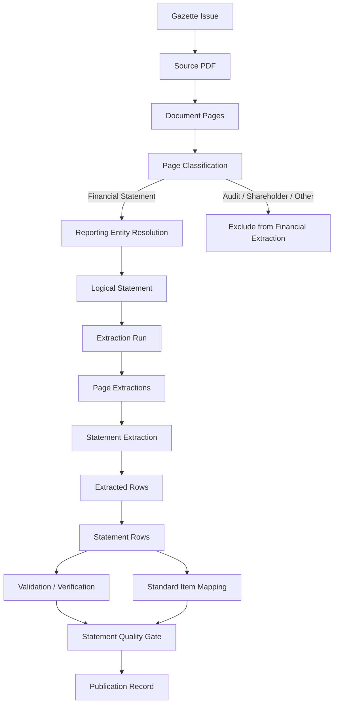
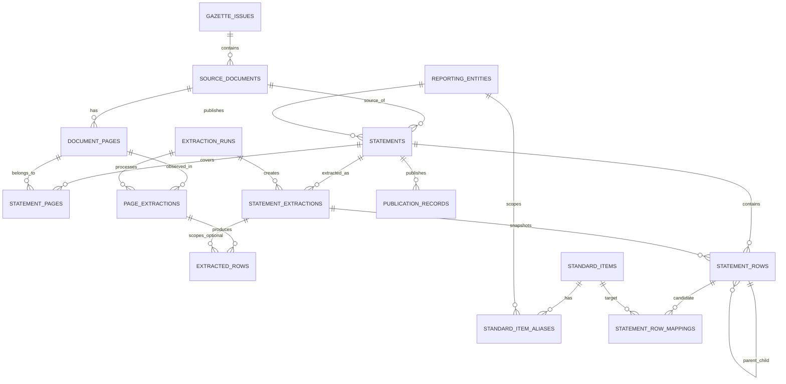

# Macau Banking Data Platform — Data Model v3 Implementation Specification

**文件狀態：** Implementation Specification Draft 1.2（DDL / Replay Hardening Patch）  
**設計基線：** v5 Frozen Baseline + SQL Audit（2026-11-19 audit; baseline artifact dated 2026-11-18）  
**目標資料庫：** `data/macau_balancete_v3.sqlite`  
**舊資料庫：** `data/baseline/baseline_v5_20261118.sqlite`（唯讀、永久保留）  
**主要範圍：** Summary Financial Statements published in Macau Gazette；不以 General Ledger / 詳細 Trial Balance 為資料模型前提。

---

## 0. 文件目的及使用方式

本文件將現有 v5 Schema、中文及葡文公報樣本，以及已完成的 v5 SQL Audit 結果，整理成可執行的 v3 Database 設計及 Controlled Rebuild 規格。

本文件涵蓋：

1. v3 的核心資料概念及不可違反的設計原則。
2. v3 Tables、欄位、主外鍵、Unique Constraints、Indexes 及資料狀態。
3. Bilingual Standard Item Catalogue 的重建及 Registry Reconciliation。
4. Page Classification、Entity Cleanup、Statement Identity 及 Re-OCR / Adoption。
5. Replay Importer、Legacy Crosswalk 及 Reconciliation 規格。
6. Phase-by-phase Refactoring Action Plan、測試及驗收條件。

**本文件不是直接執行的 Migration Script。** DDL 應按第 12 節的建立次序拆成 SQL migration files；執行前必須在新 v3 檔案及測試副本驗證。任何步驟均不得寫入 v5 baseline。

### 0.1 證據來源及限制

本規格採用 **2026-11-19** 在本 Repository 完成的 `audit_v5.py` 唯讀 Audit 作為 v5 baseline。Audit 報告記錄：原 DB 與 frozen baseline 的 SHA-256 均為：

```text
a08ca1e24a5ae7cbf50067093124e7d42e5b7a2cbef36d56c6f6424586c598b6
```

Audit 交付物包括 `SQL_AUDIT_V5.md/.json`、`artifact_manifest.json`、Registry / Mapping / Entity / Statement / Page / Amount CSV，以及 `BASELINE.md`。現有 test suite 已於本 Repository 執行：151 tests OK。正式 Build 前仍須按 `BASELINE.md` 重跑 Audit、Tests，並比較 hash、manifest 及輸出摘要。

本文件中的 Audit 數字是 **2026-11-19 project audit baseline**，不是永久常數。任何重跑結果不同，都必須輸出差異及調查原因，不得為符合本文數字而修改資料。

Frozen baseline copy `data/baseline/baseline_v5_20261118.sqlite` 是唯讀基線。原工作資料庫 `data/macau_balancete.sqlite` 在 Legacy Cutover 前仍可能由舊工具使用；v3 Audit / Replay 工具不得寫入原 DB 或 baseline。不得把「baseline copy 唯讀」誤解成「原 v5 工作 DB 已自動唯讀」。

---

## 1. 設計總結：v3 的核心決定

### 1.1 核心模型

v3 是一個 **Multi-bank Summary Financial Statement Database**，不是 General Ledger Database。

- `statement_rows`：公報中實際出現的一條報表行。
- `extracted_rows`：某一次 OCR / Extraction Run 對該行的原始觀察。
- `standard_items`：跨銀行、跨年份及跨語言共用的標準財務項目。
- `statement_row_mappings`：原始報表行對應標準項目的證據、建議及批准狀態。

原始報表階層與標準項目階層是兩套不同的 Hierarchy，不得混為一談。

### 1.2 鎖定的 v3 決策

| 範疇 | v3 決定 |
|---|---|
| 舊 DB | v5 freeze；只讀，不作 in-place migration |
| 新 DB | 建立 `macau_balancete_v3.sqlite` |
| 資料來源 | Replay 14 個現有 Runs 的完整原始 Outputs |
| Statement identity | Logical Statement 與 Extraction Run 分離 |
| Adoption | `statements.adopted_statement_extraction_id` 為唯一權威 |
| Statement rows | Append-only；重新採納新 Extraction 時新增新 Row Set，不覆寫舊 Rows |
| Page | `document_pages` 保存 PDF 物理頁及目前分類；`page_extractions` 保存每次 Run 的頁面觀察；`statement_pages` 保存 Logical Statement 與物理頁的關係 |
| OCR data | `extracted_rows` 保存原始 OCR / parser evidence |
| Financial data | `statement_rows` 保存某次已採納 Extraction 的結構化報表行 |
| Amount | `raw TEXT` + `minor INTEGER` + `value_state`；`currency`、`unit_scale` 及 decimal precision 在 Statement 層 |
| Standard Catalogue | 89 seed + 65 draft + 120 lexicon 先 Reconciliation，禁止直接 UNION |
| Mapping | 只保存有候選 Standard Item 的 Mapping rows；Legacy Mapping 初始為 `proposed`；衝突以候選群組表示，不以 `conflict` 充當單筆 Mapping 狀態 |
| Entity | 使用 `reporting_entities`；非實體 OCR Header 不得建立 Entity |
| Page classification | 必須先於正式 Entity / Statement Creation |
| Publication | Statement-level `publication_records`；DB trigger / partial unique index 保證 current publication 對應 adopted extraction |
| Cell table | MVP 不建立 `extracted_cells` |
| PostgreSQL | 暫不遷移；DDL 保持可移植性 |

### 1.3 明確不做的事情

- 不將系統設計成借貸分錄、總帳科目或交易流水資料庫。
- 不要求每間銀行使用相同原始科目樹。
- 不因為中文名稱及葡文名稱看似相近便自動批准配對。
- 不因 OCR confidence 高便視為數據已核實。
- 不把 `-`、空白或 unreadable 自動當成零。
- 不在第一版建立通用 EAV / `extracted_cells`。
- 不建立多個互相重複的 Adoption / Current Status 欄位。
- 不在 Registry 中建立核數師報告、股東名單、普通 Header OCR 垃圾作 Reporting Entity。

---

## 2. v5 Audit Baseline

### 2.1 Baseline Integrity

已完成的 Audit 結果：

```text
Original DB SHA-256:
a08ca1e24a5ae7cbf50067093124e7d42e5b7a2cbef36d56c6f6424586c598b6

Frozen baseline SHA-256:
a08ca1e24a5ae7cbf50067093124e7d42e5b7a2cbef36d56c6f6424586c598b6

Status: MATCH
```

Baseline path：

```text
data/baseline/baseline_v5_20261118.sqlite
```

唯讀 Audit 執行方式：

```bash
python3 tools/audit_v5.py \
  --db data/baseline/baseline_v5_20261118.sqlite \
  --out docs/audit
```

Audit script 使用 `mode=ro` 及 `PRAGMA query_only=ON`。現有 test suite：151 tests OK（已於本 Repository 執行）。

### 2.2 資料量及 Provenance

| 指標 | Audit 數值 |
|---|---:|
| Runs | 14 |
| Statements | 118 |
| Rows | 7,156 |
| Database size | 約 12 MB |
| PDF files | 14 / 14 存在 |
| Run output sets | 14 / 14 完整（`run_report.json`、`tb_rows.csv`、`documents.csv`） |
| PDF hash match | 14 / 14 |
| Provenance mismatch | 0 |
| Legacy `row_verification` | 0 rows |
| `name_mapping_audit` | 0 rows |
| `name_mapping_review` | 154 rows，全部 pending |
| Legacy published | 5 runs、38 statements，均來自 app 0.4.2 |
| Published verified rows | 0 |
| `needs_review` | 4,279 / 7,156（約 60%） |
| `auto_check_pass` | 2,877 |

**解讀：** 舊 Published 只代表舊版本曾經發布，不代表已符合 v3 的 verification / quality policy。v3 必須將 38 個舊 Published Statements 標示為 `legacy_published_unverified`，不得自動升格為 Verified 或正常 Published。

### 2.3 Standard Registry Inventory

| 來源 | Items | 中葡齊全 | 只有中文 | 只有葡文 | 使用 Rows |
|---|---:|---:|---:|---:|---:|
| `standard_labels` | 89 | 72 | 15 | 2 | 6,802 |
| `line_item_standard.csv` | 65 | 55 | 4 | 6 | 0（draft，未 apply） |
| `line_item_concepts` lexicon | 120 | 0 | 59 | 61 | 2,215 |
| `line_item_concepts` auto discovery | 96 | 0 | — | — | 0 |

其他重要結果：

- `standard_labels` 是 curated seed，不是最終 Catalogue。
- `line_item_standard.csv` 的 65 項是重要候選來源；其 55 個 exact bilingual candidates 仍不是自動批准的 merge。
- `line_item_concepts` 的 120 個 lexicon 項目均為單語，且有葡文資料被放在 `canonical_zh` 的 Schema Misuse；不得直接當成雙語 Catalogue。
- 96 個 `auto_discovery` 沒有被任何 Row 使用，應封存至 Exclusion Archive，不加入 Active Catalogue。
- `label_lexicon.csv` 是舊 `label_standard_id` 的來源，必須納入 Legacy Crosswalk，不能遺漏。

### 2.4 三方 Mapping Audit

| 指標 | 數量 |
|---|---:|
| Raw concept-vs-user name mismatch | 544 |
| Name-folding exact conflicts | 85 |
| Partial overlaps | 15 |
| Review rows after contextual grouping | 100 |

85 個 exact conflicts 的主要成因：

| 類型 | Rows |
|---|---:|
| `總額` vs `總計`（包括 `總額TOTAIS`） | 82 |
| `Outra Reserva` vs `其他儲備` | 3 |

15 個 partial overlaps 主要涉及葡文名稱 `Depósitos à ordem noutras instituições de crédito` 的 OCR truncation，例如缺少 `no Território` qualifier。

**v3 規則：** 文件不得將舊 302 或本次 100 寫成永久常數。每次 Audit / Reconciliation 必須按演算法重新計算。85、15、100 只作此 baseline 的結果。

### 2.5 Standard Item Reconciliation Baseline

370 rows = 89 + 65 + 120 + 96。

| 建議分類 | Rows |
|---|---:|
| `merge_candidate` | 112 |
| `needs_review` | 140 |
| `needs_review_unmatched` | 22 |
| `exclude_archive` | 96 |

65 Draft Items：

- 55 exact bilingual `merge_candidate`。
- 10 `needs_review`：6 個 pt-only、4 個 parent/child 或同名問題。

120 Lexicon Items：

- 114 個目前為 `needs_review`；當 89 + 65 的對應關係經批准後，部分可以 deterministic crosswalk。
- 其餘亦必須按實際語義及 Parent Context 審核。

**重要次序：先 Reconcile 89 + 65，再處理 120 lexicon。** 不得直接將三個 Registry UNION 成一份 Catalogue。

### 2.6 Mapping Conflict 的處理

- 85 exact conflicts 不等於 85 個不同財務概念；主要集中在兩組 Taxonomy Decisions。
- 15 partial overlap 必須區分 OCR truncation、Qualifier omission 及真正不同概念。
- 100 review rows 是此 Audit 使用的 review scope，不得直接當成永久全量衝突數。
- `總額` / `總計` 的 canonical 選擇，以及 `Outra Reserva` / `其他儲備` 的處理，由 Catalogue Owner 明確決定，不能由 Match Score 自動決定。

### 2.7 Entity / Statement / Page Cleanup

| 項目 | Audit 數值 |
|---|---:|
| Legacy bank records | 48 |
| Non-bank / junk records | 5（IDs 112–116） |
| OCR duplicate groups | 4 組 |
| Serious entity issues | 13 |
| Provisional identity | 40 |
| Statements | 118 |
| Serious statement issues | 16（5 junk + 11 duplicate entity） |
| Serious page issues | 5，均來自 Issue 17 非財務頁 |

四組實體變體：

- 11 / 49
- 22 / 58
- 33 / 91
- 36 / 69

IDs 113–116 是 OCR Header / 核數師報告 / 股東名單文字，不是 Reporting Entity。ID 112「南光石油化工」是公司而非銀行；除非未來明確擴展到非銀行發行人，否則不加入 Active Reporting Entity Registry，保留為排除決策及 Legacy Crosswalk。

**Page Classification 必須先於 Entity Resolution。** Issue 17 五個非財務頁面作為 Negative Test。

### 2.8 Amount Audit

| 項目 | 數量 |
|---|---:|
| Debit amount rows | 2,434 |
| Credit amount rows | 2,400 |
| Debit unparsed | 75 |
| Credit unparsed | 97 |
| Debit cents missing | 1 |
| Credit cents missing | 1 |
| Cents mismatch | 0 |
| Negative credit | 12 |
| Both debit + credit raw | 935 |
| Both debit + credit amount | 867 |
| Amount without label | 642 |

其他觀察：

- 40 個 `dot_comma` 及 70 個 `ambiguous` 全部集中在 Issue 17 五個非財務頁面。
- 真正銀行 Balance Sheet 頁面沒有 Audit 所報告的 number-format ambiguity。
- 12 個 negative credit 必須保留符號，不得自動取絕對值。
- 75 debit / 97 credit unparsed 不得當成零。
- 642 個 Amount without Label 必須保留原始證據並進入 Review；不可丟棄。

### 2.9 Audit 作為 v3 Gate

P0 的必要條件：重新執行 Audit 時，baseline SHA 必須一致，Artifact Manifest 所列檔案 Hash 必須匹配。任何差異先停止 Rebuild，確認來源版本後才繼續。

---

## 3. v3 資料流程



### 3.1 核心 ER Relationship Diagram



ERD 只顯示主要關係；Composite FK、nullable targets 及 Trigger Gate 以第 5、12 節為準。

### 3.2 各層責任

| Layer | 責任 | 不應負責 |
|---|---|---|
| Document | 公報、PDF、物理頁身份 | OCR Run 狀態 |
| Entity / Statement | 誰發布哪份報表、報表日期及類型 | OCR 原始字串 |
| Extraction | 每次 OCR 的觀察及證據 | 最終 Approved Mapping |
| Statement Rows | 某個 Extraction 的採納報表行 Snapshot | 跨銀行 Catalogue 定義 |
| Standard Catalogue | 標準中葡項目及其 Hierarchy | 原始銀行 Report Tree |
| Quality / Publish | Validation、Review、Publication History | 覆寫原始 OCR 證據 |

---

## 4. 核心資料模型及 Table Scope

v3 按資料責任分表，而不是按資料量限制表數。MVP 先建立資料來源、Statement、Extraction、Statement Rows 及 Catalogue 基礎；Workbench 的 Verification / Publish 表在相應階段啟用。MVP 不建立 `extracted_cells`、通用 EAV 或 polymorphic `target_type + target_id`。

### 4.1 Database Foundation（Replay 前建立）

1. `schema_meta`
2. `gazette_issues`
3. `source_documents`
4. `document_pages`
5. `statement_pages`
6. `reporting_entities`
7. `reporting_entity_aliases`
8. `statements`
9. `extraction_runs`
10. `page_extractions`
11. `statement_extractions`
12. `extracted_rows`
13. `statement_rows`
14. `standard_items`
15. `standard_item_aliases`
16. `statement_row_mappings`
17. `audit_events`（Foundation 建立；P4 Replay / Entity Merge / Statement Merge 需要寫入，不可等 Workbench 才建表）

### 4.2 Verification / Publish（Workbench Slice 開始時加入）

18. `field_verifications`
19. `validation_findings`
20. `review_tasks`
21. `publication_records`

上述是完整邏輯模型；不要求所有 21 張表在同一個 Sprint 完成。`schema_meta` 很小，應在首次建立 DB 時加入。`statement_pages` 是必要的正規化關聯，不以 `page_range_json` 取代。`audit_events` 必須跟 Foundation 一起建立，因為 P4 的 Replay / Merge 操作需要 Append-only Audit；Workbench 只增加操作 UI 及額外事件類型。

### 4.3 Migration Support（只供 Rebuild 使用）

- `legacy_id_crosswalk.csv`：外部 CSV，保存每個舊 ID 的 mapped / archived / excluded / not_recoverable 結果。
- `artifact_manifest.json`：外部 JSON，保存來源檔案 Hash。
- `standard_item_reconciliation.csv`：Audit 原始證據；不可直接當成人工決策結果。
- `STANDARD_ITEM_RECONCILIATION_DECISIONS.csv`：由 Audit 證據整理而成的 curated decision file，記錄 merge / keep / retire / needs_review 及批准者。
- `replay_reconciliation.csv`：保存舊資料到 v3 的逐項對帳。

MVP 不建立 `extracted_cells`、`validation_rules`、`analytics_categories`，亦不建立無明確關聯欄位的 polymorphic table。

---

## 5. Table Specifications

> 欄位契約是 v3 DDL 的依據。所有 FK 預設 `ON DELETE RESTRICT`；歷史資料不得因刪除父記錄而被 Cascade Delete。除明確列出的必要欄位外，不應加入第二套 Adoption、Current、Mapping 或 Verification 權威。

### 5.0 `schema_meta`

**責任：** 記錄 DB Schema、應用版本及 Rebuild provenance；不保存業務資料。

| Field | Type | Null | Rule |
|---|---|---:|---|
| `key` | TEXT | No | PK |
| `value` | TEXT | No | Metadata value |
| `updated_at` | TEXT | No | ISO timestamp |

至少保存 `schema_version`、`app_version`、`id_generation_version`、`baseline_sha256`、`artifact_manifest_sha256`、`last_successful_replay_at`。Schema Upgrade 必須更新 `schema_version`。

### 5.1 `gazette_issues`

**責任：** 一期澳門政府公報的來源身份。

| Field | Type | Null | Rule |
|---|---|---:|---|
| `gazette_issue_id` | TEXT | No | PK，穩定 ID |
| `issue_key` | TEXT | No | UNIQUE，例如官方 Issue Number |
| `publication_date` | TEXT | Yes | ISO `YYYY-MM-DD` |
| `source_url` | TEXT | Yes | 官方來源 URL |
| `discovered_at` | TEXT | No | ISO timestamp |
| `notes` | TEXT | Yes | 來源說明 |

Indexes：`UNIQUE(issue_key)`、`publication_date`。

### 5.2 `source_documents`

**責任：** PDF 的物理文件身份及內容完整性。

| Field | Type | Null | Rule |
|---|---|---:|---|
| `source_document_id` | TEXT | No | PK |
| `gazette_issue_id` | TEXT | Yes | FK → `gazette_issues` |
| `document_key` | TEXT | No | UNIQUE，穩定機器鍵 |
| `source_url` | TEXT | Yes | 官方 URL |
| `original_filename` | TEXT | Yes | 原檔名 |
| `storage_uri` | TEXT | No | 原始 PDF 儲存位置 |
| `sha256` | TEXT | No | 64 位 lowercase hex；建立 Index，不預設全域 UNIQUE |
| `page_count` | INTEGER | Yes | 大於 0 |
| `acquired_at` | TEXT | No | ISO timestamp |
| `mime_type` | TEXT | Yes | 通常為 application/pdf |

同一 PDF 內容可能在不同 URL / Issue 被引用；Hash 用於內容驗證，不單獨取代 Document Identity。

### 5.3 `document_pages`

**責任：** PDF 中的物理頁身份及目前採納的 Page Classification。OCR Run 的狀態不得放在此表。

| Field | Type | Null | Rule |
|---|---|---:|---|
| `document_page_id` | TEXT | No | PK；按 Document + PDF page deterministic generation |
| `source_document_id` | TEXT | No | FK → `source_documents` |
| `pdf_page` | INTEGER | No | 固定使用 1-based |
| `printed_page` | TEXT | Yes | 公報印刷頁碼 |
| `page_role` | TEXT | No | financial_statement / audit_report / shareholder_list / cover / contents / other / unknown |
| `classification_status` | TEXT | No | proposed / approved / rejected |
| `classification_source` | TEXT | No | automatic / human / imported |
| `classified_by` | TEXT | Yes | User / system identity |
| `classified_at` | TEXT | Yes | ISO timestamp |
| `classification_version` | TEXT | Yes | 分類規則版本 |
| `notes` | TEXT | Yes | 補充 |

Constraints：`UNIQUE(source_document_id, pdf_page)`；另建立 `UNIQUE(document_page_id, source_document_id)` 供 Composite FK。

Classification Policy：

- 自動分類只產生 proposed。
- `financial_statement` 經確認後才進行 Statement Segmentation / Entity Resolution。
- `audit_report`、`shareholder_list`、`other` 不產生金融 Statement，但 OCR evidence 仍可保留於 `page_extractions` / `extracted_rows`。
- `unknown` 不得靜默當成 Financial Statement。
- Page Classification 修訂必須產生 `audit_events`，不得只覆蓋而無歷史。

### 5.4 `statement_pages`

**責任：** 明確保存 Logical Statement 與 PDF 物理頁的關係；是 Page Coverage / Statement Segmentation 的權威資料來源。

| Field | Type | Null | Rule |
|---|---|---:|---|
| `statement_id` | TEXT | No | FK → `statements` |
| `source_document_id` | TEXT | No | 用於確保 Statement 與 Page 屬於同一 PDF |
| `document_page_id` | TEXT | No | FK → `document_pages` |
| `page_order` | INTEGER | No | Statement 內頁次序，從 1 開始 |
| `is_primary` | INTEGER | No | 0 / 1；每個 Statement 最多一個 primary page |
| `created_at` | TEXT | No | ISO timestamp |

Constraints：

- `PRIMARY KEY(statement_id, document_page_id)`。
- `UNIQUE(statement_id, page_order)`。
- `FOREIGN KEY(statement_id, source_document_id)` → `statements(statement_id, source_document_id)`。
- `FOREIGN KEY(document_page_id, source_document_id)` → `document_pages(document_page_id, source_document_id)`。
- Partial Unique Index：每個 Statement 最多一個 `is_primary = 1`。

`statement_extractions.page_range_json` 可以保留作 convenience cache，但不能取代本表。MVP 假設一份 Logical Statement 來自一個 Source PDF；多 PDF 拼接留待有實際用例才擴展。

### 5.5 `reporting_entities`

**責任：** 代表實際發布目標財務報表的銀行／分行／銀行集團等實體，不是所有 OCR Header 字串。

| Field | Type | Null | Rule |
|---|---|---:|---|
| `entity_id` | TEXT | No | PK |
| `entity_key` | TEXT | No | UNIQUE、穩定機器鍵 |
| `entity_type` | TEXT | No | bank / branch / banking_group / non_bank |
| `canonical_zh` | TEXT | Yes | 標準中文名稱 |
| `canonical_pt` | TEXT | Yes | 標準葡文名稱 |
| `canonical_en` | TEXT | Yes | 可選英文名稱 |
| `parent_entity_id` | TEXT | Yes | FK → `reporting_entities` |
| `registry_status` | TEXT | No | proposed / approved / excluded / merged / retired |
| `merged_into_entity_id` | TEXT | Yes | FK → `reporting_entities`；合併後指向 surviving Entity |
| `merged_at` | TEXT | Yes | 合併時間 |
| `notes` | TEXT | Yes | 補充 |
| `created_at` | TEXT | No | ISO timestamp |

MVP Active Registry 只收錄經確認會發布目標財務報表的 Entity。非銀行公司如未在產品範圍內，不加入 Active Registry；OCR junk header 永不建立 Entity。Merge 不刪除舊 Entity；舊 ID 仍可追溯至 surviving Entity。DDL 加 `CHECK(merged_into_entity_id IS NULL OR merged_into_entity_id <> entity_id)`；Runtime 禁止 Merge Cycle，Merge 操作必須寫入 `audit_events`。

### 5.6 `reporting_entity_aliases`

| Field | Type | Null | Rule |
|---|---|---:|---|
| `entity_alias_id` | TEXT | No | PK |
| `entity_id` | TEXT | No | FK → `reporting_entities` |
| `raw_name` | TEXT | No | 原始名稱 |
| `normalized_name` | TEXT | No | 正規化名稱 |
| `language` | TEXT | No | zh-Hant / pt / en / unknown；NOT NULL DEFAULT unknown |
| `alias_type` | TEXT | No | official / historical / ocr_variant / abbreviation / branch / other |
| `status` | TEXT | No | proposed / approved / rejected / retired |
| `source_reference` | TEXT | Yes | 文件、Run 或 Legacy ID |
| `notes` | TEXT | Yes | 補充 |

Unique：採用 `UNIQUE(entity_id, normalized_name, language)`。`language` 不可 NULL，避免 SQLite UNIQUE + NULL 可重複插入的陷阱。不得設全域 `UNIQUE(normalized_name, language)`。

### 5.7 `statements`

**責任：** 一份邏輯上的金融報表。與 OCR Run 分離；MVP 一份 Statement 屬於一份 Source PDF。

| Field | Type | Null | Rule |
|---|---|---:|---|
| `statement_id` | TEXT | No | PK |
| `source_document_id` | TEXT | No | FK → `source_documents`；MVP 一份 Statement 一個 Source PDF |
| `reporting_entity_id` | TEXT | No | FK → `reporting_entities` |
| `entity_alias_id` | TEXT | Yes | FK → `reporting_entity_aliases` |
| `entity_name_raw` | TEXT | Yes | 公報原始 Entity Name |
| `entity_match_method` | TEXT | Yes | exact_alias / contextual / manual / legacy_import / unknown |
| `entity_match_score` | REAL | Yes | 0–1；只代表建議分數 |
| `gazette_issue_id` | TEXT | Yes | FK → `gazette_issues` |
| `publication_date` | TEXT | Yes | ISO date；即使 Issue FK 缺失亦可保留 |
| `publication_date_source` | TEXT | Yes | issue_metadata / pdf / manual / legacy_import / unknown |
| `statement_date` | TEXT | Yes | ISO date；未確認可 NULL |
| `statement_date_source` | TEXT | Yes | pdf_header / documents_csv / manual / legacy_import / unknown |
| `statement_type` | TEXT | No | balance_sheet / income_statement / cash_flow / other_financial_statement / unknown |
| `statement_type_source` | TEXT | Yes | page_classification / pdf_header / manual / legacy_import / unknown |
| `reporting_scope` | TEXT | No | bank / branch / group / other / unknown |
| `currency` | TEXT | Yes | ISO currency code；未知不得猜測 |
| `currency_source` | TEXT | Yes | explicit_document / manual / legacy_import / unknown |
| `unit_scale` | INTEGER | Yes | 1 / 1000 / 1000000；未知可 NULL |
| `unit_scale_source` | TEXT | Yes | explicit_document / manual / legacy_import / unknown |
| `amount_decimal_places` | INTEGER | Yes | 顯示金額精度 0–6；未知可 NULL |
| `identity_key` | TEXT | No | 正規化候選身份鍵；初期 NON-UNIQUE |
| `identity_status` | TEXT | No | proposed / confirmed / needs_review |
| `metadata_status` | TEXT | No | proposed / confirmed / needs_review |
| `statement_status` | TEXT | No | proposed / active / excluded / merged / retired |
| `merged_into_statement_id` | TEXT | Yes | FK → `statements`；合併後指向 surviving Statement |
| `supersedes_statement_id` | TEXT | Yes | FK → `statements`；代表正式重發／替代關係，不等同 OCR reprocessing |
| `adopted_statement_extraction_id` | TEXT | Yes | 唯一 Adoption 權威；Composite FK 見 5.9 |
| `created_at` | TEXT | No | ISO timestamp |
| `notes` | TEXT | Yes | 補充 |

Constraints：`UNIQUE(statement_id, source_document_id)` 供 Statement Page composite FK；`CHECK(merged_into_statement_id IS NULL OR merged_into_statement_id <> statement_id)`。`identity_key` 初期只建 Index，不立即 UNIQUE。Merge Cycle 必須由 Application / Integrity Test 拒絕。`publication_date_source`、`statement_date_source` 等 Source 欄位即使日期目前 NULL 亦保留來源狀態。

Identity Rule：以 Entity + Statement Date + Statement Type + Reporting Scope 作候選；同日不同報表類型、分行／集團、重發文件及缺日期必須經 Identity Test Set 確認。`gazette_issue_id` 可 NULL，但 `publication_date` 的原始來源必須保留。

Currency Rule：`currency` 是報表金額計價貨幣；行內 `PATACAS` / `MOEDAS EXTERNAS` 是科目分類，不可直接當成 Statement Currency。

### 5.8 `extraction_runs`

**責任：** 一次針對 Source PDF 的完整處理執行。

| Field | Type | Null | Rule |
|---|---|---:|---|
| `run_id` | TEXT | No | PK；Legacy Run ID 可經 Crosswalk 保留 |
| `source_document_id` | TEXT | No | FK → `source_documents` |
| `app_version` | TEXT | Yes | Application version |
| `ocr_engine_versions` | TEXT | Yes | JSON text，記錄 Vision / Paddle 等版本 |
| `config_json` | TEXT | Yes | JSON config snapshot |
| `started_at` | TEXT | Yes | ISO timestamp |
| `completed_at` | TEXT | Yes | ISO timestamp |
| `run_status` | TEXT | No | queued / running / completed / failed / partial |
| `run_report_uri` | TEXT | Yes | 原始 Report 路徑 |

Constraints：`UNIQUE(run_id, source_document_id)`，供下游 Composite FK 確保 Run 與 Page / Statement Extraction 使用同一 PDF。

MVP 一個 Run 對應一份 Source Document。若未來一個 Run 處理多份 PDF，再擴展 Run-Document relation。

### 5.9 `statement_extractions`

**責任：** 某一個 Run 對某一份 Logical Statement 的抽取結果。

| Field | Type | Null | Rule |
|---|---|---:|---|
| `statement_extraction_id` | TEXT | No | PK |
| `statement_id` | TEXT | No | FK → `statements` |
| `run_id` | TEXT | No | FK → `extraction_runs` |
| `source_document_id` | TEXT | No | 同一 Statement / Run 的 Source PDF |
| `extraction_status` | TEXT | No | proposed / completed / failed / rejected |
| `page_range_json` | TEXT | Yes | Convenience cache；頁面權威關係由 `statement_pages` 保存 |
| `created_at` | TEXT | No | ISO timestamp |
| `notes` | TEXT | Yes | 補充 |

Constraints：

- `UNIQUE(statement_extraction_id, statement_id)`。
- `UNIQUE(statement_extraction_id, run_id)`。
- `UNIQUE(statement_extraction_id, statement_id, run_id)`，供 `extracted_rows` Composite FK。
- `UNIQUE(statement_extraction_id, statement_id, run_id, source_document_id)`，供 Source Document provenance FK。
- `UNIQUE(statement_id, run_id)`：MVP 同一 Run 對同一 Statement 最多一個 Extraction。
- Composite FK `(statement_id, source_document_id)` → `statements(statement_id, source_document_id)`。
- Composite FK `(run_id, source_document_id)` → `extraction_runs(run_id, source_document_id)`。

以上確保同一 Statement Extraction 的 Statement 與 Run 來自同一 PDF。

唯一 Adoption 權威為 `statements.adopted_statement_extraction_id`；本表不得另設 `is_adopted` / `is_current`。

### 5.10 `page_extractions`

**責任：** 某次 Run 對一個 PDF 物理頁的 OCR / Parser 觀察。物理頁身份仍在 `document_pages`。

| Field | Type | Null | Rule |
|---|---|---:|---|
| `page_extraction_id` | TEXT | No | PK |
| `run_id` | TEXT | No | FK → `extraction_runs` |
| `document_page_id` | TEXT | No | FK → `document_pages` |
| `source_document_id` | TEXT | No | 確保 Page Extraction 與 Run / Page 同屬一份 PDF |
| `ocr_status` | TEXT | No | pending / completed / failed / skipped |
| `ocr_languages_json` | TEXT | Yes | JSON text |
| `image_path` | TEXT | Yes | Rendered image artifact |
| `image_width` | INTEGER | Yes | Pixels |
| `image_height` | INTEGER | Yes | Pixels |
| `number_format_detected` | TEXT | Yes | 本次 Run 對該頁的偵測 |
| `number_format_confidence` | REAL | Yes | 0–1 |
| `page_result_uri` | TEXT | Yes | OCR page result JSON |
| `created_at` | TEXT | No | ISO timestamp |

Constraints：`UNIQUE(run_id, document_page_id)`；另設 `UNIQUE(page_extraction_id, document_page_id, run_id)` 作為 `extracted_rows` 的 Composite FK Parent Key。Composite FK `(run_id, source_document_id)` → `extraction_runs` 及 `(document_page_id, source_document_id)` → `document_pages`，確保 Run 與物理頁同屬一份 PDF。毋須為 `page_extraction_id` 再建立其他重複 Unique Key。重新 OCR 只增加 Page Extraction，不建立新 Document Page。

### 5.11 `extracted_rows`

**責任：** 單次 Page Extraction 的原始 Row Observations。所有 OCR Rows（包括來自非財務頁的 Rows）均可保存；是否屬於金融 Statement 由 `row_disposition` 表示。

| Field | Type | Null | Rule |
|---|---|---:|---|
| `extracted_row_id` | TEXT | No | PK |
| `page_extraction_id` | TEXT | No | FK → `page_extractions` |
| `document_page_id` | TEXT | No | 與 Page Extraction 同一物理頁 |
| `run_id` | TEXT | No | 與 Page Extraction 同一 Run |
| `row_disposition` | TEXT | No | included / excluded_page_role / unassigned |
| `statement_id` | TEXT | Yes | included 時必填；FK / Composite FK → `statements` / `statement_pages` |
| `statement_extraction_id` | TEXT | Yes | included 時必填；FK → `statement_extractions` |
| `page_row_order` | INTEGER | No | 頁面內次序 |
| `statement_order` | INTEGER | Yes | 報表內全局次序；不能可靠重建可 NULL |
| `label_raw` | TEXT | Yes | OCR 原始文字；允許 NULL 以保留 amount-only row |
| `label_normalized` | TEXT | Yes | OCR 後處理文字，不代表 Standard Item |
| `label_language` | TEXT | No | zh-Hant / pt / en / unknown |
| `debit_raw` | TEXT | Yes | OCR 原始借方文字 |
| `credit_raw` | TEXT | Yes | OCR 原始貸方文字 |
| `debit_parsed_minor` | INTEGER | Yes | Parser 候選值，不代表 Verified |
| `credit_parsed_minor` | INTEGER | Yes | Parser 候選值，不代表 Verified |
| `debit_value_state` | TEXT | No | amount / dash / blank / unreadable / not_applicable / ambiguous |
| `credit_value_state` | TEXT | No | 同上 |
| `row_type_proposed` | TEXT | No | heading / item / subtotal / total / continuation / note / header / unknown |
| `parent_extracted_row_id` | TEXT | Yes | 可重建時的 Parent Evidence；只限同一 Page Extraction |
| `parent_context_status` | TEXT | No | root / identified / unknown / not_applicable |
| `indent_level` | INTEGER | Yes | 偵測縮排 |
| `row_band_y0` / `row_band_y1` | REAL | Yes | Row band 座標 |
| `label_bbox_x0` / `label_bbox_y0` / `label_bbox_x1` / `label_bbox_y1` | REAL | Yes | Label bounding box |
| `debit_bbox_x0` / `debit_bbox_y0` / `debit_bbox_x1` / `debit_bbox_y1` | REAL | Yes | Debit bounding box |
| `credit_bbox_x0` / `credit_bbox_y0` / `credit_bbox_x1` / `credit_bbox_y1` | REAL | Yes | Credit bounding box |
| `row_confidence` | REAL | Yes | 0–1 |
| `row_payload_json` | TEXT | Yes | 非核心附加 evidence |
| `created_at` | TEXT | No | ISO timestamp |

Constraints：

- `UNIQUE(page_extraction_id, page_row_order)`。
- `UNIQUE(extracted_row_id, statement_extraction_id)` 供下游 Composite FK；對 `statement_extraction_id IS NULL` 的 Rows，另以 `UNIQUE(extracted_row_id, page_extraction_id)` 保持來源一致。
- Composite FK `(page_extraction_id, document_page_id, run_id)` → `page_extractions(page_extraction_id, document_page_id, run_id)`。
- Composite FK `(statement_extraction_id, statement_id, run_id)` → `statement_extractions(statement_extraction_id, statement_id, run_id)`；三欄 NULL 時代表未分配至金融 Statement。
- Composite FK `(statement_id, document_page_id)` → `statement_pages(statement_id, document_page_id)`，確保 Included Row 所在 PDF Page 確實屬於該 Logical Statement。
- `row_disposition='included'` 時 `statement_id` 及 `statement_extraction_id` 必須非 NULL。
- `row_disposition IN ('excluded_page_role','unassigned')` 時兩者必須 NULL。
- 非財務頁 OCR Rows 保留於此表，毋須建立假 Statement Extraction。

Parent Extracted Row 只在同一 Page Extraction 內可靠重建時填寫；以 `UNIQUE(extracted_row_id, page_extraction_id)` 及 Composite Self-FK `(parent_extracted_row_id, page_extraction_id)` 限定同頁。跨頁的報表 Parent / Child 關係只在 `statement_rows` 層重建。非財務／unassigned 頁的階層 evidence 可留在 `row_payload_json`。

座標必須使用 `page_extractions` 記錄的 rendered-image pixel coordinate system，並保存 Image Width / Height；不同 OCR Engine 不可混用 normalized 與 pixel 座標。

MVP 不建立 `extracted_cells`。

### 5.12 `statement_rows`

**責任：** 某個 Statement Extraction 被採納候選後形成的報表行 Snapshot。每個 Extraction 有獨立 Row Set；Rows 不覆寫。

| Field | Type | Null | Rule |
|---|---|---:|---|
| `statement_row_id` | TEXT | No | PK |
| `statement_id` | TEXT | No | FK → `statements` |
| `statement_extraction_id` | TEXT | No | FK → `statement_extractions` |
| `extracted_row_id` | TEXT | No | FK → `extracted_rows`；MVP 每條正式 Row 必須來自 OCR Row |
| `parent_row_id` | TEXT | Yes | 同一 Statement + Extraction 的 Parent FK |
| `statement_order` | INTEGER | Yes | 報表內排序 |
| `row_type` | TEXT | No | heading / item / subtotal / total / continuation / note / header / unknown |
| `parent_context_status` | TEXT | No | root / identified / unknown / not_applicable |
| `label_normalized` | TEXT | Yes | normalized label；原始文字由 Extracted Row 保留 |
| `label_language` | TEXT | No | zh-Hant / pt / en / unknown |
| `debit_minor` | INTEGER | Yes | 採納的解析金額 |
| `debit_value_state` | TEXT | No | amount / dash / blank / unreadable / not_applicable / ambiguous |
| `credit_minor` | INTEGER | Yes | 採納的解析金額 |
| `credit_value_state` | TEXT | No | 同上 |
| `row_fingerprint` | TEXT | No | Versioned SHA-256 matching fingerprint；非 PK、非 Unique |
| `fingerprint_version` | INTEGER | No | Fingerprint algorithm version |
| `carry_forward_status` | TEXT | No | none / exact_match_candidate / changed / ambiguous |
| `carried_from_statement_row_id` | TEXT | Yes | FK → 舊 Statement Row；僅作 carry-forward provenance |
| `created_at` | TEXT | No | ISO timestamp |

Constraints：

- `UNIQUE(statement_extraction_id, extracted_row_id)`，避免同一 Extracted Row 被複製兩次。
- `UNIQUE(statement_row_id, statement_id, statement_extraction_id)`，供 Parent Composite FK。
- Composite FK `(statement_extraction_id, statement_id)` → `statement_extractions(statement_extraction_id, statement_id)`。
- Composite FK `(extracted_row_id, statement_extraction_id)` → `extracted_rows(extracted_row_id, statement_extraction_id)`；僅 included extracted rows 可建立 Statement Row。
- Parent Composite FK `(parent_row_id, statement_id, statement_extraction_id)` → 本表 `(statement_row_id, statement_id, statement_extraction_id)`。
- `row_fingerprint` 建 Index，但不得設 Unique；完全相同的重複列可能合法存在。

**Append-only / Current Set：** Current Rows 由 `statements.adopted_statement_extraction_id` 決定；禁止 UPDATE / DELETE `statement_rows`。修正走 `field_verifications` 或新 Extraction，不改寫 Snapshot。

**Manual Row Policy：** MVP 不支援在 Workbench 直接新增沒有 OCR Evidence 的 Statement Row。若 OCR 漏行，第一版建立 Review Task 並要求重新 Extraction / 修正 OCR Input；後續如有需要，才加入 `row_origin='manual'`、nullable `extracted_row_id` 及獨立 Manual Evidence。不得偷偷以空白 Extracted Row 模擬人工新增。

### 5.13 `standard_items`

**責任：** 唯一正式 Bilingual Standard Item Catalogue。

| Field | Type | Null | Rule |
|---|---|---:|---|
| `standard_item_id` | TEXT | No | PK，Item 身份穩定 |
| `item_key` | TEXT | No | UNIQUE，穩定機器鍵 |
| `canonical_zh` | TEXT | Yes | 標準中文名稱 |
| `canonical_zh_status` | TEXT | No | missing / draft / approved / rejected |
| `canonical_pt` | TEXT | Yes | 標準葡文名稱 |
| `canonical_pt_status` | TEXT | No | missing / draft / approved / rejected |
| `canonical_en` | TEXT | Yes | 可選英文名稱 |
| `canonical_en_status` | TEXT | No | missing / draft / approved / rejected |
| `parent_standard_item_id` | TEXT | Yes | FK → `standard_items` |
| `category` | TEXT | Yes | 財務分類 |
| `item_status` | TEXT | No | draft / approved / merged / retired |
| `merged_into_standard_item_id` | TEXT | Yes | FK → `standard_items`；合併至 surviving Item |
| `created_at` | TEXT | No | ISO timestamp |
| `notes` | TEXT | Yes | 語義及治理說明 |

Language Status Rule：名稱為 NULL 時對應 status 必須為 `missing`；名稱非 NULL 時 status 不可為 `missing`。`item_status='approved'` 不代表每個語言名稱均已批准，必須另外檢查 zh / pt / en status。中葡名稱是同一 Standard Item 的不同語言，不是兩個 Item。DDL 加 `CHECK(merged_into_standard_item_id IS NULL OR merged_into_standard_item_id <> standard_item_id)`；Runtime 禁止 Merge Cycle，Merge 必須寫 Audit Event。

### 5.14 `standard_item_aliases`

| Field | Type | Null | Rule |
|---|---|---:|---|
| `standard_item_alias_id` | TEXT | No | PK |
| `standard_item_id` | TEXT | No | FK → `standard_items` |
| `scope_entity_id` | TEXT | Yes | FK → `reporting_entities`；NULL = global alias，非 NULL = bank/entity-specific |
| `raw_name` | TEXT | No | 原始名稱 |
| `normalized_name` | TEXT | No | 正規化名稱 |
| `language` | TEXT | No | zh-Hant / pt / en / unknown；NOT NULL DEFAULT unknown |
| `alias_type` | TEXT | No | bank_label / historical / abbreviation / ocr_variant / translation / other |
| `source_registry` | TEXT | Yes | standard_labels / line_item_standard / line_item_concepts / label_lexicon / manual |
| `source_legacy_id` | TEXT | Yes | 原始 Registry ID |
| `alias_status` | TEXT | No | proposed / approved / rejected / retired |
| `notes` | TEXT | Yes | 補充 |

Indexes：

- Global Alias：`UNIQUE(standard_item_id, normalized_name, language) WHERE scope_entity_id IS NULL`。
- Entity-scoped Alias：`UNIQUE(standard_item_id, scope_entity_id, normalized_name, language) WHERE scope_entity_id IS NOT NULL`。
- Alias Matching 優先使用 Entity-scoped Alias，其次才使用 Global Alias。

### 5.15 `statement_row_mappings`

**責任：** 保存一條 Statement Row 對一個候選 Standard Item 的 Mapping Evidence / Decision。

| Field | Type | Null | Rule |
|---|---|---:|---|
| `mapping_id` | TEXT | No | PK |
| `statement_row_id` | TEXT | No | FK → `statement_rows` |
| `standard_item_id` | TEXT | No | FK → `standard_items`；每筆 Mapping 必須代表一個候選 Item |
| `conflict_group_id` | TEXT | Yes | 多個候選屬於同一未解決衝突時共用 Group ID |
| `mapping_status` | TEXT | No | proposed / approved / rejected / superseded；不設單筆 `conflict` 狀態 |
| `match_method` | TEXT | Yes | parent_exact / child_path_exact / bilingual_exact / alias_exact / fuzzy / manual / legacy_import |
| `match_score` | REAL | Yes | 0–1；只代表演算法分數 |
| `mapping_version` | TEXT | Yes | Mapping rules version |
| `evidence_source` | TEXT | Yes | legacy_user_standard / label_lexicon / concept_lexicon / draft_catalogue / manual |
| `context_json` | TEXT | Yes | Parent Context、候選來源等補充證據 |
| `carried_from_mapping_id` | TEXT | Yes | FK → 本表；Re-OCR exact carry-forward 的來源 Mapping |
| `reviewed_by` | TEXT | Yes | 只有人工批准／拒絕後填寫 |
| `reviewed_at` | TEXT | Yes | 人工決策時間 |
| `created_at` | TEXT | No | ISO timestamp |
| `notes` | TEXT | Yes | 補充 |

Mapping Rules：

- 每筆 Mapping row 必須指向一個候選 Standard Item，因此 `standard_item_id` NOT NULL。
- Unmapped Row 不建立空白 Mapping row；只保留 Statement Row，並建立指向該 Row 的 Review Task。
- 多個 Proposed Candidates 指向同一 Row 時，共用 `conflict_group_id`；衝突是候選群組狀態，不是單筆 Mapping 狀態。
- 同一 Row 最多一個 Approved Mapping（Partial Unique Index）。
- Legacy Mapping 全部先為 Proposed；有互相矛盾候選時建立同一 `conflict_group_id`，並建立一個 Grouped Review Task。
- Parent Context 未知的同名 Child 不可自動批准。
- `match_score` 永遠不觸發 Approved。
- 新 Extraction 的 carry-forward Mapping 必須複製為 Proposed，並填 `carried_from_mapping_id`；不得沿用舊 Approved 狀態。

### 5.16 `field_verifications`（Workbench Stage）

**責任：** 對 Statement Row 特定欄位作人工核實或修正；不覆寫 Statement Row Snapshot。

| Field | Type | Null | Rule |
|---|---|---:|---|
| `field_verification_id` | TEXT | No | PK |
| `statement_row_id` | TEXT | No | FK → `statement_rows` |
| `field_name` | TEXT | No | label_normalized / debit_minor / debit_value_state / credit_minor / credit_value_state / row_type / parent_row_id |
| `original_value_text` | TEXT | Yes | Base Snapshot 值 |
| `verified_value_text` | TEXT | Yes | 人工核實值；依 field_name 解析 |
| `verification_status` | TEXT | No | pending / verified / rejected / waived |
| `carried_from_verification_id` | TEXT | Yes | FK → 本表；Re-OCR exact carry-forward 的來源 |
| `verified_by` | TEXT | Yes | User ID |
| `verified_at` | TEXT | Yes | ISO timestamp |
| `reason` | TEXT | Yes | 修正或核實原因 |
| `created_at` | TEXT | No | ISO timestamp |

MVP 每個 Row + Field 只保留一筆目前有效核實結果，`UNIQUE(statement_row_id, field_name)`。Re-OCR carry-forward 只建立 `pending` 候選紀錄，並填 `carried_from_verification_id`；不得複製成 `verified`。每次狀態／值改動寫入 `audit_events`。Effective Value View 只採用 `verification_status='verified'` 的值。

### 5.17 `validation_findings`（Workbench Stage）

**責任：** 保存可附著在 Statement、Row、Page、Entity 或 Standard Item 的品質問題。未建立 Statement 前亦可記錄 Page / Entity / Catalogue Findings。

| Field | Type | Null | Rule |
|---|---|---:|---|
| `finding_id` | TEXT | No | PK |
| `statement_id` | TEXT | Yes | FK → `statements`；Statement-level target |
| `statement_row_id` | TEXT | Yes | FK → `statement_rows` |
| `document_page_id` | TEXT | Yes | FK → `document_pages` |
| `entity_id` | TEXT | Yes | FK → `reporting_entities` |
| `standard_item_id` | TEXT | Yes | FK → `standard_items` |
| `rule_key` | TEXT | No | 穩定 Validation Rule Key |
| `severity` | TEXT | No | info / warning / error / critical |
| `finding_status` | TEXT | No | open / acknowledged / resolved / waived |
| `details_json` | TEXT | Yes | Rule output、evidence |
| `created_at` | TEXT | No | ISO timestamp |
| `resolved_at` | TEXT | Yes | ISO timestamp |

Constraint：上述五個 target 欄位必須剛好一個非 NULL。Row-level finding 不必重複填 Statement ID；需要 Statement Scope 時可由 Row 關係取得。Page / Entity / Standard Item Findings 可在 Statement 尚未建立前存在。

### 5.18 `review_tasks`（Workbench Stage）

**責任：** 將人工決策組織成可分派及可追蹤的任務。Task 可以是單筆，也可以按 Root Cause 分組；不要求每個受影響 Row 建立重複 Task。

| Field | Type | Null | Rule |
|---|---|---:|---|
| `review_task_id` | TEXT | No | PK |
| `scope_statement_id` | TEXT | Yes | 可選 Statement Scope；不一定是 Task Target |
| `target_statement_id` | TEXT | Yes | Statement-level target |
| `statement_row_id` | TEXT | Yes | Row target |
| `finding_id` | TEXT | Yes | Finding target |
| `mapping_id` | TEXT | Yes | Mapping candidate target |
| `document_page_id` | TEXT | Yes | Page target |
| `entity_id` | TEXT | Yes | Entity target |
| `standard_item_id` | TEXT | Yes | Catalogue target |
| `root_cause_key` | TEXT | Yes | Root-cause grouped task key，例如 `canonical_total_label_decision` |
| `group_key` | TEXT | Yes | 穩定批次鍵 |
| `criteria_json` | TEXT | Yes | 受影響資料的可重算條件；不得只放無法追溯的自由文字 |
| `affected_count` | INTEGER | Yes | 建立／更新時的 affected count snapshot |
| `task_type` | TEXT | No | amount_review / label_review / mapping_review / parent_context_review / page_classification / identity_review / catalogue_decision / other |
| `priority` | TEXT | No | critical / high / normal / low |
| `task_status` | TEXT | No | open / in_progress / resolved / waived |
| `assigned_to` | TEXT | Yes | User ID |
| `created_at` | TEXT | No | ISO timestamp |
| `resolved_at` | TEXT | Yes | ISO timestamp |

Constraint：`target_statement_id`、`statement_row_id`、`finding_id`、`mapping_id`、`document_page_id`、`entity_id`、`standard_item_id`、`root_cause_key` 八個 Target 欄位必須剛好一個非 NULL；Grouped Root-Cause Task 使用 `root_cause_key` 作唯一 target，並以 `criteria_json` 定義受影響 cohort。`scope_statement_id` 不計入 Target 數量。DDL 以 CASE expression 計算非 NULL targets 的總數必須等於 1。此設計支援未有 Statement 的 Page / Entity / Catalogue Review。

Review Queue 必須按 Root Cause / `group_key` 去重。例如 82 個 `總額` / `總計` rows 可形成一個 Catalogue Decision Task，再由 criteria 查出 affected rows；不得預設建立 82 個相同任務。

### 5.19 `publication_records`（Workbench Stage）

| Field | Type | Null | Rule |
|---|---|---:|---|
| `publication_id` | TEXT | No | PK |
| `statement_id` | TEXT | No | FK → `statements` |
| `statement_extraction_id` | TEXT | No | Composite FK 屬於同一 Statement |
| `supersedes_publication_id` | TEXT | Yes | FK → `publication_records`；只可取代同一 Statement 的舊發布 |
| `quality_level` | TEXT | No | quality_checked / reviewed / fully_verified / legacy_unverified |
| `publication_status` | TEXT | No | published / revoked / superseded |
| `published_by` | TEXT | Yes | User / system identity |
| `published_at` | TEXT | Yes | ISO timestamp |
| `reason` | TEXT | Yes | 發布、撤回或取代原因 |

Constraints / Gate：

- `UNIQUE(publication_id, statement_id, statement_extraction_id)` 供 Composite FK / audit trace。
- `FOREIGN KEY(statement_extraction_id, statement_id)` → `statement_extractions(statement_extraction_id, statement_id)`。
- `UNIQUE(publication_id, statement_id)` 及 `FOREIGN KEY(supersedes_publication_id, statement_id)` → 本表，確保 supersede 不跨 Statement。
- Partial Unique Index：每個 Statement 最多一筆 `publication_status='published'`。
- Insert / Update 為 `published` 時，Trigger 必須確認 `statement_extraction_id = statements.adopted_statement_extraction_id`，而該 Extraction `extraction_status='completed'`。
- Adoption 更新前，若存在指向舊 Extraction 的 current published record，必須先在同一 Transaction 將舊 Record 設為 `superseded` 或 `revoked`；Adoption + 新 Publication 必須在同一 Transaction 完成。
- `v_current_publication` 只顯示 Published Record 且其 Extraction 等於 Statement 現時 Adopted Extraction。

### 5.20 `audit_events`（Foundation / Workbench）

**責任：** 保存人工修正、Page Classification、Entity / Standard Item Merge、Mapping Approve / Reject、Adoption、Publish / Revoke 等操作歷史。

| Field | Type | Null | Rule |
|---|---|---:|---|
| `audit_event_id` | TEXT | No | PK |
| `event_type` | TEXT | No | 穩定事件代碼 |
| `source_document_id` | TEXT | Yes | FK → `source_documents` |
| `document_page_id` | TEXT | Yes | FK → `document_pages` |
| `entity_id` | TEXT | Yes | FK → `reporting_entities` |
| `statement_id` | TEXT | Yes | FK → `statements` |
| `statement_extraction_id` | TEXT | Yes | FK → `statement_extractions` |
| `statement_row_id` | TEXT | Yes | FK → `statement_rows` |
| `standard_item_id` | TEXT | Yes | FK → `standard_items` |
| `mapping_id` | TEXT | Yes | FK → `statement_row_mappings` |
| `field_verification_id` | TEXT | Yes | FK → `field_verifications` |
| `review_task_id` | TEXT | Yes | FK → `review_tasks` |
| `publication_id` | TEXT | Yes | FK → `publication_records` |
| `actor_id` | TEXT | Yes | User / system |
| `before_json` | TEXT | Yes | 修改前內容 |
| `after_json` | TEXT | Yes | 修改後內容 |
| `details_json` | TEXT | Yes | 批次操作、Root Cause、額外 provenance |
| `reason` | TEXT | Yes | 原因 |
| `created_at` | TEXT | No | ISO timestamp |

Audit Events append-only；每個事件最少要有一個關聯 Target，或在 `details_json` 記錄明確的批次操作身份。Registry、Page、Entity、Statement、Mapping、Verification、Publication 操作都必須寫事件。

---

## 6. Amount / Currency / Unit Scale Contract

### 6.1 儲存欄位

```text
extracted_rows:
  debit_raw TEXT
  credit_raw TEXT
  debit_parsed_minor INTEGER NULL
  credit_parsed_minor INTEGER NULL
  debit_value_state TEXT
  credit_value_state TEXT

statement_rows:
  debit_minor INTEGER NULL
  credit_minor INTEGER NULL
  debit_value_state TEXT
  credit_value_state TEXT

statements:
  currency TEXT NULL
  unit_scale INTEGER NULL
  amount_decimal_places INTEGER NULL
```

### 6.2 Minor Unit 定義

`debit_minor` / `credit_minor` 儲存 **公報顯示單位下的最小數值單位**，不是已乘 `unit_scale` 的實際金額。

若：

- 顯示值為 `1,234.50`
- `amount_decimal_places = 2`
- `unit_scale = 1000`

則：

- `debit_minor = 123450`
- Display Amount = `1234.50`
- Analytics Amount = `1234.50 × 1000 = 1,234,500`

公式：

```text
actual_amount = minor / (10 ^ amount_decimal_places) * unit_scale
```

**不得在 OCR Import 時乘入 `unit_scale`。** 否則會造成 Double Scaling 或失去公報原始顯示值。

### 6.3 Currency Precision

- `amount_decimal_places` 必須由報表顯示精度或明確設定決定。
- 不可假設所有貨幣均為兩位小數。
- 未能確定 precision 時，Amount Parsing 可以保留 Raw String，但 `minor` 暫時 NULL，`value_state = 'ambiguous'` 或 `unreadable'`。
- SQLite `INTEGER` 需確認不會超出 64-bit signed integer 範圍；超出時停止自動轉換並送 Review。
- 禁止以 SQLite `REAL` 或 Python `float` 作正式財務金額儲存。

### 6.4 Value States

建議允許值：

- `amount`：成功解析出確切金額。
- `dash`：公報明確顯示 `-`。
- `blank`：原欄位空白。
- `unreadable`：OCR 無法辨識。
- `not_applicable`：經確認不適用。
- `ambiguous`：多種數值解讀未能決定。

基本 Constraint：

- `value_state = 'amount'` 時，對應 minor 必須非 NULL。
- 非 `amount` 狀態時，minor 預設 NULL。
- `dash` 不自動當成 0；如報表總額檢查需將 dash 按 0 處理，必須由明確 Validation Rule 在計算時作解釋，原始狀態仍保留 `dash`。
- Negative Values 必須保留正負號，包括 Audit 發現的 12 個 negative credit。

---

## 7. Standard Item Catalogue Reconciliation

### 7.1 唯一正式 Catalogue

v3 的唯一 Active Catalogue 為 `standard_items` + `standard_item_aliases`。

來源資料只作 Seed / Evidence，不直接作第二套權威：

1. `standard_labels`：89 curated seed。
2. `line_item_standard.csv`：65 bilingual draft candidates。
3. `line_item_concepts` lexicon：120 single-language legacy evidence。
4. `label_lexicon.csv`：舊 `label_standard_id` 的 Legacy ID 來源。
5. `line_item_concepts` auto discovery：96 unused entries，封存排除。

### 7.2 Reconciliation 次序

**Stage A — 89 + 65**

- 先逐項比較 89 seed 與 65 draft。
- 55 bilingual exact candidates 進入 `merge_candidate`，仍要核對 Parent、語義及實際 Row Context。
- 其餘 10 Draft Items 標 `needs_review`，不可自動合併。
- 89 seed 的缺語言項目（15 缺葡文、2 缺中文）保留，除非有可靠來源補充；不虛構翻譯。

**Stage B — 120 Lexicon**

- 89 + 65 的候選關係經人工確認後，才將 120 lexicon 對應至正式 Standard Items / Aliases。
- lexicon 中葡文塞入 `canonical_zh` 的項目，先按實際文字語言修復來源 metadata，不直接搬欄位。
- 有 Parent Context 才可處理同名 Child。

**Stage C — 96 Auto Discovery**

- 96 項均沒有被 Rows 使用。
- 不進入 Active Catalogue。
- 寫入 `standard_item_exclusion_archive.csv`，保存 legacy ID、原始文字、來源、排除理由。

**Stage D — Label Lexicon Crosswalk**

- 舊 `label_standard_id` 指向 CSV，不是現有 DB PK。
- 每個舊 ID 必須在 `legacy_id_crosswalk.csv` 有處理結果。
- 不得把 `zh_044` / `pt_050` 等字串當成 v3 `standard_item_id`。

### 7.3 Reconciliation Matrix 格式

產生：`docs/audit/STANDARD_ITEM_RECONCILIATION_MATRIX.csv`

建議欄位：

```text
source_registry
source_legacy_id
source_raw_key
canonical_zh_candidate
canonical_pt_candidate
canonical_en_candidate
source_parent_key
candidate_standard_item_key
candidate_source_registry
candidate_legacy_id
match_type
match_evidence
parent_context_status
reconciliation_status
review_required
reviewed_by
reviewed_at
decision_note
```

狀態：

- `merge_candidate`
- `keep`
- `needs_review`
- `needs_review_unmatched`
- `retire`
- `exclude_archive`

矩陣的 370 rows（89 + 65 + 120 + 96）是本次 baseline 數量；之後如來源變更，應由 Script 重算，不硬編碼。

### 7.4 Taxonomy Decisions

至少需由 Catalogue Owner 明確決定：

1. `總額` / `總計` / `總額TOTAIS` 的 Canonical Name、Alias 及是否同一 Standard Item。
2. `Outra Reserva` / `其他儲備` 的語義是否等價，以及中葡 canonical 欄位如何處理。
3. 15 個 Partial Overlaps 是否為 OCR truncation、Qualifier omission 或真正不同概念。
4. 10 個 Draft Parent / Child / pt-only Items 的位置及語義。
5. 10 個 child seed items（例如澳門元 / 外幣）缺乏共同 Parent Key 的處理；不得單靠字面合併。

### 7.5 PATACAS / Parent Context Rule

`PATACAS` 可能出現在 `CAIXA` 及 `DEPÓSITOS NA AMCM` 等不同 Parent 下。

因此：

- Alias 字串不能全域唯一。
- Mapping 必須考慮 Parent Row / Parent Standard Item Context。
- 如果 Parent Context 未知，Child Mapping 只可 `proposed`，不可自動 `approved`。
- 舊資料只有 1,004 / 7,156 Rows 有 Parent Label（Audit 指標）；其餘不得事後猜測 Parent。
- 新 Extraction 要保留 indent、row band、bounding boxes、column boundaries 及 Parent Detection Evidence。

---

## 8. Page Classification & Entity Cleanup

### 8.1 正確處理順序

1. PDF page rendering / page inventory。
2. Page Role Classification。
3. 只有 `financial_statement` pages 進入 Statement Segmentation。
4. 再做 Reporting Entity Recognition / Resolution。
5. 建立 Statement。
6. 最後執行 Balance Sheet Row Extraction。

不得先把每頁 OCR Header 當成 Bank，再事後刪除 junk entities。

### 8.2 Issue 17 Negative Test

Audit 指出 Issue 17 五個非財務頁包含：

- 40 個 `dot_comma` detections。
- 70 個 `ambiguous` number formats。

這些頁面屬非財務內容；新 Pipeline 應透過 Page Classification 排除，不應放寬／改寫 Amount Parser 去遷就非目標頁面。

驗收：五個 Negative Test Pages 不得建立金融 `statements` 或 `statement_rows`；頁面身份及排除原因仍需保存。

### 8.3 Entity Cleanup

- Legacy IDs 113–116：OCR Header / Auditor / Shareholder 等字串，不建立 Reporting Entity；用 Page Classification / exclusion decision 保存來源。
- Legacy ID 112「南光石油化工」：非銀行；MVP 不建立 Active Bank Entity。若保留歷史識別，標示為 excluded non-bank evidence。
- Duplicate alias groups：11/49、22/58、33/91、36/69；每組決定一個 surviving Entity，其他舊 ID 經 Alias / Crosswalk 指向 surviving entity。
- 40 Provisional Identities：按 Statement Context 逐項處理，不能僅憑 OCR 名稱自動批准。

---

## 9. Statement Identity, Reprocessing & Adoption

### 9.1 Logical Statement Identity

`statements` 代表邏輯報表，不代表某一次 OCR。MVP 一份 Statement 屬於一份 Source PDF；同一 Statement 可以有多次 Extraction。

候選 Identity 欄位：

- `reporting_entity_id`
- `statement_date`
- `statement_type`
- `reporting_scope`
- 必要時 `gazette_issue_id` 或更細的 `reporting_basis`

`identity_key` 初期只建 Index，不立即 UNIQUE。Statement 同一日重發、同日多報表類型、分行／集團、日期缺失均須通過 Identity Fixture。

### 9.2 Identity Test Set

在加 UNIQUE 前必須通過：

1. Audit 目前 118 Statements。
2. 模擬同一 Statement 重新 OCR。
3. 模擬同一 Entity、同一日期不同 `statement_type`。
4. 模擬總行與分行同日報表。
5. 模擬同一文件重發／修訂（`supersedes_statement_id`）。
6. 模擬日期缺失或 Metadata 不完整。
7. 模擬同一 Issue 同一 Entity 有多個 report scope。

不得用不透明 Hash 隱藏身份衝突；如欄位不足，先加 `statement_variant` / reporting basis 等明確欄位。

### 9.3 Single Adopted Extraction

MVP 一份 Statement 只有一個 Adopted Extraction。唯一權威：

```text
statements.adopted_statement_extraction_id
```

`statement_extractions` 不設 `is_adopted` / `is_current`。

採納流程：

1. 建立新 Extraction Run。
2. 建立該 Run 的 Page Extractions。
3. 建立 Statement Extraction。
4. 建立 Included Extracted Rows 及 Statement Rows Snapshot。
5. 執行 Validation / Review。
6. Adoption Gate 確認 Extraction 已 completed、Row Set 一致、必要 Findings 已處理。
7. Statement 建立時 `adopted_statement_extraction_id` 必須為 NULL；首次及後續採納均在 Extraction 完成後，於 Transaction 內更新 `statements.adopted_statement_extraction_id`。
8. 舊 Extraction / Rows / Mappings / Verifications 保留。

DB Trigger 必須拒絕採納非 `completed` Extraction。MVP 不支援多 Extraction 頁面拼接；未來若有用例再加 extraction-page junction。

### 9.4 Append-only Statement Rows

- 每個 Extraction 產生獨立 Row Set。
- 新 Extraction 不更新舊 Rows。
- Current Rows 由 `statements.adopted_statement_extraction_id` 唯一決定。
- Parent FK 必須限定同一 Statement + Extraction。
- `statement_rows`、`audit_events` 不可 UPDATE / DELETE；`extracted_rows` 的 OCR 欄位亦不可改寫，但 `row_disposition`、`statement_id`、`statement_extraction_id`、`statement_order` 可在 P2-C 由 `unassigned` 一次性轉為 `included` / `excluded_page_role`，並必須寫 Audit Event。以 DB Trigger 或等效明確的 Application Enforcement 實施。
- `field_verifications` 用於修正值；不得直接改寫 Snapshot。

### 9.5 Re-OCR Carry-forward Policy

Re-OCR 不應將已核實工作靜默丟失，但亦不可自動把舊結果升格為新版本的 Approved / Verified。

**Fingerprint：**

- `row_fingerprint` 使用版本化 canonical payload 再計 SHA-256。
- v1 payload 包含 source document/page identity、page row order、trimmed `label_raw`、`debit_raw`、`credit_raw`、row type proposal 及可確認的 parent path evidence。
- 不包括 OCR bounding box 像素座標，避免細微 layout jitter 令所有 fingerprint 失配。
- Fingerprint 不是 Row PK，也不設 Unique；重複行可以有相同內容。
- Match 必須是一對一；同一 Fingerprint 出現多個可能候選時，標 `ambiguous`，不 carry-forward。

**Exact Match：**

1. 新 Row `row_fingerprint` 與舊 Row 完全一致且唯一匹配。
2. 舊 Approved Mapping 複製為新 Row 的 `proposed` Mapping，填 `carried_from_mapping_id`。
3. 舊 Verified Field Values 複製為新 Row 的 `pending` Field Verification Candidate，填 `carried_from_verification_id`。
4. 所有帶過去的資料都需要重新確認；不得自動 Approved / Verified。

**Changed / Ambiguous / No Match：** 不複製 Mapping / Verification；新 Row 保持 Proposed / Pending / Unmapped，建立 Review Task。

此功能可以在 P6 Workbench Slice 落地；P4 Replay 第一輪可只建立 Fingerprints，不執行 carry-forward，並須明確報告需要重新核實的估算 workload。

---

## 10. Replay Importer Specification

### 10.1 輸入來源與 Source Precedence

主要 Replay 來源是 14 個 Run Output Directories 及原始 PDFs；v5 作為歷史 Metadata / Mapping Evidence / Reconciliation Reference，不是唯一原始資料來源。

| Data | Primary Source | Fallback / Reference | Policy |
|---|---|---|---|
| Raw Label / Amount / Row Order / BBox | `tb_rows.csv` / row-level run outputs | v5 `line_items` | Run Output 為原始觀察；v5 只作對帳 |
| Page / OCR Result / Engine | `run_report.json` + page output | v5 `pages` | Run-specific fields 不覆蓋 Document Page identity |
| Bank / Statement candidate identity | `documents.csv` + PDF evidence | v5 `statements` / `banks` | 舊身份先為 proposed，使用 P2 cleanup decisions |
| Publication Date / Statement Date | Gazette / PDF / `documents.csv` | v5 statement metadata | 每個欄位需保存 source / confidence |
| Page Role | P2 page classification decisions | PDF visual review | 未決頁面保持 unknown，不建立 Statement |
| Standard Item seed | Approved Reconciliation Decisions | 89 / 65 / 120 source registries | 只有人工簽核的 catalogue decisions 可成為 Approved Item |
| Legacy Mapping | v5 IDs + labels CSVs | run outputs | 全部 proposed / conflict evidence |
| PDF Hash / Page Count | Original PDF | `run_report.json` / v5 | 原始 PDF Hash 是內容完整性權威 |

`import_manifest.json` 並非所有舊 Run 都必需。對沒有該檔案的 Runs（Audit 指出 Issue 31、42–46 等），使用 `run_report.json` + `tb_rows.csv` + `documents.csv` + 原始 PDF Hash 重建 Import Manifest，並標示 `manifest_origin='reconstructed'`。不得因 optional manifest 缺失而拒絕有完整核心 Artifacts 的 Run。

### 10.2 ID Generation & Schema Metadata

所有 PK 使用 TEXT。ID 生成規則必須 deterministic、versioned、idempotent：

- `gazette_issue_id`：UUIDv5(namespace, issue_key)。
- `entity_id`：UUIDv5(namespace, entity_key)。
- `source_document_id`：UUIDv5(namespace, canonical document key + source identity + sha256)。
- `document_page_id`：UUIDv5(namespace, source_document_id + pdf_page)。
- `statement_id`：UUIDv5(namespace, source_document_id + identity_key)。`identity_key` 由已套用 P2 Entity / Statement Cleanup 決定的 `entity_key + statement_date(or unknown) + statement_type + reporting_scope` 組成；**不得包含 page coverage**，否則補頁／修正頁碼會令 Logical Statement PK 改變。舊 Statement ID 必須保存在 Legacy Crosswalk。Statement Identity 日後改變時，用 `supersedes_statement_id` / `merged_into_statement_id` 表達，不得重算 PK。
- `page_extraction_id`：UUIDv5(namespace, run_id + document_page_id)。
- `statement_extraction_id`：UUIDv5(namespace, statement_id + run_id)。
- `extracted_row_id`：UUIDv5(namespace, page_extraction_id + page_row_order)。
- `statement_row_id`：UUIDv5(namespace, statement_extraction_id + extracted_row_id)。
- `mapping_id`：UUIDv5(namespace, statement_row_id + standard_item_id + mapping_version + evidence_source + candidate_ordinal)。
- `standard_item_id`：UUIDv5(namespace, item_key)；Item Key 不因顯示名稱修訂而變更。
- `publication_id`：Replay 匯入的 Legacy Publication 用 UUIDv5(namespace, legacy_publication_key)；人工發布用 UUIDv4。
- `review_task_id`、`finding_id`、`field_verification_id`、`audit_event_id`、`standard_item_alias_id`、`entity_alias_id`：Replay 產生的用 UUIDv5(穩定來源鍵)；Workbench / 人手產生的用 UUIDv4。
- Manual / user-created non-replay records 可用 UUIDv4；不可與 deterministic replay namespace 混用。
- `schema_meta.id_generation_version` 必須記錄上述規則版本；任何 ID 規則改動需新 Namespace 或版本，不可靜默令舊 Crosswalk 失效。

新增 `schema_meta`：

| Field | Type | Rule |
|---|---|---|
| `key` | TEXT | PK |
| `value` | TEXT | NOT NULL |
| `updated_at` | TEXT | ISO timestamp |

至少保存 `schema_version`、`app_version`、`id_generation_version`、`baseline_sha256`、`artifact_manifest_sha256`、`last_successful_replay_at`。Schema Upgrade 必須更新 version。

### 10.3 Idempotency

Idempotency Keys：

- Run：`run_id` + Source Document Hash。
- Document Page：`source_document_id + pdf_page`。
- Page Extraction：`run_id + document_page_id`。
- Statement Extraction：`statement_id + run_id`。
- Extracted Row：`page_extraction_id + page_row_order`。
- Statement Row：`statement_extraction_id + extracted_row_id`。

Importer 必須：

- 每個 Run 使用 Transaction 或可安全重試的分段 Transaction。
- 已存在 Key 時比較內容 Hash；相同則 skip，內容不同則 fail，不可靜默覆蓋。
- Append-only Tables 不得使用會 UPDATE existing record 的 UPSERT。
- 匯入失敗保留明確 Run Status / Error Log。
- 同一 Artifact Manifest + Importer Version 重跑，不得增加重複 Rows。

### 10.4 Replay Mapping Policy

所有 Legacy Mapping 只建立 Proposed Candidate：

- `user_standard_label_id` → Proposed Mapping，保留 match method。
- `label_standard_id` → 透過 `label_lexicon.csv` Crosswalk 後提出 Mapping。
- `line_item_concept_id` → 經 120 Lexicon Reconciliation 後提出 Mapping。
- 多個候選 → 多筆 Proposed Mapping，共用 `conflict_group_id`；建立一個 Grouped Review Task。
- Unmapped Row 不建立 NULL Standard Item Mapping row；保留 Row 並建立 Review Task。
- 不允許任何 Legacy mapping 自動成為 Approved。

### 10.5 Parent Rebuild Policy

- 有可驗證 Parent Evidence 的 Rows 才建立 `parent_row_id`。
- 舊資料只有 Parent Label / `label_path` 時，先產生 Parent Candidate，不自動轉為正式 Parent。
- 無 Parent Evidence 的 Child 標示 `parent_context_status='unknown'`。
- Parent Context 未知的同名 Child 不可自動 Mapping。
- 任何人工補 Parent 必須有 Verification / Audit Evidence。

---

## 11. Reconciliation & Acceptance Criteria

### 11.1 Artifact Integrity

| Check | Acceptance |
|---|---|
| v5 frozen baseline SHA-256 | 與 `a08ca1e24a5ae7cbf50067093124e7d42e5b7a2cbef36d56c6f6424586c598b6` 完全一致 |
| PDF hashes | 14 / 14 match |
| Run output sets | 14 / 14 核心 outputs 完整；optional manifest 可重建 |
| Artifact manifest | 所有必要 Artifacts 有 SHA-256 |
| Frozen baseline mutation | 0 |
| Original v5 workspace writes by v3 tools | 0 |

### 11.2 Replay Reconciliation

必須產生 Markdown + JSON + CSV，逐 Run / Statement / Page 對比：

- Raw Row Count、Page Row Count、Statement Row Count。
- Debit / Credit Raw Values。
- Debit / Credit Minor Units。
- Negative Values、Value State counts。
- Label Raw Values、Row Order、BBox availability。
- Mapping Proposed / Conflict Group / Unmapped counts。
- Entity / Statement Identity。
- Parent Context completeness。
- Legacy ID Crosswalk coverage。
- Excluded Page Rows 及 exclusion reasons。

Acceptance：

- 可重建 Rows 數量與來源 Run Outputs 一致；任何排除必須有明確 disposition，不可無聲丟失。
- 已解析 Legacy Cents 與 v3 Minor Unit 逐筆一致；目標 0 mismatch。
- Raw Amount / Raw Label 保留。
- 12 個 negative credit 符號保留。
- 75 debit、97 credit unparsed 狀態保留，不轉零。
- 642 Amount-without-Label Rows 保留並列入 Review。
- 不可重建 Parent 一律標 Unknown，不猜測。
- 任何 Legacy Mapping 不可自動成為 Approved。
- 每個舊 PK 都有 mapped / archived / excluded / not_recoverable Crosswalk 結果。

### 11.3 Mapping Reconciliation

Audit baseline counts（僅供核對，不硬編碼）：

- 370 source registry rows。
- 112 merge candidates。
- 140 needs review。
- 22 needs review unmatched。
- 96 exclude archive。
- 85 exact name-folded conflicts。
- 15 partial overlaps。

三方 Mapping Audit 必須輸出四種 coverage / agreement 組合：三方一致、兩方一致一方不同、三方不同、只有一方有值。85 / 15 / 100 不可寫死於程式；每次 Audit 按相同規則重算。

### 11.4 Page / Entity Acceptance

- Issue 17 五個非財務頁不建立金融 Statements / Statement Rows；原始 OCR rows 可留在 `extracted_rows` 並標 `excluded_page_role`。
- 40 `dot_comma` / 70 `ambiguous` 不得觸發放寬 Parser；先完成 Page Classification。
- 113–116 不建立 Reporting Entities；其 Header / Page evidence 保留於文件層及 Exclusion Decision。
- 112 保留 Excluded Non-bank Evidence，不進入 Active Bank Registry。
- 四組 Entity Variant 按人工批准 Alias Merge 處理。
- 40 Provisional Identity 必須可見為 pending / needs review，不得默認 approved。
- Statement / Page coverage 可以透過 `statement_pages` 查詢，不靠 JSON parsing。

### 11.5 Reprocessing / Carry-forward Acceptance

- 同一 Statement 重新 OCR 後仍只有一個 Logical Statement。
- 新 Run 建立新 Page Extractions / Statement Extraction。
- 未 Adoption 前 Current Rows 仍指向舊 Extraction。
- Adoption 後 Current Rows 一次性切換至新 Extraction。
- 舊 Extraction / Rows / Mapping / Verification 不被覆蓋或刪除。
- Fingerprint exact unique match 的舊 Approved Mapping 只複製為 Proposed；舊 Verified Field Value 只複製為 Pending。
- Changed / ambiguous / no-match rows 不 carry-forward；建立 Review Task。
- Fingerprint 不唯一時必須標 ambiguous，不得隨機配對。

### 11.6 Publication Acceptance

- 每份 Statement 最多一筆 current `published` Publication Record。
- Published Record 的 Extraction 必須等於 Statement 的 Adopted Extraction。
- Adoption 變更與舊 Publication Supersede / 新 Publication 必須在同一 Transaction 操作。
- Trigger / Application Gate 失敗時不得留下部分更新。
- `v_current_publication` 只顯示與 current Adopted Extraction 相符的 publication。

### 11.7 Workbench Acceptance

- 每個 Row 可跳轉原始 PDF Page / Bounding Box。
- OCR Raw Value 與 Verified Value 可同時查看。
- 每個 Field 可獨立核實。
- Mapping Proposed 不顯示為 Approved。
- Conflict candidates 可按 Root Cause 分組 Review。
- Page / Entity / Catalogue Task 可以在 Statement 建立前存在。
- MVP 不支援新增沒有 OCR Evidence 的 Manual Statement Row；UI 必須明確顯示此限制。
- Publish 必須針對 Statement + current Adopted Extraction。
- Publication 記錄 Quality Level、操作者、時間及依據。

---

## 12. DDL Implementation Notes

### 12.1 SQLite Runtime & Connection Settings

- MVP 最低 SQLite Runtime：**3.37.0**；Build 時記錄 `sqlite3.sqlite_version`。
- Shared data contract 保持 PostgreSQL-portable；SQLite-only syntax（例如 `STRICT`）不列入 shared DDL。若將來啟用 STRICT，需另設 SQLite-specific migration 並在 PostgreSQL migration translate，不可宣稱 SQL 檔完全通用。
- 連線必須啟用 `PRAGMA foreign_keys = ON`。
- v5 Audit / baseline 連線使用 read-only URI `mode=ro` + `PRAGMA query_only=ON`。
- 正式金額禁止使用 `REAL`；使用 INTEGER minor units。
- 時間統一 ISO 8601 UTC；日期使用 `YYYY-MM-DD`。
- DDL / Test 必須確認實際 Python SQLite runtime 達到最低版本。

### 12.2 Enum / CHECK Constraints

所有狀態欄位必須在 DDL 有 CHECK，不得只依賴 Python Enum。至少涵蓋：

- `page_role`、`classification_status`、`classification_source`
- `entity_type`、`registry_status`、entity alias `language` / `alias_type` / `status`
- `statement_type`、`reporting_scope`、`metadata_status`、`identity_status`、`statement_status`
- `run_status`、`extraction_status`、`ocr_status`、`row_disposition`
- `row_type_proposed`、`row_type`、`parent_context_status`、`value_state`
- `item_status`、每語言名稱 status、alias status / type
- `mapping_status`、`verification_status`
- `severity`、`finding_status`、`task_type`、`priority`、`task_status`
- `quality_level`、`publication_status`

以下欄位雖非 Enum，仍須有獨立 CHECK / FK / Format Validation：`source_document_id`、`reporting_entity_id` 的 FK；`statement_date` / `publication_date` 的日期格式；`gazette_issue_id`、`entity_alias_id`、`supersedes_statement_id` 的 FK；`is_primary` / boolean flags 的 0/1 限制。

日期格式最少檢查 `YYYY-MM-DD` 結構，例如 SQLite：

```sql
CHECK (
  value IS NULL OR (
    length(value) = 10 AND
    value GLOB '[0-9][0-9][0-9][0-9]-[0-9][0-9]-[0-9][0-9]'
  )
)
```

此 CHECK 驗證格式，不替代 Application 層日曆日期解析（例如 2026-02-31 必須由 Python date parser 拒絕）。SHA-256：

```sql
CHECK (length(sha256) = 64 AND lower(sha256) NOT GLOB '*[^0-9a-f]*')
```

Amount / Unit：

```sql
CHECK (unit_scale IS NULL OR unit_scale IN (1, 1000, 1000000))
CHECK (amount_decimal_places IS NULL OR amount_decimal_places BETWEEN 0 AND 6)
CHECK ((debit_value_state = 'amount' AND debit_minor IS NOT NULL)
    OR (debit_value_state <> 'amount' AND debit_minor IS NULL))
```

Credit 同樣建立 CHECK。SQLite 應用 `typeof(debit_minor)='integer'` / `typeof(credit_minor)='integer'` 作額外型別檢查；PostgreSQL DDL 使用 BIGINT。所有 enum 和 amount pairing 均需負面測試。

### 12.3 Composite Foreign Keys & ON DELETE Policy

所有歷史／核心 FK 預設 `ON DELETE RESTRICT`。不使用 CASCADE 刪除文件、Extraction、Rows、Mappings、Verification 或 Publication。

至少建立以下 UNIQUE Parent Keys 及 Composite FKs：

1. `document_pages UNIQUE(document_page_id, source_document_id)`；`statements UNIQUE(statement_id, source_document_id)`；`statement_pages` 用兩組 Composite FK 確保 Statement / Page 同屬一個 PDF。
2. `extraction_runs UNIQUE(run_id, source_document_id)`；`page_extractions` 以 Composite FK 確保 Run / Page 同屬一個 PDF。
3. `statements(adopted_statement_extraction_id, statement_id)` → `statement_extractions(statement_extraction_id, statement_id)`。
4. `statement_extractions UNIQUE(statement_extraction_id, statement_id, run_id, source_document_id)`；另有 `(statement_extraction_id, statement_id, run_id)` unique，供 Included `extracted_rows` FK。
5. `statement_extractions` 以 `(statement_id, source_document_id)` 及 `(run_id, source_document_id)` Composite FK 確保 Statement / Run 同屬一個 PDF。
6. `page_extractions UNIQUE(page_extraction_id, document_page_id, run_id)`；`extracted_rows(page_extraction_id, document_page_id, run_id)` Composite FK。`extracted_rows UNIQUE(extracted_row_id, page_extraction_id)` 供同一 Page Extraction 的 Parent Self-FK；Page Extraction 自身再以 `(run_id, source_document_id)` 及 `(document_page_id, source_document_id)` FK 保證 Run / Page 同屬一份 PDF。
7. `extracted_rows(statement_id, document_page_id)` → `statement_pages(statement_id, document_page_id)`，確保 Included Row 的 Page 屬於該 Statement。
8. `extracted_rows UNIQUE(extracted_row_id, statement_extraction_id)`；`statement_rows(extracted_row_id, statement_extraction_id)` FK。Excluded / Unassigned Rows 的 `statement_extraction_id` 為 NULL，不建立 Statement Row。
9. `statement_rows UNIQUE(statement_row_id, statement_id, statement_extraction_id)`；Parent Composite FK 指回同一 Statement + Extraction。
10. `statement_rows UNIQUE(statement_extraction_id, extracted_row_id)`，避免同一 Extracted Row 重複複製。
11. `publication_records` 以 `(statement_extraction_id, statement_id)` Composite FK 指向同一 Statement 的 Extraction；`supersedes_publication_id + statement_id` Composite FK 保證不跨 Statement。
12. `extracted_rows.parent_extracted_row_id` 以 `(parent_extracted_row_id, page_extraction_id)` Composite FK 限制於同一 Page Extraction。

所有需要被 Composite FK 參照的 Parent 欄位組合，必須先有對應 UNIQUE Constraint / Index；DDL Test 必須實際建表及插入非法跨 Parent / Extraction fixture，不能只用靜態檢查。

### 12.4 Nullable Language / Alias Uniqueness

所有 Registry Alias 的 `language` 設 `TEXT NOT NULL DEFAULT 'unknown'`，避免 SQLite UNIQUE 對 NULL 的行為令重複 Alias 通過。

`standard_item_aliases`：

```sql
CREATE UNIQUE INDEX uq_global_item_alias
ON standard_item_aliases(standard_item_id, normalized_name, language)
WHERE scope_entity_id IS NULL;

CREATE UNIQUE INDEX uq_scoped_item_alias
ON standard_item_aliases(standard_item_id, scope_entity_id, normalized_name, language)
WHERE scope_entity_id IS NOT NULL;
```

`reporting_entity_aliases` 同樣使用 `language NOT NULL DEFAULT 'unknown'` 及 `(entity_id, normalized_name, language)` Unique。

### 12.5 Indexes

至少建立：

```text
source_documents(sha256)
document_pages(source_document_id, pdf_page)
document_pages(page_role, classification_status)
statement_pages(statement_id, page_order)
reporting_entity_aliases(normalized_name, language)
statements(reporting_entity_id, statement_date, statement_type)
statements(identity_key)
extraction_runs(source_document_id, run_status)
page_extractions(run_id, document_page_id)
statement_extractions(statement_id, run_id)
extracted_rows(statement_extraction_id, statement_order)
extracted_rows(page_extraction_id, page_row_order)
statement_rows(statement_extraction_id, statement_order)
statement_rows(statement_id, statement_extraction_id)
statement_rows(row_fingerprint)
standard_items(item_key, item_status)
standard_item_aliases(normalized_name, language)
standard_item_aliases(scope_entity_id, normalized_name, language)
statement_row_mappings(statement_row_id, mapping_status)
statement_row_mappings(conflict_group_id)
field_verifications(statement_row_id, field_name)
validation_findings(finding_status, severity)
review_tasks(task_status, priority, assigned_to)
review_tasks(group_key, task_status)
publication_records(statement_id, published_at)
```

`identity_key` 初期不加 UNIQUE。

### 12.6 Partial Unique Indexes

每條 Statement Row 最多一個 Approved Mapping：

```sql
CREATE UNIQUE INDEX uq_one_approved_mapping_per_row
ON statement_row_mappings(statement_row_id)
WHERE mapping_status = 'approved';
```

每份 Statement 最多一筆 Current Published Publication：

```sql
CREATE UNIQUE INDEX uq_current_publication_per_statement
ON publication_records(statement_id)
WHERE publication_status = 'published';
```

每個 Statement 最多一個 primary page：

```sql
CREATE UNIQUE INDEX uq_one_primary_page_per_statement
ON statement_pages(statement_id)
WHERE is_primary = 1;
```

SQLite / PostgreSQL Target Version 必須在 CI 實測 Partial Index，不可靜默省略。

### 12.7 Triggers / Application Gates

DB Trigger 必須執行以下保護（或在採用 Application-only 時明確列出限制並以 Transaction Integration Tests 證明）：

1. `BEFORE UPDATE/DELETE ON extracted_rows` → OCR 欄位 immutable；只允許 P2-C 的 assignment 欄位一次性轉換（`row_disposition` / `statement_id` / `statement_extraction_id` / `statement_order`），並寫 Audit Event。
2. `BEFORE UPDATE/DELETE ON statement_rows` → ABORT；Snapshot immutable。
3. `BEFORE UPDATE/DELETE ON audit_events` → ABORT；Audit append-only。
4. `BEFORE INSERT ON statements` → 新 Statement 必須以 `adopted_statement_extraction_id IS NULL` 建立；因為 Statement Extraction 需先引用 Statement，首次採納只能在 Extraction 建立及完成後透過 UPDATE 進行。`BEFORE UPDATE OF adopted_statement_extraction_id ON statements`（新值非 NULL 且與舊值不同時）→ 新 Extraction 必須存在、屬於該 Statement 且 `extraction_status='completed'`。
5. Adoption 變更前如存在舊 Extraction 的 current published record，必須先在同一 Transaction 將其 supersede / revoke；否則 ABORT。
6. `BEFORE INSERT ON publication_records` 及 `BEFORE UPDATE OF publication_status, statement_extraction_id ON publication_records`（當新狀態為 `published`）→ 必須與 Statement current adopted extraction 相同，且 Extraction completed。
7. `statement_rows` / `extracted_rows` 不可經 `INSERT OR REPLACE` 或 UPSERT 更新既有 Immutable Record；Importer 需先查內容 Hash，相同則 skip，不同則 fail。

### 12.8 Views

至少建立：

- `v_current_statement_rows`：只讀取 Statement Adopted Extraction 的 Rows。
- `v_effective_statement_rows`：Current Rows + Verified Field Overrides。
- `v_approved_statement_row_mappings`：只讀取 Approved Mapping。
- `v_current_publication`：只讀取與 Adopted Extraction 相符的 Published Record。
- `v_statement_quality_summary`：Statement-level Findings、Review Task、Mapping Coverage 及 Publication Quality。

View 不得把 Proposed Mapping 當作正式 Standard Item。

---

## 13. Refactoring Action Plan（P0–P7）

### P0 — Freeze & Artifact Manifest（Audit 已完成，Build 前重驗）

**交付物：** baseline copy、`artifact_manifest.json`、`BASELINE.md`、SQL Audit report / CSV、必要時補充的 `run_artifact_manifest.csv`。

**工作：**

1. `data/baseline/baseline_v5_20261118.sqlite` 作永久唯讀基線；v3 工具不得寫入。
2. 原 `data/macau_balancete.sqlite` 在 Legacy Cutover 前仍可能由舊工具使用；不得誤稱原工作 DB 已唯讀。
3. 對 DB、14 個 PDF、每個 Run 的 `tb_rows.csv`、`documents.csv`、`run_report.json`、Labels CSV 計 SHA-256。
4. 對沒有 `import_manifest.json` 的 Runs，以核心 artifacts 重建 manifest，標記 `reconstructed`。
5. 凍結文件及 Registry 來源版本；核對 Markdown / CSV item counts，記錄 Drift。
6. v3 Audit / Replay 全程不得寫入 v5 original 或 baseline。

**Exit Gate：** baseline SHA match；Artifact Manifest 完整；151 tests 的結果有可追溯執行記錄；每個 Run 的 required / optional artifacts 清楚標示。

### P1 — Registry Reconciliation & Catalogue Governance

**交付物：**

- Audit 原始 `standard_item_reconciliation.csv`（不覆蓋）。
- Curated `STANDARD_ITEM_RECONCILIATION_DECISIONS.csv`。
- `STANDARD_ITEM_DECISIONS.md`。
- `standard_items_seed.csv` / `standard_item_aliases_seed.csv`。
- `standard_item_exclusion_archive.csv`。
- `legacy_id_crosswalk.csv`。

**工作：**

1. 先逐項比較 89 seed 與 65 draft；55 exact bilingual candidates 仍需核對 Parent / Context / 語義。
2. 對 10 Draft Exceptions 作決策。
3. 決定 `總額` / `總計` / `總額TOTAIS` Canonical / Alias 關係。
4. 決定 `Outra Reserva` / `其他儲備` 關係。
5. 分析 15 Partial Overlaps，區分 OCR truncation、Qualifier omission、Semantic Difference。
6. 89 + 65 經批准後，才處理 120 Legacy Lexicon。
7. 96 Auto Discovery 只封存排除，不進 Active Catalogue。
8. 完成 `label_lexicon.csv` Legacy ID Crosswalk。
9. 所有舊 Mapping 保持 Proposed / Conflict Candidate；不自動 Approved。
10. Review Workbench 按 Root Cause 分組，不逐 Row 建立重複任務。

**Exit Gate：** 每個 Registry Source Item 有 disposition；無自動 Approved；Catalogue Owner 簽核正式中葡 Standard Item Seed。

### P2 — Page Classification & Entity / Statement Cleanup

**交付物：** `page_classification_decisions.csv`、`reporting_entity_reconciliation.csv`、`statement_identity_reconciliation.csv`、`excluded_entity_evidence.csv`。

**工作：**

1. 先分類 14 個 PDF Pages，再做 Entity Resolution。
2. Issue 17 五個非財務頁作 Negative Test；OCR Rows 若有輸出仍保留作 `excluded_page_role`。
3. 113–116 不建立 Entity；112 作 Excluded Non-bank Evidence。
4. 處理四組 Entity Alias Merge：11/49、22/58、33/91、36/69；以 `merged_into_entity_id` 保留舊身份。
5. 處理 40 Provisional Identity。
6. 清理 5 個 Junk Statements 及 11 個 Duplicate-Entity Statements；以 Statement Status / Merge Link 保留舊身份。
7. 建立 `statement_pages`，記錄 Statement 實際涵蓋頁面。
8. 118 Statements Identity Test；不立即加 Identity UNIQUE。

**Exit Gate：** Active Statements 僅來自已確認 Financial Statement Pages；Entity / Statement 舊 ID 有 Crosswalk / Merge / Exclusion Decision。

### P3 — v3 DDL & Database Foundation

**交付物：** `database/v3/001_...sql` 至 `009_...sql`、`DATA_DICTIONARY_V3.md`、`test_v3_constraints.py`、ER Diagram。

**工作：**

1. 建立 `schema_meta`、Document / Page / Statement / Extraction / Financial / Catalogue Tables。
2. 建立 `statement_pages` 及 Composite FKs。
3. 加入 CHECK、Partial Unique Index、`ON DELETE RESTRICT`。
4. 加入 Append-only / Adoption / Publication Triggers。
5. 建立 Current / Effective Views。
6. 測試錯誤 Adoption、跨 Statement Parent、跨 Extraction Parent、重複 Approved Mapping、Publication 指向非 Adopted Extraction 必須失敗。

**Exit Gate：** 空白 v3 DB 可由 DDL 完整建立；所有 Constraint / Trigger Tests 通過。

### P4 — Replay Runs to v3

**交付物：**

- `tools/replay_runs_to_v3.py`（不要命名 `replay_v5_to_v3.py`，因 Run Outputs 是主要 Replay Source）。
- `docs/REPLAY_IMPORT_SPEC.md`。
- `docs/audit/legacy_id_crosswalk.csv`。
- `docs/audit/replay_import_log.csv`。

**工作：**

1. Run Outputs 作主要 Raw Data Source；PDF Hash 作 Provenance。
2. v5 作歷史 Metadata / Mapping / Reconciliation Reference。
3. 建立 Issue / Document / Physical Pages。
4. 套用 P2 Page Classification，再建立 Entity / Statement / Statement Pages。
5. 建立 Run / Page Extractions / Statement Extractions。
6. 將所有 Page OCR Rows 匯入 `extracted_rows`；按 Page Role 填 included / excluded_page_role / unassigned。
7. 對 Included Rows 建立 Statement Rows Snapshot。
8. 舊 Mapping 全部 Proposed / Conflict Candidates。
9. 建立 Legacy Crosswalk。
10. 同一輸入重跑不重複插入；Append-only Records 不可 UPDATE。
11. 第一輪可只產生 Fingerprint；Carry-forward 操作可待 P6，但必須報告 workload impact。

**Exit Gate：** Idempotent；中斷可安全重試；v5 hash 不變。

### P5 — Reconciliation & Focused Pilot

**Pilot 範圍：** Issue 45 選 1–2 間葡文銀行；Issue 46 選 1 間中文銀行（先驗證輸入完整及代表性）；Issue 17 五個非金融頁作 Negative Test。不得一開始將 Issue 45 全部 26 Statements 作為 Workbench Pilot。

**工作：**

1. 全量 14 Runs Replay，先做非 UI Reconciliation。
2. Pilot 只針對 2–3 份代表性 Statements 做完整 Row / Mapping / Page / Amount / Parent Review。
3. 逐 Run / Statement / Page 對 Row Count。
4. 逐筆對 Debit / Credit Minor Units；目標 0 mismatch。
5. 核對 Mapping Status、Conflict Group 及 Legacy Evidence。
6. 核對 Statement Identity、Page Coverage、Parent Context。
7. 執行 Idempotency / Reprocessing / Publication Gate Tests。

**Exit Gate：** Reconciliation 通過，或每個差異都有已批准 disposition；Pilot 中葡兩種語言及 Negative Test 均通過。

### P6 — Workbench Integration

**交付物：** Review Queue API / UI、PDF + Row Evidence Workbench、Field Verification Flow、Mapping Approval Flow、Adoption / Publication Flow。

**工作：**

1. Workbench 只接 v3，不做 v5 / v3 雙寫。
2. 支援 PDF Page / Bounding Box 對照。
3. 支援 Field-level Verify / Correct / Reject。
4. 支援 Mapping Proposed / Conflict Group / Approve。
5. 按 Root Cause / Group Key 聚合 Review Tasks。
6. Exact Fingerprint Carry-forward 僅複製為 Proposed / Pending，要求人工 Re-confirm。
7. 支援 Statement-level Validation Gate、Adoption、Publication。
8. MVP 不支援手動新增無 OCR Evidence 的 Statement Row；若要加入，另開 Manual Row Feature Spec。

**Exit Gate：** Pilot Statements 可完成 Import、Review、Adoption、Publication；Current Publication 永遠對應 Adopted Extraction。

### P7 — Backup, Rollback & Legacy Retirement

**工作：**

1. v5 baseline 永久保留；原 v5 工作 DB 在新流程 Cutover 前按 Legacy Policy 管理。
2. 設定 v3 SQLite Backup / Restore / Integrity Check。
3. Cutover 前完整備份 v3、Manifest 及 Reconciliation Reports。
4. Rollback：停止 v3 writes、保留 v3 檔案供調查、將應用程式連回原 Legacy DB；不得覆寫 v5 baseline。
5. 確認 v3 為唯一 Active Application DB 後，舊 CLI 進入維護模式。
6. 驗證 PostgreSQL migration path；有多用戶併發／部署需求才遷移。

**Exit Gate：** Restore Test 成功；Rollback Drill 成功；v5 baseline Hash 不變；v3 為唯一 Active Application DB。

---

## 14. 測試矩陣

### 14.1 Database Integrity

- Adoption Composite FK 不可指向其他 Statement。
- Adoption Trigger 不可採納非 completed Extraction。
- Statement Row Extraction 必須屬於同一 Statement。
- Statement Row Extracted Row 必須屬於同一 Extraction。
- Parent Row 必須屬於同一 Statement + 同一 Extraction。
- 同一 Statement Extraction + Extracted Row 不可複製兩次。
- Excluded / Unassigned Extracted Row 不可帶 Statement Extraction。
- Mapping Approved 必須有 Standard Item。
- Unmapped Row 不需要空白 Mapping record。
- 同一 Row 不可有兩個 Approved Mapping。
- Nullable language uniqueness 不能漏過重複 Alias（language 使用 unknown）。
- Publication 不可指向非 Adopted Extraction；每份 Statement 最多一筆 current published。
- `ON DELETE RESTRICT` 防止刪除已引用歷史資料。
- Append-only Triggers 阻止 UPDATE / DELETE Statement Rows、Audit Events；Extracted Rows 只允許一次性 assignment transition，OCR 欄位不可改寫。

### 14.2 Standard Item Tests

- 中文與葡文名稱可以屬於同一 Standard Item。
- zh / pt / en 名稱狀態可獨立表示 missing / draft / approved / rejected。
- 英文可缺省。
- Global Alias 與 Entity-scoped Alias 可並存；查找優先使用 Entity-scoped。
- 相同 Alias Text 可按 Parent Context 對應不同 Standard Items。
- `PATACAS` 在 `CAIXA` vs `DEPÓSITOS NA AMCM` 下不會錯誤合併。
- Parent 未知時 Child Mapping 不會自動 Approved。
- 65 Draft Items 不可直接成為 Approved Catalogue。
- 96 Auto Discovery 不會進 Active Catalogue。
- 三套 Legacy Mapping 的四種一致性組合均有 Audit Fixture。

### 14.3 Amount Tests

- 中文格式及葡文格式都能正確解析。
- 千分位與小數點 Locale 分開處理。
- `dash`、`blank`、`unreadable` 不當成零。
- Negative Credit 保留符號。
- `unit_scale` 只在 Analytics 使用一次。
- minor units 與 decimal precision 一致。
- Amount / Value State CHECK 成功拒絕不一致組合。
- Integer overflow 會阻止自動採納並送 Review。

### 14.4 Document / Page Tests

- Issue 17 五個非財務頁不建立 Statement / Statement Rows；OCR Evidence 可保留。
- Unknown Page Role 不靜默進入 Financial Extraction。
- 同一物理頁重新 OCR 只增加 Page Extraction，不增加 Document Page。
- `statement_pages` 可 Query Page Coverage、Page Order 及 Primary Page。
- 每次 OCR 有獨立 OCR Status、Language、Image、Number Format Evidence。

### 14.5 Reprocessing / Carry-forward Tests

- 同一 Statement 第二次 OCR 不建立第二份 Logical Statement。
- 新 Extraction 建立新 Row Set。
- 未採納前 Current Rows 仍指向舊 Extraction。
- Adoption 後 Current Rows 原子切換至新 Extraction。
- 舊 Mapping / Verification 不被覆蓋或刪除。
- Exact unique Fingerprint Match 只 carry-forward 為 Proposed / Pending。
- Changed / ambiguous / no-match 不 carry-forward。
- Duplicate fingerprints 不會隨機配對。

### 14.6 Fixture Set（最少）

1. 同一 Statement 兩次 Extraction / Re-adoption。
2. `PATACAS` 分別位於 `CAIXA` 及 `DEPÓSITOS NA AMCM`。
3. 同一 Row 有兩個 Proposed Mapping Candidates 及同一 Conflict Group。
4. Issue 17 非財務 Page Classification Negative Test。
5. `unit_scale=1000`、`amount_decimal_places=2`，驗證不 Double Scale。
6. `dash` / blank / unreadable / negative credit。
7. Page-only Extracted Rows（無 Statement Extraction）。
8. Publication 指向非 Adopted Extraction 必須失敗。
9. Statement Page 與 Document Page 來源 PDF 不一致必須失敗。
10. 無 OCR Evidence 的 Manual Row 在 MVP 必須被拒絕。

---

## 15. Repository Deliverables

建議新增／更新：

```text
macau_tb_ocr_prototype/
├── database/
│   └── v3/
│       ├── 001_schema_meta_gazette_documents.sql
│       ├── 002_entities_statements.sql
│       ├── 003_document_pages_statement_pages.sql
│       ├── 004_extraction_runs_and_pages.sql
│       ├── 005_statement_extractions_and_extracted_rows.sql
│       ├── 006_statement_rows.sql
│       ├── 007_standard_catalogue_and_mapping.sql
│       ├── 008_verification_publish_audit.sql
│       └── 009_constraints_triggers_indexes_views.sql
│
├── tools/
│   ├── audit_v5.py
│   └── replay_runs_to_v3.py
│
├── docs/
│   ├── DATA_MODEL_V3_IMPLEMENTATION_SPEC.md
│   ├── DATA_DICTIONARY_V3.md
│   ├── REPLAY_IMPORT_SPEC.md
│   ├── V3_SCHEMA_ERD.md
│   └── audit/
│       ├── SQL_AUDIT_V5.md
│       ├── SQL_AUDIT_V5.json
│       ├── artifact_manifest.json
│       ├── standard_item_reconciliation.csv
│       ├── STANDARD_ITEM_RECONCILIATION_DECISIONS.csv
│       ├── legacy_id_crosswalk.csv
│       ├── page_classification_decisions.csv
│       ├── reporting_entity_reconciliation.csv
│       ├── statement_identity_reconciliation.csv
│       └── v3_reconciliation_summary.md
│
└── tests/
    └── database/
        ├── test_v3_constraints.py
        ├── test_v3_replay_idempotency.py
        ├── test_v3_amounts.py
        ├── test_v3_reprocessing.py
        ├── test_v3_publication_gate.py
        └── fixtures/
            ├── same_statement_two_extractions/
            ├── bilingual_parent_context/
            ├── mapping_conflict_group/
            ├── issue17_nonfinancial_pages/
            └── amount_unit_scale/
```

`standard_item_reconciliation.csv` 是 Audit 原始輸出；`STANDARD_ITEM_RECONCILIATION_DECISIONS.csv` 是人工治理後的決策檔，兩者不得互相覆蓋。`data/baseline/`、`data/macau_balancete_v3.sqlite` 及大型原始 Artifact 按 `.gitignore` / Backup Policy 管理，不應不小心提交。

`replay_runs_to_v3.py` 是正確命名；Replay 主來源是 Run Outputs，v5 是 Reference / Reconciliation Source。

---

## 16. Open Decisions（執行前必須簽核）

以下決策不能由程式自行猜測：

1. `總額` / `總計` / `總額TOTAIS` 的 Canonical / Alias 關係。
2. `Outra Reserva` / `其他儲備` 是否同義。
3. 15 個 Partial Overlaps 的逐項處理結果。
4. 65 Draft Items 中 10 個 exceptions 的位置及語義。
5. 10 個 Child Seed Items 缺 Parent Context 的處理。
6. 118 Statements Identity Key 是否足以分辨重發、不同報表類型及 Reporting Scope。
7. 每份 Statement 的 `currency`、`unit_scale`、`amount_decimal_places` 證據。
8. Issue 46 是否有完整可用的中文 PDF / Run Output 作 Pilot；若不合適，需由 Audit 選另一個代表 Issue。
9. `quality_checked`、`reviewed`、`fully_verified` 的具體 Publication Gate。
10. 哪些重要 Rows 必須逐項人工核實，哪些可用 Total Check + Sampling。
11. Exact Fingerprint Carry-forward 在 P6 的人工確認 UX；不得自動 Approved / Verified。
12. MVP 不支援手動新增無 OCR Evidence 的 Statement Row；如要支援，另立 Feature Spec。

---

## 17. Final Implementation Rules

1. v5 永遠不作 in-place migration；baseline Hash 必須保持不變。
2. v3 由 Artifact Replay 重建；不得依賴無法重建的暫存欄位。
3. Standard Item Catalogue 只設一套正式權威；Legacy Registries 全部作 Seed / Evidence / Crosswalk。
4. 任何自動 Mapping 都不是人工批准。
5. 原始 Statement Hierarchy 與 Standard Item Hierarchy 分離。
6. Page Classification 先於 Entity / Statement Recognition。
7. `statements.adopted_statement_extraction_id` 是唯一 Adoption 權威。
8. `statement_rows` Append-only；Current Set 由 Adopted Extraction 決定。
9. Page physical identity 與 Page Extraction history 分離。
10. 金額保存 Raw、Minor Units 及 Value State；`unit_scale` 不預先乘入 Minor Units。
11. Negative、Dash、Blank、Unreadable、Ambiguous 必須保留其語義。
12. 不確定 Parent、Entity、Statement Identity 或 Mapping 時，保留 Unknown / Proposed / Review，不猜測。
13. Issue 45、Issue 46 作中葡 Pilot；Issue 17 作 Negative Test。
14. v3 通過 Reconciliation 及 Pilot 前，不接入正式 Workbench，不停用舊工具。
15. 所有 Rebuild / Adoption / Verification / Publication 必須可追溯到來源 Artifact、Run、操作者及時間。
16. Mapping row 必須指向候選 Standard Item；真正 Unmapped 以沒有 Mapping row + Review Task 表示。
17. Conflict 以多個 Proposed Candidate 共用 `conflict_group_id` 表示，不設單筆 `mapping_status=conflict`。
18. `document_pages` 是物理頁；`page_extractions` 是 Run-specific OCR observation；`statement_pages` 是 Statement Page Coverage 的權威關係。
19. Review Task 可在 Statement 建立前存在，並按 Root Cause / Group Key 聚合。
20. Re-OCR Carry-forward 只產生 Proposed / Pending 候選，必須人工重新確認。
21. Publication 必須由 DB Trigger / Partial Unique Index 保證只對應 current Adopted Extraction。
22. SQLite Alias Language 不可 NULL；使用 `unknown`，避免 UNIQUE + NULL 重複漏洞。
23. 所有 FK 預設 `ON DELETE RESTRICT`；Append-only Tables 以 Trigger 或等效的已測試機制保護。

---

## 18. v1.1 Targeted Review Patch Log

本次 v1.1 根據 Spec Review 作以下修正：

| Review | v1.1 決定 |
|---|---|
| A1 Mapping nullable / conflict | `statement_row_mappings` 只保存有候選 Item 的 Mapping，`standard_item_id` 保持 NOT NULL；Unmapped 不建立空 Mapping Row；多個 Proposed 候選共用 `conflict_group_id`，移除單筆 `conflict` status |
| A2 Pre-Statement Review | Findings / Tasks 支援 Page、Entity、Standard Item 及 Root-Cause target；Statement scope 可 NULL |
| A3 Non-financial OCR Rows | `extracted_rows` 以 Page Extraction 為必需來源；`statement_extraction_id` 可 NULL，加入 `row_disposition` |
| A4 Statement Page Coverage | 新增 `statement_pages`，JSON 只作 cache |
| A5 Re-OCR Carry-forward | 加 `row_fingerprint` 及 mapping / verification provenance；Carry-forward 只產生 Proposed / Pending |
| A6 Publication gate | 新增 supersedes link、partial unique index、adoption / publication triggers 及 current publication view |
| B7 Merge lineage | Entity / Statement / Standard Item 加 merged / supersedes fields |
| B8 Provenance | Statement 補 publication date / field source / entity match evidence |
| B9 Language / scope | Standard Item 每種語言獨立 status；Alias 支援 entity scope；language NOT NULL |
| B10 ID / Replay | 新增 `schema_meta`、deterministic ID policy、Source Precedence、optional manifest fallback |
| B11 Manual Row | MVP 明確不支援手動新增無 OCR Evidence Row；擴展時另立 Feature Spec；Row Type 加 continuation / note / header |
| C12 Composite FK | 補齊 Parent UNIQUE Keys、Composite FK 及 ON DELETE RESTRICT |
| C13 Nullable Language | 改為 NOT NULL DEFAULT unknown，配合 scoped / global Partial Unique Index |
| C14 DDL CHECK | 明確 enum、date、hash、unit scale、decimal precision、minor/value-state CHECK |
| C15 Enforcement | Append-only / adoption / publication triggers；若改 Application Gate 必須有 integration tests |
| C16 Audit Coverage | Audit Events 加 Page、Entity、Catalogue、Extraction、Verification、Publication 關聯 |
| D1–D8 Operations | 修正 Audit provenance 說明、baseline/original v5 區分、檔名、ERD、fixtures、rollback、pilot scope、root-cause grouping |

### v1.1 明確選擇的兩個簡化

1. **不採用 NULL `standard_item_id` Mapping Rows。** Mapping Table 每列代表一個候選 Item，故 Item ID 必須存在；Unmapped 是沒有候選 Mapping Row。這比建立空白 Mapping 記錄更清楚。Conflict 以多候選 group 表達。
2. **MVP 不支援 Manual Row Insertion。** 人工可修正 OCR 已抽出的 Row；如需補錄 OCR 漏行，第一版先建立 Review Task 並重跑 Extraction。Manual Row 應另立資料來源、證據及版本政策後才加入。

## 19. v1.2 DDL / Replay Hardening Patch Log

本次 v1.2 根據第二輪 Schema Review 補強 DDL、Replay 及營運流程：

| Review | v1.2 決定 |
|---|---|
| A1 | 保持候選 Mapping `standard_item_id NOT NULL`；Unmapped 不建立 Mapping Row；多候選以 `conflict_group_id` 分組 |
| A2 | 保留 Pre-Statement Page / Entity / Catalogue Review Targets；`validation_findings` 及 `review_tasks` 可在 Statement 建立前使用 |
| A3 | OCR Rows 以 `page_extraction_id` 為必需來源；非財務頁透過 `row_disposition` 保留，不建立假 Statement Extraction |
| A4 | `statement_pages` 是 Page Coverage 的關聯權威；`page_range_json` 僅為 cache |
| A5 | Exact Fingerprint Match 可帶出 Proposed / Pending 候選，必須人工重新確認；Changed / Ambiguous 不 carry-forward |
| A6 | Publication 有同 Statement Supersede Link、Current Published Partial Unique Index、採納及發布 Gate、Current Publication View |
| B7–B8 | Entity / Statement / Standard Item 保留 Merge / Supersede Lineage；Statement 補日期、名稱、Entity Match、Currency、Unit Scale 及 Statement Type Source |
| B9 | Standard Item 名稱狀態按語言分開；Alias 支援 Entity Scope；Language 不可 NULL |
| B10 | 明確 Schema Metadata、Deterministic IDs、Replay Idempotency 及 Source Precedence |
| B11 | MVP 不支援無 OCR Evidence 的 Manual Row；Row Type 加 continuation / note / header |
| C12 | 修正 Page Extraction Composite FK 至三欄 Parent Key；明確列出同頁 Parent Row 的 Unique Key；全部 FK 預設 RESTRICT |
| C13 | Alias Language 使用 `NOT NULL DEFAULT 'unknown'`，配合 Global / Entity-scoped Unique Index |
| C14 | Enum、Date、SHA-256、Unit Scale、Minor Amount / Value State 等 DDL CHECK 必須實際執行負面測試 |
| C15 | Append-only、首次 Adoption、Re-Adoption、Publication Gate 由 Trigger 或經 Integration Test 證明的 Application Gate 執行 |
| C16 | Audit Events 支援 Page、Entity、Standard Item、Extraction、Verification 及 Publication Target |
| D1–D8 | 更新 Audit Provenance、Baseline / Working DB 區分、Replay 檔名、ERD、Fixtures、Rollback、Pilot 縮細及 Root-Cause Review Grouping |

**v1.2 額外 DDL Clarification：** `page_extractions` 提供三欄 Parent Key `(page_extraction_id, document_page_id, run_id)`，`extracted_rows` 不需要額外複製 `source_document_id`。Source Document 一致性由 `page_extractions` 自身對 `extraction_runs` 及 `document_pages` 的 Composite FK 保證。新 `statements` 必須先以 NULL Adoption 建立，Extraction 完成後才可透過受 Gate 保護的 UPDATE 首次採納。

---

## 20. 最終建議

v3 應採用 **Controlled Rebuild + Replay + Reconciliation**，而不是在 v5 上做 in-place Schema Migration。

這次 Audit 顯示資料量細、Artifact 完整、Provenance 一致，而且沒有任何既有真人 Row Verification 需要從舊 `row_verification` 搬遷。這讓我們可以用較簡單、可重複及可驗證的方法建立乾淨的新模型。

最重要的產品資產不是舊 `line_items` 表，而是：

- 原始 PDF 及 Extraction Evidence；
- 經治理的中葡 Standard Item Catalogue；
- 各銀行原始報表樹；
- 可追溯的 Statement Row Mapping；
- 人工核實及發布歷史。

**先完成 Registry Decisions、Page / Entity Cleanup、DDL、Replay 及 Reconciliation，再開發 Workbench。** 這個順序能最大程度減少 v3 將舊有雙重權威及未核實 Mapping 帶入新系統的風險。
